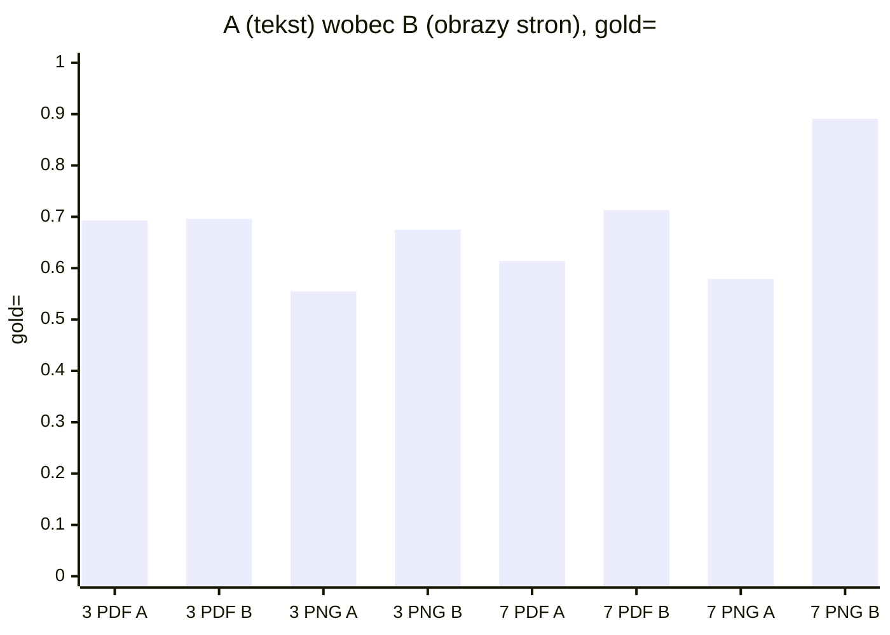
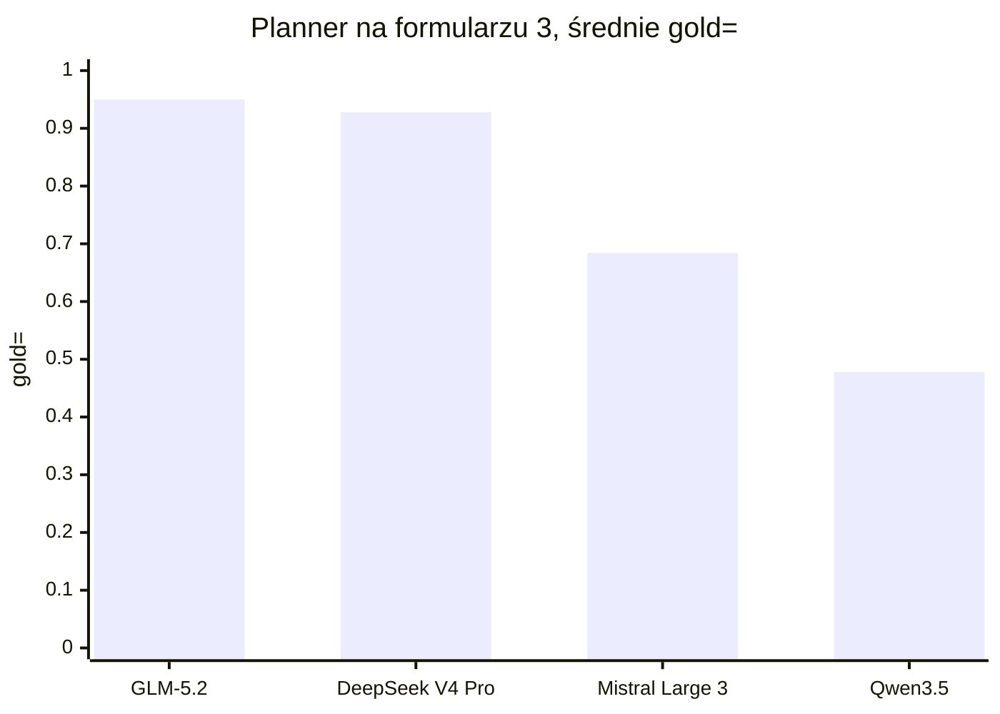
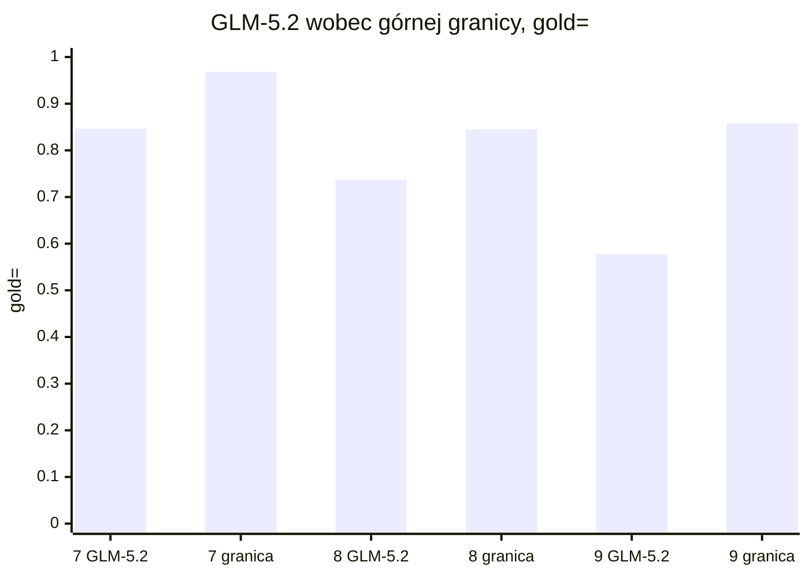

# coi-formularze

REST API, które zamienia pusty formularz papierowy (PDF, DOC, DOCX, ODS, XLSX, XLS, JPG, PNG) w konfigurację e-usługi COI, czyli JSON gotowy do importu. Formularz czytają dwa modele z otwartymi wagami na Eden AI: Qwen3.5 przepisuje każdą stronę do Markdown, a GLM-5.2 układa z tego plan formularza. Resztę robi deterministyczny kod. Do tego strona dla urzędnika, na której widać oryginał obok gotowej e-usługi i można ją poprawić przed pobraniem.

Projekt na HackNation 2026, zadanie COI „Cyfryzacja Formularzy”.

## Szybki start

Potrzebujesz Dockera 23+ i klucza Eden AI.

```bash
cp .env.example .env          # wpisz EDENAI_API_KEY, to jedyny wymagany sekret
docker compose up -d --build
curl -X POST http://localhost:8000/api/forms/convert -F "file=@wniosek.pdf" -o wniosek.json
```

Strona dla urzędnika: http://localhost:8000. Dokumentacja OpenAPI: http://localhost:8000/docs. Stan modelu: http://localhost:8000/health.

Jeden formularz trwa zwykle od pół minuty do kilku minut (najdłuższy ma 16 stron). Jeśli klient nie może tyle czekać na odpowiedź, użyj [zadania w tle](#zadanie-w-tle).

## Wymagania z zadania: gdzie są

| Wymaganie z „Pełnej treści zadania konkursowego” | Gdzie |
|---|---|
| 3.2.I Usługa REST: plik formularza → JSON zgodny ze strukturą COI i wymaganiami projektowania | `POST /api/forms/convert` ([REST API](#rest-api)). Każdy wynik sprawdzają reguły COI (`app/rules.py`) przed odpowiedzią |
| 3.2.II Dokumentacja architektury | [Architektura](#architektura) |
| Przesłanie pojedynczego pliku; formaty PDF, DOC, DOCX, ODS, XLSX, JPG, JPEG, PNG | [Walidacja i limity](#walidacja-i-limity) |
| Walidacja typu pliku z weryfikacją MIME z zawartości | [Walidacja i limity](#walidacja-i-limity), `app/upload.py` |
| Walidacja nazwy pliku (do 250 znaków, bez `; : > < / \ \| ' * % $`) | [Walidacja i limity](#walidacja-i-limity) |
| Maksymalny rozmiar pliku konfigurowalny parametrem aplikacji | `MAX_FILE_SIZE_MB` ([Konfiguracja](#konfiguracja)) |
| Tylko tymczasowe przetwarzanie pliku | [Przechowywanie plików](#przechowywanie-plików), `HISTORY_ENABLED=0` |
| Konteneryzacja, wymagania dla obrazów Docker | [Budowanie obrazu Docker](#budowanie-obrazu-docker), [Uruchomienie aplikacji](#uruchomienie-aplikacji) |
| Konfiguracja: rozmiar pliku, JWT, parametry integracji | [Konfiguracja](#konfiguracja) |
| README: budowanie obrazu, uruchomienie, konfiguracja, REST API | sekcje o tych nazwach poniżej |
| Python 3.14+, open source bez copyleft, modele z otwartymi wagami | [Licencje](#licencje). GLM-5.2 (MIT) i Qwen3.5 (Apache-2.0) wołamy przez Eden AI. Te same wagi można uruchomić na własnym serwerze, zmieniając `LLM_BASE_URL` |

## Architektura

```mermaid
flowchart LR
  U["Upload<br/>app/upload.py"] --> I["Obrazy stron<br/>PDFium, LibreOffice"]
  I --> T["Qwen3.5: strona → Markdown<br/>app/llm/transcribe.py"]
  T --> P1["GLM-5.2, przebieg 1<br/>struktura"]
  P1 --> P2["GLM-5.2, przebieg 2<br/>warunki"]
  P2 --> Q["Filtr cytatów i naprawy<br/>app/quotes.py, app/repair.py"]
  Q --> B["Builder<br/>app/builder/"]
  B --> R["Reguły COI<br/>app/rules.py"]
  R --> J["JSON COI"]
  J --> S["Strona: podgląd i edytor<br/>app/static/"]
  S -- "każda poprawka" --> C["POST /api/forms/check"]
```



Model czyta papier, a kod pilnuje formatu COI. Modele zwracają tylko Markdown stron i krótki plan formularza. Wszystko po nich to deterministyczny kod z testami (`uv run pytest`). Kroki skleja `app/pipeline.py`, a REST jest w `app/api.py`.

1. **Upload** (`app/upload.py`). Plik trafia strumieniowo do pamięci. Limit rozmiaru jest liczony w trakcie odczytu. Potem kod sprawdza nazwę, rozszerzenie i sygnaturę bajtów. Przy `AUTH_ENABLED=1` żądanie potrzebuje tokenu JWT (`app/security.py`).
2. **Odczyt** (`app/llm/transcribe.py`). Każdy plik staje się obrazami stron, a model wizyjny przepisuje każdą stronę do Markdown. Jedyny wyjątek to plik biurowy, w którego PDF z LibreOffice zginął tekst: wtedy kod czyta tekst z samego pliku.
   - PDF (z tekstem albo ze skanem) renderuje PDFium (`pypdfium2`).
   - DOC, DOCX, ODS, XLS i XLSX najpierw zamienia na PDF LibreOffice bez okna (headless). Gdy w tym PDF brakuje tekstu pliku (LibreOffice gubi pola tekstowe niektórych DOCX, całe strony wychodzą puste) albo LibreOffice nie umie pliku zamienić, kod nie wysyła obrazów stron, tylko daje plannerowi tekst odczytany z samego pliku.
   - JPG i PNG idą tak, jak są. Wysoki obraz z kilkoma stronami jedna pod drugą kod tnie na strony A4.
   - Każda strona, zmniejszona do 1024 px na dłuższym boku, idzie osobno do Qwen3.5-397B-A17B. Jedno wywołanie na stronę daje krótkie odpowiedzi. Cztery strony lecą naraz. Gdy model zapętli się na stronie (np. przepisuje w kółko pusty wiersz tabeli) i odpowiedź się utnie albo przekroczy limit czasu, strona idzie jeszcze raz z karą za powtórzenia (`frequency_penalty`).
   - Wynik to Markdown: nagłówki, pola, kratki i tabele. Wykropkowanie do wypełnienia to `______`. Strony są sklejone w kolejności.
3. **Plan od modelu** (`app/llm/planner.py`, klient `app/llm/client.py`). GLM-5.2 czyta sam Markdown, bez obrazów. Dwa wywołania bez trybu myślenia, a odpowiedź wymusza schemat JSON.
   - Przebieg 1 ustala strukturę: strony, sekcje, pola z typami i opcjami, oświadczenia, adresata, kto może złożyć wniosek i czy przez pełnomocnika.
   - Przebieg 2 ustala warunki pokazania pól i sekcji. Model widzi listę pól z ich cytatami, a schemat dopuszcza tylko istniejące pola i opcje.
   - Każdy element planu niesie `quote`, dosłowny cytat z papieru. Kontrakt planu jest w `app/plan.py`.
4. **Filtr cytatów i naprawy** (`app/quotes.py`, `app/repair.py`). Element, którego cytatu nie ma w Markdownie z kroku 2, wypada. Dopasowanie jest rozmyte (`rapidfuzz`, próg 90). Wypadają też pola strony „Dane”, które kod buduje sam, i warunki bez oparcia w papierze (pole zostaje). Naprawy bez modelu:
   - lista wyboru z opcją spoza papieru staje się polem tekstowym;
   - pytanie wyboru zadane dwa razy zostaje raz;
   - adres do korespondencji dostaje pytanie Tak/Nie, gdy papier mówi „inny niż”.
5. **Builder** (`app/builder/`). Plan staje się pełną konfiguracją COI, bez modelu: UUID, `techName`, siatka, strony ze Standardów COI (Dane z rejestru MLPZ, Kontakt i zgody, strona końcowa), warunki `SHOW` w JSONata, walidatory, słowniki i sekcje powtarzalne.
   - Zależności to warunki `SHOW` na polach i sekcjach. Schemat COI nie ma warunku na stronie ani na linku między stronami, więc warunkowe przejście między stronami to warunki na sekcjach.
   - Builder zwraca też mapę dowodów: dla każdego elementu cytat z papieru albo informację, że element dodał kod.
   - Lista walidatorów COI nie ma długości pola ani formatu telefonu. Pola telefonu dostają więc podpowiedź w opisie.
6. **Reguły** (`app/rules.py`). Kod sprawdza schemat JSON COI i „Reguły techniczne”. Każdy problem kończy żądanie kodem 422, więc API nie wypuszcza JSON-a, którego generator COI nie przyjmie.

Tesseract nie czyta treści formularza. Kod bierze z niego tylko ramki słów na skanach (`app/sources.py`, tryb `psm 11`), żeby pokazać nagłówek „W dokumencie” i „Źródło” w oryginale. PDF z warstwą tekstu i pliki biurowe dają te ramki bez OCR.

### Strona dla urzędnika

Strona `/` (`app/static/index.html`, `preview.html`, `editor.js`) pokazuje oryginał obok e-usługi, tak jak zobaczy ją obywatel.
- Pod każdym polem widać jego cytat z dokumentu i warunek, który je pokazuje. „Źródło” pokazuje to miejsce w oryginale.
- Ikona ołówka przy elemencie otwiera panel „Edycja” z prawej strony. Urzędnik poprawia albo usuwa tam pole, sekcję, stronę lub oświadczenie, a „Cofnij” przywraca zmianę.
- Każdą zmianę sprawdza `POST /api/forms/check`, te same reguły co przy konwersji. Z problemami nie da się pobrać JSON-a. Jeśli usunięcie zepsułoby import, przycisk jest wyłączony i podaje powód.
- Kilka wgranych plików strona przetwarza po kolei.
- Bez dokumentu też się da. Gotowy JSON e-usługi (np. z innego systemu) albo „+ Zacznij od pustego formularza” otwiera się od razu w edytorze, bez modelu.

Pozostałe części:
- **Propozycje słowników** (bonus II, `app/dictionaries.py`). Model proponuje nowe słowniki dla pól formularza, a kod odrzuca propozycje bez oparcia w papierze. JSON e-usługi się nie zmienia.
- **Katalog słowników** (`app/catalog.py`, strona `/slowniki`). „Dodaj” przy propozycji zapisuje słownik i podpina go pod pole formularza (w JSON-ie tylko `dictionaryName`, jak w słowniku Kraje). Urzędnik dopisuje i usuwa wartości na stronie „Słowniki”. Słowniki COI (Kraje, TERYT, Numery kierunkowe) są tam tylko do odczytu.
- **Historia strony** (`app/history.py`). Plik SQLite `HISTORY_DB`, więc wyniki widać w każdej przeglądarce. `HISTORY_ENABLED=0` ją wyłącza.
- **Zadania w tle** (`app/jobs.py`). `POST /api/forms/jobs` od razu zwraca adres wyniku, który można odpytywać.

## Budowanie obrazu Docker

```bash
docker build -t coi-formularze:0.1.0 .
```

Obraz buduje też `docker compose build` albo `docker compose up --build`. Potrzebny jest Docker 23+, bo `Dockerfile` używa `RUN --mount=type=cache` (BuildKit, domyślny builder).

LibreOffice jest w obrazie domyślnie (`LIBREOFFICE=1`), bo zamienia DOC, DOCX, ODS, XLS i XLSX na obrazy stron. Lżejszy obraz bez niego (`--build-arg LIBREOFFICE=0`) przyjmie tylko PDF, JPG i PNG.

Co jest w obrazie API (`Dockerfile`):
- Oficjalny obraz `python:3.14.10-alpine3.24` w obu etapach budowy. Wszystkie zależności mają gotowe koła dla musl.
- `uv` instaluje zależności dokładnie z `uv.lock` w etapie budowy. Do obrazu końcowego trafia tylko środowisko i kod `app/`.
- LibreOffice Writer i Calc z fontami Liberation (pliki biurowe → PDF → obrazy stron).
- Tesseract z danymi `pol`, tylko do ramek słów na skanach („Źródło” i nagłówki „W dokumencie”).
- Proces działa jako użytkownik bez uprawnień (UID 10001), wystawia tylko port 8000 i ma `HEALTHCHECK` na `/health`.
- Sekrety przychodzą wyłącznie przy uruchomieniu, z `.env`. `.dockerignore` wyklucza `.env`, więc nie trafia do obrazu.
- Jawne wersje, nigdzie `latest`. Obrazy bazowe są przypięte co do wersji (`python:3.14.10-alpine3.24`), `uv==0.13.9`, a zależności Pythona pochodzą z `uv.lock` z hashami. Pakiety systemowe (Tesseract, LibreOffice) pochodzą z zamrożonej gałęzi Alpine 3.24, bez numerów rewizji: Alpine usuwa stare rewizje z repozytorium, więc przypięty build przestałby się budować.

## Uruchomienie aplikacji

### Docker Compose

```bash
cp .env.example .env          # wpisz EDENAI_API_KEY; z AUTH_ENABLED=1 uzupełnij też JWT_SECRET i AUTH_PASSWORD
docker compose up -d --build  # strona http://localhost:8000, OpenAPI /docs, stan modelu /health
```

`docker-compose.yml` (Docker Compose 2.24+) dokłada system plików tylko do odczytu, `cap_drop: ALL` i `no-new-privileges`. Kontener API zapisuje tylko do `/tmp` w pamięci (tmpfs, 1 GB). Trafiają tam pliki tymczasowe LibreOffice i Tesseracta oraz historia strony (`HISTORY_DB=/tmp/history.sqlite3`), która znika przy restarcie kontenera.

Modele są na Eden AI, więc kontener potrzebuje tylko klucza i dostępu do internetu. Wszystkie pozostałe ustawienia mają rozsądne wartości domyślne ([Konfiguracja](#konfiguracja)). `/health` mówi, czy klucz jest ustawiony, i nie woła przy tym Edenu.

### Bez compose (`docker run`)

Z obrazem z [Budowania obrazu Docker](#budowanie-obrazu-docker):

```bash
docker run --rm -p 8000:8000 --read-only --tmpfs /tmp --cap-drop ALL --security-opt no-new-privileges \
  --env-file .env coi-formularze:0.1.0
```

### Natywnie (macOS, Linux)

Potrzebujesz Pythona 3.14+, [uv](https://docs.astral.sh/uv/), LibreOffice (`brew install --cask libreoffice` albo `apt install libreoffice-writer libreoffice-calc`) i Tesseracta z językiem polskim do „Źródła” na skanach (`brew install tesseract tesseract-lang` albo `apt install tesseract-ocr tesseract-ocr-pol`).

```bash
cp .env.example .env          # wpisz EDENAI_API_KEY; logowanie: AUTH_ENABLED=1 + JWT_SECRET i AUTH_PASSWORD
uv sync
uv run uvicorn app.api:app --port 8000
```

Strona działa pod http://localhost:8000, a dokumentacja OpenAPI pod http://localhost:8000/docs. Testy: `uv run pytest` (bez sieci, żaden test nie woła modelu).

Sam podgląd e-usługi jest pod http://localhost:8000/preview. Wrzucasz plik JSON COI albo go wklejasz, a strona pokazuje e-usługę tak, jak zobaczy ją obywatel: strony, sekcje, zależności na żywo i walidatory. Każdy krok otwiera się bez wypełniania pól. „Pokaż cytaty” dopisuje pod każdym polem fragment formularza, z którego powstało. „Pokaż warunki” dopisuje warunek, który pokazuje pole, a ukryte pola zastępuje jedną linią z tym warunkiem.

## Konfiguracja

Aplikacja czyta zmienne środowiskowe albo plik `.env` przy starcie (`app/config.py`, wzór w `.env.example`). Sekrety podajesz tylko przy uruchomieniu, nigdy w obrazie.

### Parametry, których wymaga zadanie

| Zmienna | Domyślnie | Opis |
|---|---|---|
| `MAX_FILE_SIZE_MB` | `10` | Maksymalny rozmiar pliku (MiB) |
| `AUTH_ENABLED` | `0` | `0` = API otwarte, strony bez logowania (na razie domyślnie). `1` = każde wywołanie wymaga tokenu `Bearer` JWT, strony pokazują logowanie |
| `JWT_SECRET` | brak | Klucz podpisu tokenów, min. 32 znaki. Wymagany w produkcji. Lokalnie bez niego API losuje klucz na czas życia procesu i ostrzega w logu |
| `JWT_ALGORITHM` | `HS256` | Algorytm podpisu (z `JWT_JWKS_URL` np. `RS256`) |
| `JWT_ISSUER` | `coi-formularze` | Wymagane `iss` w tokenie |
| `JWT_AUDIENCE` | `coi-formularze` | Wymagane `aud` w tokenie |
| `JWT_TTL_MINUTES` | `60` | Ważność wydanego tokenu |
| `AUTH_USERNAME` | `admin` | Login do `/api/auth/token` |
| `AUTH_PASSWORD` | brak | Hasło. Bez niego logowanie lokalne jest wyłączone |
| `JWT_JWKS_URL` | brak | Zewnętrzny serwer tożsamości (np. Keycloak). API weryfikuje tokeny jego kluczami publicznymi, a logowanie lokalne jest wyłączone |
| `EDENAI_API_KEY` | brak | **Jedyne ustawienie, które trzeba podać.** Klucz Eden AI do każdego wywołania modelu. Tylko w `.env`, nigdy w repo ani w obrazie. Nie trafia do logów |
| `LLM_BASE_URL` | `https://api.edenai.run/v3` | Adres API czatu zgodnego z OpenAI (`/chat/completions`). Dawna nazwa `LLM_URL` też działa |
| `LLM_MODEL` | `deepinfra/zai-org/GLM-5.2` | Planner: czyta Markdown stron i pisze plan formularza. Tylko modele z otwartymi wagami |
| `TRANSCRIBE_MODEL` | `deepinfra/Qwen/Qwen3.5-397B-A17B` | Model wizyjny, który przepisuje każdą stronę do Markdown. Planner nie czyta obrazów, więc to zawsze osobne ustawienie |
| `LLM_TIMEOUT_S` | `1200` | Limit czasu jednego wywołania planera (s) |

### Historia strony

| Zmienna | Domyślnie | Opis |
|---|---|---|
| `HISTORY_ENABLED` | `1` | `0` = serwer nie zachowuje żadnego wgranego pliku ani wyniku po zakończeniu żądania. `/api/history` odpowiada 404, a strona trzyma listę plików tylko do odświeżenia (bez „Źródła”). Katalog słowników zostaje, bo trzyma same nazwy i wartości |
| `HISTORY_DB` | `history.sqlite3` (katalog repo); w Dockerze `/tmp/history.sqlite3` | Plik SQLite z historią strony (wgrane pliki i wyniki) i katalogiem słowników |

### Strojenie odczytu (opcjonalne)

| Zmienna | Domyślnie | Opis |
|---|---|---|
| `TRANSCRIBE_SIDE` | `1024` | Dłuższy bok obrazu strony wysyłanego do przepisania, px (ok. 1,4 tys. tokenów na stronę) |
| `TRANSCRIBE_WORKERS` | `4` | Ile stron przepisywanych naraz |
| `TRANSCRIBE_TIMEOUT_S` | `180` | Limit czasu przepisania jednej strony (s), potem jedna ponowna próba |
| `SOFFICE` | `soffice` | Program LibreOffice do zamiany plików biurowych na PDF (na macOS kod sprawdza też ścieżkę aplikacji) |
| `LIBREOFFICE` | `1` | Tylko przy budowie obrazu (compose czyta go z `.env`). `1` = LibreOffice w obrazie, `0` = lżejszy obraz tylko dla PDF, JPG i PNG |

## REST API

Kolumna „Autoryzacja” dotyczy `AUTH_ENABLED=1`. Przy domyślnym `0` wszystko działa bez tokenu. Pełny schemat żądań i odpowiedzi jest w `/docs`.

### Formularze

| Metoda i ścieżka | Autoryzacja | Opis |
|---|---|---|
| `POST /api/forms/convert` | `Bearer` JWT | Jeden plik w polu `file` (multipart) → JSON COI, bez żadnej otoczki. Z `?evidence=1` → `{"coi": ..., "evidence": {id elementu: {"source": "paper" \| "model" \| "code", "quote": cytat z papieru, "page": ...}}}`. Tej wersji używa strona, żeby pokazać cytaty w podglądzie i w edytorze |
| `POST /api/forms/jobs` | `Bearer` JWT | To samo co `convert`, ale bez czekania. Plik w polu `file` przechodzi te same kontrole (400/413/415 od razu) → `202 {"id", "status_url", "result_url"}`, nagłówek `Location` = `result_url`. 429, gdy 20 zadań jest już w toku (liczone i czekające) |
| `GET /api/forms/jobs/{id}/result` | `Bearer` JWT | **404, dopóki formularz się przetwarza** (nagłówek `Retry-After`). Potem 200 i czysty JSON COI jak z `convert` albo ten sam kod błędu co `convert` (422/500/502/503/504) z `{"detail"}`. Wynik jest dostępny przez 1 h od zakończenia |
| `GET /api/forms/jobs/{id}` | `Bearer` JWT | `{"id", "status": "pending" \| "done" \| "error"}`, przy błędzie też `code` i `detail`. 404 = nieznane albo wygasłe zadanie |
| `POST /api/forms/text` | `Bearer` JWT | Jeden plik w polu `file` (multipart) → `{"text": tekst odczytany z pliku, "method": sposób odczytu}`, bez modelu. Strona pokazuje ten tekst jako oryginał pliku biurowego tylko wtedy, gdy nie udało się zrobić z niego PDF-u |
| `POST /api/forms/check` | `Bearer` JWT | JSON COI (np. po poprawkach urzędnika) → `{"problems": [{"id": id elementu lub null, "message": opis po polsku, "detail": reguła}]}`. Pusta lista = gotowe do importu. Te same reguły co przy konwersji |
| `GET /api/forms/blank` | `Bearer` JWT | `{"coi": ..., "evidence": ...}` formularza do zbudowania ręcznie, bez pliku i bez modelu: strony standardowe COI (Dane, Kontakt i zgody, strona końcowa) wokół jednej strony z jednym polem. Używa go przycisk „+ Zacznij od pustego formularza” |

### Słowniki

| Metoda i ścieżka | Autoryzacja | Opis |
|---|---|---|
| `POST /api/dictionaries/proposals` | `Bearer` JWT | Bonus II. Ten sam upload co `convert` → propozycje nowych słowników dla pól formularza (nazwa, struktura kod + nazwa, wartości, pole) i to, co kod odrzucił. JSON e-usługi się nie zmienia |
| `GET/POST /api/dictionaries` | `Bearer` JWT | Katalog słowników (SQLite, `HISTORY_DB`). `GET`: najpierw słowniki COI tylko do odczytu, potem nasze z wartościami `{kod, nazwa}`. `POST`: nowy słownik `{name, code?, source?: {file, field}, items?}`, zajęty kod dostaje `_2` |
| `GET/PUT/DELETE /api/dictionaries/{code}` | `Bearer` JWT | Jeden słownik: odczyt, zmiana nazwy lub wartości, usunięcie (słowniki COI: 403) |
| `POST /api/dictionaries/{code}/items` | `Bearer` JWT | Dopisanie wartości bez duplikatów |

### Historia strony

Wszystkie trasy odpowiadają 404 przy `HISTORY_ENABLED=0`. Skrypty dopisują gotowy wynik bez API: `uv run python -m bench.history_add <plik> <coi.json>`.

| Metoda i ścieżka | Autoryzacja | Opis |
|---|---|---|
| `GET /api/history` | `Bearer` JWT | Lista wpisów bez bajtów pliku, najnowsze pierwsze |
| `POST /api/history` | `Bearer` JWT | Nowy wpis: multipart `record` (JSON ze stanem) + `file` → `{id}`. Plik przechodzi te same kontrole co w `convert`. JSON COI formularza bez papieru musi spełniać te same zasady nazwy i być konfiguracją e-usługi |
| `DELETE /api/history` | `Bearer` JWT | Usuwa wszystkie wpisy |
| `PUT/DELETE /api/history/{id}` | `Bearer` JWT | Zmiana stanu wpisu (JSON) albo usunięcie |
| `GET /api/history/{id}/file` | `Bearer` JWT | Oryginał pliku |
| `GET /api/history/{id}/pdf` | `Bearer` JWT | Plik biurowy (DOC, DOCX, ODS, XLS, XLSX) jako PDF zrobiony raz przez LibreOffice, żeby oryginał wyglądał jak prawdziwy dokument (arkusz na szerokość jednej strony) |
| `POST /api/history/{id}/sources` | `Bearer` JWT | „Źródło”: `{coi, evidence}` → miejsce każdego elementu w oryginale |
| `GET /api/history/{id}/page/{n}.png` | `Bearer` JWT | Strona `n` oryginału jako PNG |

### Logowanie, stan i strony

| Metoda i ścieżka | Autoryzacja | Opis |
|---|---|---|
| `POST /api/auth/token` | brak | `username` i `password` (JSON lub formularz) → `{access_token, token_type, expires_in}` |
| `GET /api/auth/config` | brak | `{"enabled": true \| false, "history": true \| false}`: czy potrzebny jest token (`AUTH_ENABLED`) i czy serwer prowadzi historię (`HISTORY_ENABLED`). Strony pytają o to przed pokazaniem logowania |
| `GET /health` | brak | `{"status": "ok", "llm": "ok" \| "no_api_key", "llm_model": ..., "transcribe_model": ...}`. Sprawdza tylko, czy jest klucz, i nie woła Edenu, więc nic nie kosztuje |
| `GET /` | brak | Strona dla urzędnika (opis w [Strona dla urzędnika](#strona-dla-urzędnika)) |
| `GET /preview` | brak | Sam podgląd e-usługi z pliku JSON COI |
| `GET /slowniki` | brak | Strona katalogu słowników: słowniki COI tylko do odczytu i nasze, z dodawaniem i usuwaniem wartości |
| `GET /docs` | brak | OpenAPI i Swagger UI. Przycisk „Authorize” loguje loginem i hasłem |

### Przykłady

```bash
# AUTH_ENABLED=0 (domyślnie): bez tokenu
curl -X POST http://localhost:8000/api/forms/convert -F "file=@wniosek.pdf" -o wniosek.json

# AUTH_ENABLED=1: najpierw token
TOKEN=$(curl -s -X POST http://localhost:8000/api/auth/token \
  -H 'Content-Type: application/json' -d '{"username": "admin", "password": "haslo"}' | jq -r .access_token)

curl -X POST http://localhost:8000/api/forms/convert \
  -H "Authorization: Bearer $TOKEN" -F "file=@wniosek.pdf" -o wniosek.json
```

#### Zadanie w tle

Wyślij plik, a potem odpytuj adres wyniku, aż przestanie zwracać 404. Z `AUTH_ENABLED=1` dodaj `-H "Authorization: Bearer $TOKEN"` do każdego `curl`.

```bash
BASE=http://localhost:8000
JOB=$(curl -s -X POST $BASE/api/forms/jobs -F "file=@wniosek.pdf")   # {"id", "status_url", "result_url"}
RESULT=$BASE$(echo "$JOB" | jq -r .result_url); STATUS=$BASE$(echo "$JOB" | jq -r .status_url)
for i in $(seq 1 240); do   # do 20 minut
  CODE=$(curl -s -o wniosek.json -w '%{http_code}' "$RESULT")
  [ "$CODE" != 404 ] && break                                         # 200 = gotowe, inny kod = błąd w wniosek.json
  [ "$(curl -s -o /dev/null -w '%{http_code}' "$STATUS")" = 404 ] && break   # nieznane albo wygasłe zadanie
  sleep 5
done
echo "$CODE"
```

### Błędy

Każdy błąd to JSON `{"detail": "..."}`.

| Kod | Kiedy |
|---|---|
| 400 | zła nazwa pliku, pusty plik, brak pola `file` albo więcej niż jeden plik |
| 401 | brak, zły lub wygasły token; zły login lub hasło (tylko z `AUTH_ENABLED=1`) |
| 404 | `GET /api/forms/jobs/{id}/result`: wynik jeszcze się liczy albo zadanie jest nieznane; `/api/history` przy `HISTORY_ENABLED=0` |
| 413 | plik większy niż `MAX_FILE_SIZE_MB` |
| 415 | nieobsługiwane rozszerzenie albo zawartość niezgodna z rozszerzeniem |
| 422 | nie udało się odczytać formularza |
| 429 | `POST /api/forms/jobs`: 20 zadań już w toku |
| 500 | nieoczekiwany błąd serwera (szczegóły tylko w logu) |
| 502 / 503 / 504 | model językowy zwrócił błąd / jest niedostępny / nie odpowiedział na czas |

## Walidacja i limity

- Jeden plik na żądanie, w polu `file`. Każda inna liczba plików kończy się kodem 400.
- Rozszerzenia (wielkość liter bez znaczenia): `.pdf .doc .docx .ods .xlsx .xls .jpg .jpeg .jpe .png`. Każde inne rozszerzenie kończy się kodem 415.
- To świadomy nadzbiór listy z zadania. `.xls` (starszy Excel) i `.jpe` (inne rozszerzenie JPEG) spotykamy w BIP-ach gmin, a ich zawartość przechodzi tę samą kontrolę sygnatury.
- Zadanie wymienia DOC jako „.doc .docx”, więc oba rozszerzenia Worda przyjmują oba formaty Worda. Gminy publikują DOCX z końcówką `.doc`. Zawartość nadal musi być prawdziwym dokumentem Worda.
- Nazwa pliku: najwyżej 250 znaków, bez `; : > < / \ | ' * % $`.
- Typ MIME wynika z zawartości (sygnatury) i musi pasować do rozszerzenia. Nagłówek `Content-Type` od klienta nie decyduje.
  - PDF: `%PDF`.
  - DOC: plik OLE2 ze strumieniem `WordDocument`. XLS: plik OLE2 ze strumieniem `Workbook` (lub `Book`).
  - DOCX i XLSX: archiwum ZIP z `[Content_Types].xml` i katalogiem `word/` lub `xl/`.
  - ODS: archiwum z `mimetype` = `application/vnd.oasis.opendocument.spreadsheet`.
  - JPEG: `FF D8 FF`. PNG: sygnatura PNG.
- Rozmiar jest liczony w trakcie strumieniowego odczytu. Odczyt kończy się zaraz po przekroczeniu limitu, niezależnie od nagłówka `Content-Length`.

### Przechowywanie plików

- `POST /api/forms/convert`. Treść żądania trafia prosto do RAM i nic nie zostaje po odpowiedzi. Na dysk trafiają tylko pliki tymczasowe na czas żądania: LibreOffice konwertuje plik biurowy w katalogu tymczasowym, a `pytesseract` przekazuje Tesseractowi obraz skanu przez plik, który zaraz usuwa. Obrazy stron (JPEG, 1024 px) wychodzą do modelu na Eden AI, na dysk nie trafiają.
- `POST /api/forms/jobs`. Wgrany plik jest tylko w pamięci procesu i znika, gdy zadanie się skończy, także po błędzie. W trakcie konwersja tworzy te same pliki tymczasowe co `convert`. Zostaje sam wynik JSON, przez 1 h od zakończenia. Restart serwera zapomina wszystkie zadania.
- Historia strony `/` (`HISTORY_DB`) to funkcja interfejsu, nie API. Zachowuje oryginał i wynik, żeby urzędnik mógł wrócić do pliku. W Dockerze leży w `/tmp` w pamięci kontenera i znika przy restarcie. `HISTORY_ENABLED=0` wyłącza ją całkiem. Wtedy serwer nie zachowuje żadnego wgranego pliku ani wyniku po zakończeniu żądania.

## Benchmark i wybór modelu

Dziś każdy plik czyta Qwen3.5-397B-A17B (obraz strony → Markdown), a plan formularza pisze GLM-5.2. Oba modele mają otwarte wagi i działają na Eden AI. Doszliśmy do tego w pięciu krokach, każdy rozstrzygnięty pomiarem. Liczby pochodzą z 9 formularzy COI z zadania, w kilku formatach (PDF, skan, Word). Notatki z pomiarów i decyzji są w `bench/MODELS.md`.

### Jak mierzymy

Uruchomienie: `uv run python -m bench.run_all` (woła modele na Edenie, więc kosztuje), ocena: `bench/score.py`.
- `gold=` porównuje plan modelu z wzorcowym planem formularza (`gold/plans/formN.json`, uzasadnienia w `gold/notes/`). To średnia z pięciu miar: F1 pól, zgodność typów, zgodność opcji, odzysk warunków i zgodność strony „Dane” (kto składa wniosek). 1,0 = jak wzorzec.
- `ref` to odzysk elementów z wzorcowych JSON-ów COI (formularze 1 i 5).
- Do tego: czy JSON powstał, ile problemów z regułami COI, czas i koszt.

Zastrzeżenie: to nasze wzorce, przygotowane przez zespół, więc mierzą zgodność z naszymi decyzjami projektowymi.

### 1. Start: lokalny qwen3 30B w Ollamie (porzucony)

Zaczęliśmy od modelu na laptopie: `qwen3:30b-a3b-instruct-2507-q4_K_M` w Ollamie, czytający tekst z naszej ekstrakcji (PDFium, parsery Worda i arkuszy, Tesseract dla skanów). Zadziałał od początku do końca, ale był za słaby na trudne formularze i za wolny na długich. Porzuciliśmy go. Liczby zostają jako historia.

26 plików, kod `7090c84`: 26/26 poprawnych JSON-ów, 0 problemów z regułami COI, średnio `gold=` **0,759** (PDF 0,795, skan PNG 0,724, DOCX 0,758).

| Formularz | PDF | skan PNG | DOCX | Czas PDF / PNG / DOCX (s) |
|---|---|---|---|---|
| 1 | 0,978 | 0,978 | 0,960 | 20 / 74 / 31 |
| 2 | 0,971 | 1,000 | 0,843 | 84 / 69 / 75 |
| 3 | 0,629 | 0,589 | 0,567 | 43 / 32 / 41 |
| 4 | 0,753 | 0,753 | 0,708 | 70 / 66 / 69 |
| 5 | 0,960 | 0,803 | 0,803 | 36 / 34 / 40 |
| 6 | 0,736 | 0,736 | 0,722 | 124 / 121 / 113 |
| 7 | 0,939 | 0,563 | brak DOCX | 110 / 79 |
| 8 | 0,587 | 0,540 | 0,713 | 400 / 411 / 304 |
| 9 | 0,603 | 0,557 | 0,752 | 422 / 414 / 285 |

- Długie formularze 8 i 9 (do 16 stron) zajmowały 285-422 s na plik.
- Model wizyjny `qwen3-vl:30b-a3b-instruct` przegrał sito na formularzach 1, 4, 5 i 7: średnio 0,77 z obrazami stron wobec 0,84 modelu tekstowego. Wymyślał pola i zamieniał wybór na pytania tak/nie.
- Reguły po modelu (filtr warunków, naprawy w `app/repair.py`) przetestowaliśmy na ślepo na 18 prawdziwych pustych formularzach urzędowych spoza zadania. Dwóch sędziów (silny model zamknięty) porównywało wynik bez reguł i z regułami w losowej kolejności. Z regułami wygrywa 9 razy, bez nich 1 raz, 8 remisów. Błędy do poprawienia przez urzędnika: 70 → 56 (-20%). To zestaw, na którym reguły rozwijaliśmy, nie zestaw kontrolny.

Gdzie był sufit? Ten sam tekst i te same prompty, ale plan pisał silny model zamknięty (górna granica, pomiar diagnostyczny, nie produkt):

| Przypadek | qwen3 30B | Górna granica |
|---|---|---|
| Formularz 7, skan (tekst z OCR) | 0,563 | 0,968 |
| Formularz 8, PDF | 0,587 | 0,845 |
| Formularz 9, PDF | 0,578 | 0,858 |

Qwen na formularzu 9 to wcześniejszy przebieg, stąd inna liczba niż w tabeli wyżej.

Wąskim gardłem był model, nie odczyt ani kod. To nas przeniosło na większe modele z otwartymi wagami.

### 2. Sito modeli na Edenie

Wzięliśmy tylko modele z otwartymi wagami i licencją bez copyleft. Pierwsze sito: 9 formularzy, PDF i skany, modele dostawały tekst formularza, nie obrazy, 0,43 $ za całość.
- `gemma-4-31B-it` najlepszy: `gold=` 0,81, F1 warunków 0,75;
- `Qwen3.8-27B` dwa razy szybszy, ale 0,79 i słabszy na skanach;
- Mistral Small 4 i Qwen3.6 słabsze;
- odpadły Llama 3.3 (licencja) i mistral-ocr (zamknięte wagi), a darmowa trasa `google/` przez limity zapytań (22% odpowiedzi 429).

Potem doszedł duży model wizyjny `Qwen3.5-397B-A17B` (MoE, 17 mld aktywnych parametrów). Na nim rozstrzygnęliśmy, jak czytać plik.

### 3. Jak czytać plik: tekst (A) czy obrazy stron (B)

A = tekst z naszej ekstrakcji i Tesseracta. B = obraz każdej strony przepisany do Markdown przez Qwen3.5. Ten sam model planował w obu ramionach.

| Plik | A: tekst | B: obrazy stron |
|---|---|---|
| Formularz 3, PDF | 0,693 | 0,696 |
| Formularz 3, skan PNG | 0,555 | 0,675 |
| Formularz 7, PDF | 0,614 | 0,713 |
| Formularz 7, skan PNG | 0,579 | **0,891** |
| Średnio | 0,610 (61 s na plik) | **0,744** (75 s na plik) |



- Obrazy wygrywają na skanach. Na PDF z warstwą tekstu zysk jest mniejszy, a na formularzu 3 to remis.
- Wszystkie 16 JSON-ów przeszło reguły COI.
- Długi formularz 8 (PDF): też remis, A 0,64 (268 s, 0,055 $) wobec B 0,65 (279 s, 0,084 $).

Decyzja: zostaje tylko B. Jedna ścieżka dla każdego formatu, bez osobnego kodu na skany (jedyny wyjątek to plik biurowy, w którego PDF z LibreOffice zginął tekst, punkt „Odczyt” wyżej). Tesseract już nie czyta treści, zostały mu ramki słów do „Źródła”.

### 4. Planner: ten sam Markdown, cztery modele

Formularz 3 w trzech formatach, ścieżka B, ten sam Markdown dla każdego planera, bez trybu myślenia.

| Planner | PDF | JPEG | DOCX | Średnio | s na plan | $ za 3 pliki |
|---|---|---|---|---|---|---|
| **GLM-5.2** | 0,967 | 0,950 | 0,933 | **0,950** | 12 | 0,028 |
| DeepSeek V4 Pro | 0,900 | 0,933 | 0,950 | 0,928 | 15 | 0,046 |
| Mistral Large 3 | 0,808 | 0,793 | 0,450 | 0,684 | 12 | 0,020 |
| Qwen3.5 | 0,507 | 0,292 | 0,637 | 0,478 | 123 | 0,028 |



- GLM-5.2 ma najlepszy plan, jest 10 razy szybszy od Qwen3.5 w roli planera i kosztuje tyle samo.
- Odczyt tych 3 plików przez Qwen3.5 kosztuje 0,006 $.
- `gpt-oss-120b` nie dał wyniku (błędy dostawców 503 i 400).

Decyzja: GLM-5.2 planuje, Qwen3.5 czyta. GLM-5.2 nie czyta obrazów, więc podział ról wynika też z samych modeli.

### 5. GLM-5.2 na najtrudniejszych formularzach

Formularz 7 to skan z sekcją powtarzaną dla każdego psa, 8 to wniosek z tabelą wyliczeń, a 9 to 16-stronicowy formularz „3 w 1”. Górną granicą jest znów silny model zamknięty z tym samym promptem (na tekście z ekstrakcji, formularz 7 jako skan PNG, formularz 9 jako PDF).

| Przypadek | `gold=` | F1 pól | Opcje | Warunki odzysk / precyzja | Oświadczenia |
|---|---|---|---|---|---|
| 7 JPG, GLM-5.2 | 0,846 | 0,82 | 0,50 | 1,00 / 0,67 | 0,67 |
| 7, górna granica | 0,968 | 0,96 | 0,92 | 1,00 / 1,00 | - |
| 8 PDF, GLM-5.2 | 0,737 | 0,81 | 0,67 | 0,27 / 0,33 | 0,00 |
| 8 PDF, Qwen3.5 jako planer | 0,650 | - | 0,45 | 0,13 / - | 0,00 |
| 8 PDF, górna granica | 0,845 | 0,87 | 0,86 | 0,53 / 0,53 | - |
| 9 DOCX, GLM-5.2 | 0,578 | 0,57 | 0,66 | 0,00 / 0,00 | 0,00 |
| 9 PDF, górna granica | 0,858 | 0,68 | 0,86 | 0,80 / 0,47 | - |



- Odczyt trwał 28 / 65 / 43 s, plan 41 / 41 / 43 s. Trzy formularze kosztowały razem 0,119 $, około 0,04 $ za plik.
- Na formularzu 8 GLM-5.2 bije Qwen3.5 w roli planera (0,737 wobec 0,650).
- Najwięcej brakuje w warunkach i oświadczeniach długich formularzy. Na formularzu 9 GLM-5.2 nie trafił żadnego warunku z wzorca. To dziś główne pole do poprawy.
- Tryb myślenia nie pomógł. GLM-5.2 z myśleniem na formularzu 9 (ten sam Markdown z Qwen3.5) nie oddał planu: rozumowanie zużyło cały limit 16 000 tokenów odpowiedzi już w przebiegu 1 (`finish_reason=length`), ponowna próba tak samo. Myślenie zostaje wyłączone (`reasoning_effort: "none"`), a formularz 9 ma 0,578.

### 6. Dowód od pliku do JSON-a

Formularz 7 (skan JPG) przez działające API, w końcowej konfiguracji (Qwen3.5 czyta strony, GLM-5.2 planuje, myślenie wyłączone). Strona wysyła plik naraz do konwersji i do propozycji słowników, a oba zapytania dzielą jeden odczyt stron.

| Krok | Wynik |
|---|---|
| `POST /api/forms/convert?evidence=1` | HTTP 200 po 28 s |
| `POST /api/forms/check` na tym JSON-ie | 0 problemów z regułami COI |
| Zawartość | 4 kroki, 16 sekcji, 58 pól (w tym 7 list, 6 pól wyboru, 4 załączniki), sekcja powtarzalna dla kolejnych psów, 27 warunków pokazania |
| `POST /api/dictionaries/proposals` | HTTP 200 po 37 s: „Rasy psów”, „Płci psów”, „Sposoby oznakowania zwierząt” |
| `GET /health` | `"llm": "ok"`, GLM-5.2 i Qwen3.5 |

Ten sam obraz Dockera (z LibreOffice) wstaje z samym `EDENAI_API_KEY` w `.env`, odpowiada na `/health` i zamienia DOCX formularza 9 na 24 obrazy stron w 1,3 s, bez wywołania modelu.

Wcześniejszy test przez API (22.11, planerem był jeszcze Qwen3.5, nie GLM-5.2): 13 z 14 plików dało JSON bez żadnego problemu z regułami COI, w tym DOC, DOCX, XLS, XLSX, ODS, JPG, PNG i PDF, także w Dockerze. Czasy od 27 s (DOC) do 267 s (formularz 8 jako PNG). Jedyny błąd to zeskanowany PDF spoza zadania, który przekroczył limit czasu (504 po 363 s).

## Licencje

Kod i zależności to wyłącznie open source bez copyleft.
- Zależności Pythona: MIT, BSD, Apache-2.0, PSF i MIT-CMU (Pillow). `certifi` (zależność `httpx`) ma MPL-2.0, która obejmuje tylko jego własne pliki i nie wymaga publikacji naszego kodu.
- Tesseract: Apache-2.0. LibreOffice: MPL-2.0, uruchamiany jako osobny program, bez linkowania z naszym kodem.
- Modele: GLM-5.2 (planner) na licencji MIT, Qwen3.5-397B-A17B (odczyt stron) na Apache-2.0. Oba mają otwarte wagi.

Na hackathonie modele działają na Eden AI. Klient mówi protokołem zgodnym z OpenAI, więc te same wagi można uruchomić na własnym serwerze GPU i wskazać go w `LLM_BASE_URL` i `LLM_MODEL`, bez zmian w kodzie.
