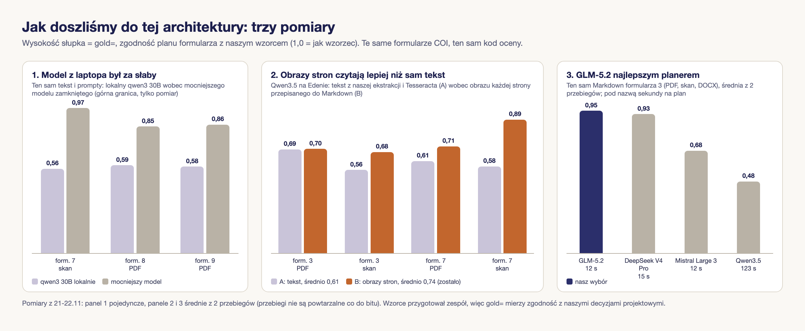

# eFormatka: z papierowego formularza e-usługa COI

Projekt na HackNation 2026, zadanie COI „Cyfryzacja Formularzy”.

Wgrywasz pusty formularz urzędowy w dowolnym formacie (PDF, skan JPG/PNG, DOC, DOCX, ODS, XLS, XLSX), a REST API zwraca JSON e-usługi COI gotowy do importu. Urzędnik widzi go obok oryginału i poprawia w edytorze: pod polem jest cytat z dokumentu, z którego pole powstało, i „Źródło”, czyli wycinek oryginału z zaznaczonym miejscem. Dlatego model nie musi trafić wszystkiego za pierwszym razem.

{{ZRZUT_APLIKACJI}}


[Wyniki](#wyniki) · [Szybki start](#szybki-start) · [Jak z tego korzystać](#jak-z-tego-korzystać) · [Co z zadania jest zrobione](#co-z-zadania-jest-zrobione) · [Architektura](#architektura) · [Docker](#budowanie-obrazu-docker) · [Uruchomienie](#uruchomienie-aplikacji) · [Konfiguracja](#konfiguracja) · [REST API](#rest-api) · [Wdrożenie](#wdrożenie) · [Znane ograniczenia](#znane-ograniczenia)

## Wyniki

Mierzymy to, co obchodzi urzędnika: ile poprawek musi zrobić w edytorze, zanim JSON pójdzie do importu.

| Miara | Wynik |
|---|---|
| Poprawki urzędnika | średnio **{{POPRAWKI_SREDNIO}}** na formularz (e-usługa ma średnio {{POLA_SREDNIO}} pól); szczegóły w tabeli niżej |
| Pliki, z których powstał JSON | **{{PLIKI_OK}}** z 69 (9 formularzy z zadania we wszystkich formatach) |
| Problemy z regułami COI | **0** w każdym z tych JSON-ów. API nie wypuszcza JSON-a, który łamie schemat COI albo „Reguły techniczne”, tylko odpowiada 422, a taki plik liczy się wyżej jako porażka |
| Czas i koszt | średnio **{{CZAS_FORMULARZ}}** i **{{KOSZT_FORMULARZ}}** na formularz (modele na Eden AI). Koszt rośnie ze stronami: jedno wywołanie odczytu na stronę i dwa przebiegi planera na formularz |
| Kalibracja sędziów | {{KALIBRACJA}} (10 błędów podrzuconych do poprawnych JSON-ów) |

**Jak liczymy poprawki.** Trzech sędziów AI dostaje strony oryginału i nasz JSON jako czytelny konspekt. Każdy osobno wypisuje poprawki, które urzędnik zrobiłby w edytorze: brakujące pole, zmyślone pole, zły typ, złe opcje, zły albo brakujący warunek, złe „wymagane”. Poprawka liczy się, gdy wypiszą ją co najmniej 2 z 3 sędziów. Sędziami są inne, mocniejsze modele niż nasz planer i odczyt, więc nie oceniają samych siebie. Służą tylko do pomiaru i nie ma ich w produkcie (pkt 5 zadania pozwala używać takich modeli przy testowaniu). Samych sędziów sprawdziliśmy na 10 błędach, które celowo wstawiliśmy do poprawnych JSON-ów (wiersz „Kalibracja sędziów”). Przepis: `bench/JUDGE-POPRAWKI.md`.

### Każdy formularz z zadania

{{POPRAWKI_TABELA}}

Na tych 9 formularzach stroiliśmy prompty i kod, więc to wynik na znanych dokumentach. {{SPOZA_ZADANIA}}

### Porównanie podejść

Te same dokumenty i ci sami sędziowie, od najprostszego podejścia (cały plik prosto do jednego modelu, który ma oddać JSON COI) do naszego. Przy każdym podejściu podajemy model. Miara: poprawki urzędnika, mniej = lepiej.

{{PORÓWNANIE}}

### JSON-y do oddania

- `output/api/<formularz>.json`: główny wynik, surowy JSON z API, ten sam, który mierzą tabele wyżej.
- `output/<formularz>.json`: ta sama e-usługa poprawiona przez zespół o poprawki wskazane przez sędziów. Ile ich było na każdym formularzu, mówi `output/POPRAWKI.md`.

## Szybki start

Docker 23+ i klucz Eden AI:

```bash
cp .env.example .env          # wpisz EDENAI_API_KEY, to jedyny wymagany sekret
docker compose up -d --build
curl -X POST http://localhost:8000/api/forms/convert -F "file=@wniosek.pdf" -o wniosek.json
```

Bez Dockera: Python 3.14+, [uv](https://docs.astral.sh/uv/) i LibreOffice ([szczegóły](#natywnie-macos-linux)):

```bash
cp .env.example .env && uv sync
uv run uvicorn app.api:app --port 8000
```

Strona dla urzędnika: http://localhost:8000. OpenAPI: http://localhost:8000/docs. Stan: http://localhost:8000/health. Jeden formularz trwa od pół minuty do kilku minut. Gdy klient nie może tyle czekać, jest [zadanie w tle](#zadanie-w-tle).

Bez klucza działa wszystko poza odczytem nowego pliku: edytor, podgląd, pusty formularz, wgrany JSON e-usługi, sprawdzanie reguł i katalog słowników. Konwersja i propozycje słowników odpowiadają wtedy 503.

## Jak z tego korzystać

1. **Wgraj plik** na http://localhost:8000: upuść go gdziekolwiek na stronie albo wybierz z dysku. Po zaznaczeniu „Wgraj wiele plików naraz” strona przyjmuje kilka plików, przetwarza je po kolei, a „Pobierz wszystkie” daje ZIP z JSON-ami wszystkich gotowych plików z historii.
2. **Porównaj.** Z lewej oryginał, z prawej e-usługa tak, jak zobaczy ją obywatel. Wszystkie kroki przeklikasz bez wypełniania pól.
3. **Sprawdź.** Pod polem z dokumentu jest jego cytat i warunek, który je pokazuje. „Źródło” rozwija wycinek oryginału z ramką na tym cytacie, a klik w wycinek pokazuje całą stronę.
4. **Popraw.** Ołówek przy elemencie otwiera panel „Edycja” obok podglądu: etykieta, typ, opcje, „wymagane”, warunek „pokaż, gdy…”, dodawanie i usuwanie pól, sekcji, stron i oświadczeń, „Cofnij”. Każdą zmianę sprawdzają reguły COI: z problemem nie da się pobrać JSON-a, a usunięcie, które zepsułoby import, jest wyłączone i podaje powód.
5. **Pobierz JSON** gotowy do importu.

Do tego:
- **Słowniki** (bonus II). Zakładka „Słowniki” przy wyniku pokazuje propozycje nowych słowników dla pól formularza. „Dodaj” zapisuje słownik w katalogu na stronie `/slowniki` i podpina go pod pole.
- **Bez dokumentu.** Gotowy JSON e-usługi (np. z innego systemu) albo „+ Zacznij od pustego formularza” otwiera się od razu w edytorze, bez modelu.
- **Sam podgląd** dowolnego JSON-a COI: http://localhost:8000/preview.
- **Historia** plików jest na serwerze, więc zostaje po odświeżeniu strony. `HISTORY_ENABLED=0` ją wyłącza, a razem z nią „Źródło”, bo wycinki serwer liczy z zapisanego oryginału.

## Co z zadania jest zrobione

| Punkt zadania | Co mamy | Gdzie |
|---|---|---|
| 3.2.I REST API: plik → JSON COI | `POST /api/forms/convert`, każdy wynik przechodzi reguły COI przed odpowiedzią | [REST API](#rest-api) |
| 3.2.II Dokumentacja architektury | diagramy i opis kroków | [Architektura](#architektura) |
| 3.3.I Słowniki i dane inicjalne | strona „Dane” z rejestru MLPZ według Standardów COI, słowniki Kraje, TERYT i Numery kierunkowe; pole z rejestru PESEL tylko wtedy, gdy na pewno dotyczy samego wnioskodawcy | `app/builder/standard.py`, `registry.py` |
| 3.3.II Nowy słownik | propozycje z wartościami z dokumentu, katalog słowników z dodawaniem do pola | `POST /api/dictionaries/proposals`, `/slowniki` |
| 3.3.III Zależności | warunki „pokaż, gdy…” na polach i sekcjach, każdy z cytatem; sekcje powtarzalne. Schemat COI nie ma warunku na stronie, więc przejście zależne od odpowiedzi to warunki na sekcjach | `app/llm/planner.py`, `app/builder/` |
| 3.3.IV Frontend | strona `/`: upload, kilka plików naraz, historia, JSON | [Jak z tego korzystać](#jak-z-tego-korzystać) |
| 3.3.V Wizualizacja e-usługi | podgląd tak, jak widzi go obywatel, z edytorem; osobno `/preview` | `app/static/preview.html` |
| 3.3.VI Walidacje i UX (w kryteriach oceny, pkt 8, to punkt V „Walidacje pól”) | walidatory COI z etykiet (PESEL, NIP, REGON, kod pocztowy, e-mail, ePUAP, ADE, dowód osobisty), „wymagane”, przy telefonie numer kierunkowy i podpowiedź formatu; batch i ZIP | `app/builder/` |
| 5. Formaty, MIME z zawartości, nazwa pliku, limit rozmiaru | wszystko z listy zadania plus `.xls` i `.jpe` | [Walidacja i limity](#walidacja-i-limity) |
| 5. Tylko tymczasowe przetwarzanie | `convert` trzyma plik tylko w pamięci. Historia strony jest domyślnie włączona; `HISTORY_ENABLED=0` ją wyłącza, kosztem „Źródła” | [Przechowywanie plików](#przechowywanie-plików) |
| 5. Docker, konfiguracja, README | Alpine, wersje przypięte, użytkownik bez uprawnień, sekrety tylko przy starcie | [Budowanie obrazu Docker](#budowanie-obrazu-docker), [Konfiguracja](#konfiguracja) |
| 5. Python 3.14+, open source bez copyleft, bez zewnętrznych API i modeli dostępnych tylko przez API | GLM-5.2 (MIT) i Qwen3.5 (Apache-2.0) mają otwarte wagi. W czasie działania wołamy je przez Eden AI, czyli zewnętrzne API, do którego dostęp i tokeny dali organizatorzy zadania (pkt 7). Własny serwer z tymi wagami to zmiana konfiguracji | [Znane ograniczenia](#znane-ograniczenia), [Licencje](#licencje) |

## Architektura


Model czyta dokument, a kod pilnuje formatu COI. Modele oddają tylko Markdown stron i krótki plan formularza. Wszystko po nich to deterministyczny kod z testami. Kroki skleja `app/pipeline.py`, REST jest w `app/api.py`.

Dlaczego tak:
- **Jedna ścieżka odczytu dla każdego formatu.** Każdy plik staje się obrazami stron, a Qwen3.5 przepisuje każdą stronę do Markdown. Skan, PDF i Word idą tą samą drogą, bez osobnego kodu na skany. Obrazy wygrały z odczytem tekstu w pomiarze, najmocniej na skanach ([historia](#jak-doszliśmy-do-tej-architektury)).
- **Każde pole, warunek i oświadczenie planu niesie cytat z dokumentu.** Kod wyrzuca te, których cytatu nie ma w odczytanym tekście, i opcje, których nie ma w dokumencie, więc model nie doda pola, którego na papierze nie ma. Ten sam cytat urzędnik widzi pod polem, a „Źródło” pokazuje go w oryginale.
- **JSON COI pisze kod, nie model.** UUID, `techName`, siatkę, warunki JSONata, walidatory, słowniki i strony ze Standardów COI (Dane, Kontakt i zgody, strona końcowa) builder składa z gotowych klocków. Dlatego struktura zgadza się ze schematem COI, a reguły COI i tak sprawdzamy jeszcze raz przed odpowiedzią.
- **Dwa przebiegi planera.** Najpierw struktura (strony, sekcje, pola, opcje, oświadczenia), potem warunki. W drugim przebiegu schemat odpowiedzi dopuszcza tylko istniejące pola i opcje oraz nowe pytania Tak/Nie z cytatem; pytanie, którego żaden warunek nie używa, kod wyrzuca.


Kroki po kolei:
1. **Upload** (`app/upload.py`). Plik idzie do pamięci, a limit rozmiaru działa w trakcie odczytu. Potem kod sprawdza nazwę, rozszerzenie i sygnaturę bajtów. Przy `AUTH_ENABLED=1` żądanie potrzebuje tokenu JWT (`app/security.py`).
2. **Odczyt** (`app/llm/transcribe.py`). PDF renderuje PDFium, pliki biurowe najpierw zamienia na PDF LibreOffice, a wysoki skan z kilkoma stronami kod tnie na strony. Każda strona, zmniejszona do 1024 px, idzie osobno do Qwen3.5-397B-A17B, cztery naraz.
3. **Plan** (`app/llm/planner.py`, kontrakt `app/plan.py`). GLM-5.2 czyta sam Markdown, bez trybu myślenia, a odpowiedź wymusza schemat JSON. Przebieg 3a ustala strukturę, przebieg 3b warunki.
4. **Filtr cytatów i naprawy** (`app/quotes.py`, `app/repair.py`). Wypada element bez cytatu w Markdownie (dopasowanie rozmyte, `rapidfuzz`), pole, które kod i tak buduje na stronie „Dane”, i warunek bez oparcia w dokumencie (pole zostaje). Naprawy bez modelu: lista z opcją spoza dokumentu staje się polem tekstowym, podwójne pytanie i podwójne pole zostają raz, adres do korespondencji dostaje pytanie Tak/Nie, gdy dokument mówi „inny niż”.
5. **Builder** (`app/builder/`). Plan staje się pełną konfiguracją COI. Builder zwraca też mapę dowodów: przy każdym elemencie cytat z dokumentu albo informacja, skąd jest (stronę lub sekcję bez cytatu ułożył model, strony ze Standardów dodał kod).
6. **Reguły** (`app/rules.py`). Schemat JSON COI i „Reguły techniczne”. Każdy problem kończy żądanie kodem 422.

Tesseract nie czyta treści formularza. Daje tylko ramki słów na skanach (`app/sources.py`, tryb `psm 11`), żeby „Źródło” i nagłówek „W dokumencie: …, str. N” (skąd w oryginale jest strona albo sekcja e-usługi) trafiły w miejsce na stronie. PDF z warstwą tekstu i pliki biurowe mają te ramki bez OCR.

Diagramy to pliki HTML obok PNG w `docs/img/`. Liczby na nich są w `docs/img/liczby.json`, a `python3 docs/img/render.py` renderuje wszystkie od nowa (potrzebny Google Chrome).

## Budowanie obrazu Docker

```bash
docker build -t coi-formularze:0.1.0 .
```

Obraz buduje też `docker compose build`. Potrzebny jest Docker 23+, bo `Dockerfile` używa `RUN --mount=type=cache` (BuildKit).

- Oficjalny obraz `python:3.14.10-alpine3.24` w obu etapach budowy. `uv==0.13.9` instaluje zależności dokładnie z `uv.lock` (z hashami), a do obrazu końcowego trafia tylko środowisko i kod `app/`.
- LibreOffice Writer i Calc z fontami Liberation zamieniają pliki biurowe na obrazy stron. Lżejszy obraz bez nich (`--build-arg LIBREOFFICE=0`) przyjmie tylko PDF, JPG i PNG.
- Tesseract z danymi `pol`, tylko do ramek słów na skanach.
- Proces działa jako użytkownik bez uprawnień (UID 10001), wystawia tylko port 8000 i ma `HEALTHCHECK` na `/health`.
- Sekrety przychodzą tylko przy uruchomieniu, z `.env`. `.dockerignore` wyklucza `.env`, więc plik nie trafia do obrazu.
- Nigdzie `latest`. Pakiety systemowe pochodzą ze stabilnej gałęzi Alpine 3.24 bez numerów rewizji, bo Alpine usuwa stare rewizje i przypięty build przestałby się budować.

## Uruchomienie aplikacji

### Docker Compose

```bash
cp .env.example .env          # wpisz EDENAI_API_KEY; z AUTH_ENABLED=1 także JWT_SECRET i AUTH_PASSWORD
docker compose up -d --build  # strona http://localhost:8000, OpenAPI /docs, stan /health
```

`docker-compose.yml` (Compose 2.24+) dodaje system plików tylko do odczytu, `cap_drop: ALL` i `no-new-privileges`. Kontener zapisuje tylko do `/tmp` w pamięci (tmpfs, 1 GB): pliki tymczasowe LibreOffice i Tesseracta oraz historię strony, która znika przy restarcie. Modele są na Eden AI, więc kontener potrzebuje tylko klucza i internetu.

### Bez compose (`docker run`)

```bash
docker run --rm -p 8000:8000 --read-only --tmpfs /tmp --cap-drop ALL --security-opt no-new-privileges \
  --env-file .env coi-formularze:0.1.0
```

### Natywnie (macOS, Linux)

Potrzebujesz Pythona 3.14+, [uv](https://docs.astral.sh/uv/) i LibreOffice (`brew install --cask libreoffice` albo `apt install libreoffice-writer libreoffice-calc`). Tesseract z językiem polskim jest potrzebny tylko do „Źródła” na skanach (`brew install tesseract tesseract-lang` albo `apt install tesseract-ocr tesseract-ocr-pol`).

```bash
cp .env.example .env          # wpisz EDENAI_API_KEY
uv sync
uv run uvicorn app.api:app --port 8000
uv run pytest                 # testy bez sieci, żaden nie woła modelu
```

## Konfiguracja

Zmienne środowiskowe albo plik `.env` (`app/config.py`, wzór w `.env.example`). Trzeba podać tylko `EDENAI_API_KEY`, reszta ma wartości domyślne.

| Zmienna | Domyślnie | Opis |
|---|---|---|
| `EDENAI_API_KEY` | brak | **Jedyne wymagane ustawienie.** Klucz Eden AI do każdego wywołania modelu. Tylko w `.env` albo w zmiennej środowiskowej, nigdy w repo ani w obrazie, nie trafia do logów |
| `MAX_FILE_SIZE_MB` | `10` | Maksymalny rozmiar pliku (MiB) |
| `AUTH_ENABLED` | `0` | `0` = API otwarte, strony bez logowania. `1` = każde wywołanie `/api/...` wymaga tokenu `Bearer` JWT, strony pokazują logowanie |
| `JWT_SECRET` | brak | Klucz podpisu tokenów, min. 32 znaki (`openssl rand -hex 32`). Bez niego API losuje klucz na czas życia procesu i ostrzega w logu |
| `JWT_ALGORITHM` | `HS256` | Algorytm podpisu (z `JWT_JWKS_URL` np. `RS256`) |
| `JWT_ISSUER`, `JWT_AUDIENCE` | `coi-formularze` | Wymagane `iss` i `aud` w tokenie |
| `JWT_TTL_MINUTES` | `60` | Ważność wydanego tokenu |
| `AUTH_USERNAME`, `AUTH_PASSWORD` | `admin`, brak | Login i hasło do `/api/auth/token`. Bez hasła logowanie lokalne jest wyłączone |
| `JWT_JWKS_URL` | brak | Zewnętrzny serwer tożsamości (np. Keycloak): API sprawdza tokeny jego kluczami publicznymi, logowanie lokalne jest wyłączone |
| `LLM_BASE_URL` | `https://api.edenai.run/v3` | API czatu zgodne z OpenAI. Tu wskazuje się własny serwer z tymi samymi wagami (jego klucz idzie w `EDENAI_API_KEY`) |
| `LLM_MODEL` | `deepinfra/zai-org/GLM-5.2` | Planer: czyta Markdown stron i pisze plan formularza |
| `TRANSCRIBE_MODEL` | `deepinfra/Qwen/Qwen3.5-397B-A17B` | Model wizyjny, który przepisuje każdą stronę do Markdown |
| `LLM_TIMEOUT_S` | `1200` | Limit czasu jednego wywołania planera (s) |
| `TRANSCRIBE_SIDE` | `1024` | Dłuższy bok obrazu strony wysyłanego do przepisania (px) |
| `TRANSCRIBE_WORKERS` | `4` | Ile stron przepisywanych naraz |
| `TRANSCRIBE_TIMEOUT_S` | `180` | Limit czasu jednej strony (s), potem jedna ponowna próba |
| `SOFFICE` | `soffice` | Program LibreOffice (na macOS kod sprawdza też ścieżkę aplikacji) |
| `HISTORY_ENABLED` | `1` | `0` = serwer nie zapisuje wgranych plików ani wyników, `/api/history` odpowiada 404, a strona działa bez „Źródła”. W pamięci procesu zostają tylko wynik zadania w tle (1 h) i odczyt 16 ostatnich plików ([Przechowywanie plików](#przechowywanie-plików)). Katalog słowników zostaje, bo trzyma tylko nazwy i wartości |
| `HISTORY_DB` | `history.sqlite3`, w Dockerze `/tmp/history.sqlite3` | Plik SQLite z historią strony i katalogiem słowników; obok niego katalog `<nazwa>-pdf` z PDF-ami plików biurowych |
| `LIBREOFFICE` | `1` | Tylko przy budowie obrazu (compose czyta go z `.env`): `0` = obraz bez LibreOffice |
| `REVIEW_RUNS_DIR` | brak | Tylko dla zespołu: katalog przebiegów benchmarku dla strony przeglądu `/review`. Bez niego ta strona odpowiada 404 |

## REST API

Przy `AUTH_ENABLED=1` każda trasa `/api/...` poza `/api/auth/*` wymaga nagłówka `Authorization: Bearer <token>`. Pełny schemat żądań i odpowiedzi jest w `/docs`.

| Trasa | Co robi |
|---|---|
| `POST /api/forms/convert` | Jeden plik w polu `file` (multipart) → czysty JSON COI. Z `?evidence=1` → `{"coi", "evidence"}`: skąd jest każdy element (cytat z dokumentu, model albo kod); tego używa strona |
| `POST /api/forms/jobs` | To samo bez czekania. Te same kontrole pliku od razu, potem `202 {"id", "status_url", "result_url"}`. Liczą się 2 naraz; 429, gdy 20 zadań jest w toku |
| `GET /api/forms/jobs/{id}/result` | **404, dopóki formularz się liczy** (z `Retry-After`), potem JSON COI albo ten sam kod błędu co `convert`. Wynik czeka 1 h |
| `GET /api/forms/jobs/{id}` | `{"id", "status": "pending" \| "done" \| "error"}`, przy błędzie też `code` i `detail` |
| `POST /api/forms/check` | JSON COI → `{"problems": [{"id", "message", "detail"}]}` po polsku. Pusta lista = gotowe do importu. Te same reguły co przy konwersji |
| `POST /api/forms/text` | Tekst pliku biurowego albo warstwa tekstu PDF, bez modelu. Strona pokazuje go jako oryginał, gdy LibreOffice nie zrobi PDF-u |
| `GET /api/forms/blank` | `{"coi", "evidence"}` pustego formularza do zbudowania ręcznie: strony standardowe COI wokół jednej strony z jednym polem |
| `POST /api/dictionaries/proposals` | Bonus II: ten sam upload co `convert` → propozycje nowych słowników (nazwa, kod + nazwa, wartości, pole) i to, co kod odrzucił. JSON e-usługi się nie zmienia |
| `GET/POST /api/dictionaries`, `GET/PUT/DELETE /api/dictionaries/{code}`, `POST /api/dictionaries/{code}/items` | Katalog słowników: słowniki COI tylko do odczytu, nasze z wartościami `{kod, nazwa}` do zmiany |
| `GET/POST/DELETE /api/history`, `PUT/DELETE /api/history/{id}`, `GET /api/history/{id}/file`, `GET /api/history/{id}/pdf` | Historia strony: wpisy, oryginał pliku, plik biurowy jako PDF z LibreOffice. 404 przy `HISTORY_ENABLED=0` |
| `POST /api/history/{id}/sources`, `GET /api/history/{id}/page/{n}.png` | „Źródło”: miejsce każdego elementu w oryginale i strona oryginału jako PNG |
| `POST /api/auth/token`, `GET /api/auth/config` | Token JWT za login i hasło. Czy token jest potrzebny i czy serwer prowadzi historię |
| `GET /health` | `{"status", "llm": "ok" \| "no_api_key", "llm_model", "transcribe_model"}`. Sprawdza tylko, czy jest klucz, nie woła Edenu |

Strony: `/` (urzędnik), `/preview` (sam podgląd), `/slowniki` (katalog słowników), `/docs` (OpenAPI).

```bash
# AUTH_ENABLED=0 (domyślnie)
curl -X POST http://localhost:8000/api/forms/convert -F "file=@wniosek.pdf" -o wniosek.json

# AUTH_ENABLED=1: najpierw token
TOKEN=$(curl -s -X POST http://localhost:8000/api/auth/token -H 'Content-Type: application/json' \
  -d '{"username": "admin", "password": "haslo"}' | jq -r .access_token)
curl -X POST http://localhost:8000/api/forms/convert -H "Authorization: Bearer $TOKEN" -F "file=@wniosek.pdf" -o wniosek.json
```

### Zadanie w tle

Wyślij plik, potem pytaj o adres wyniku, aż przestanie odpowiadać 404:

```bash
BASE=http://localhost:8000
JOB=$(curl -s -X POST $BASE/api/forms/jobs -F "file=@wniosek.pdf")
RESULT=$(echo "$JOB" | jq -r '.result_url // empty')   # puste = plik odrzucony od razu, powód w $JOB
for i in $(seq 240); do   # do 20 minut
  [ -z "$RESULT" ] && { echo "$JOB"; break; }
  CODE=$(curl -s -o wniosek.json -w '%{http_code}' "$BASE$RESULT"); [ "$CODE" != 404 ] && break; sleep 5
done; echo "$CODE"         # 200 = JSON COI, inny kod = błąd opisany w wniosek.json
```

Zadanie, którego nie ma (nieznane albo wygasłe), też daje 404 na adresie wyniku. Odróżnisz je przez `status_url`: tam 404 znaczy właśnie to, a liczące się zadanie odpowiada `pending`.

### Błędy

Każdy błąd to JSON z polem `detail`, zwykle `{"detail": "opis po polsku"}`.

| Kod | Kiedy |
|---|---|
| 400 | zła nazwa pliku, pusty plik, brak pliku albo więcej niż jeden plik; brak `username` lub `password` przy logowaniu; zła treść żądania do słowników albo historii |
| 401 | zły login lub hasło przy logowaniu; brak, zły lub wygasły token (tylko przy `AUTH_ENABLED=1`) |
| 403 | zmiana albo usunięcie słownika COI, który jest tylko do odczytu |
| 404 | wynik zadania jeszcze się liczy albo zadania nie ma; nieznany wpis historii albo słownik; `/api/history` przy `HISTORY_ENABLED=0` |
| 413 | plik większy niż `MAX_FILE_SIZE_MB` |
| 415 | nieobsługiwane rozszerzenie albo zawartość niezgodna z rozszerzeniem |
| 422 | nie udało się odczytać formularza albo wynik łamałby reguły COI |
| 429 | 20 zadań w tle już w toku |
| 500 | nieoczekiwany błąd serwera (szczegóły tylko w logu) |
| 502 / 503 / 504 | model zwrócił błąd / jest niedostępny albo brak `EDENAI_API_KEY` / nie odpowiedział na czas. 503 także z `/api/auth/token`, gdy logowanie lokalne jest wyłączone (brak `AUTH_PASSWORD` albo tokeny wydaje `JWT_JWKS_URL`), i gdy serwer tożsamości z `JWT_JWKS_URL` nie odpowiada |

## Walidacja i limity

- Jeden plik na żądanie, jako `multipart/form-data` w polu `file`. Żądanie bez pliku albo z więcej niż jednym plikiem to 400.
- Rozszerzenia, bez względu na wielkość liter: `.pdf .doc .docx .ods .xlsx .xls .jpg .jpeg .jpe .png`. Inne to 415. `.xls` i `.jpe` to świadomy dodatek do listy z zadania, bo spotykamy je w BIP-ach gmin.
- Zadanie wymienia DOC jako „.doc .docx”, więc oba rozszerzenia przyjmują oba formaty Worda (gminy publikują DOCX z końcówką `.doc`). Zawartość nadal musi być prawdziwym dokumentem Worda.
- Nazwa pliku: najwyżej 250 znaków, bez `; : > < / \ | ' * % $`.
- Typ MIME wynika z zawartości i musi pasować do rozszerzenia; nagłówek `Content-Type` od klienta nie decyduje. PDF: `%PDF-` w pierwszym kilobajcie. DOC: plik OLE2 ze strumieniem `WordDocument`. XLS: plik OLE2 ze strumieniem `Workbook` albo `Book`. DOCX i XLSX: ZIP z `[Content_Types].xml` i katalogiem `word/` albo `xl/`. ODS: `mimetype` = `application/vnd.oasis.opendocument.spreadsheet`. JPEG: `FF D8 FF`. PNG: sygnatura PNG.
- Rozmiar jest liczony w trakcie odczytu: żądanie kończy się zaraz po przekroczeniu limitu, niezależnie od `Content-Length`.

### Przechowywanie plików

- `POST /api/forms/convert`: plik jest tylko w pamięci i po odpowiedzi nie zostaje ani on, ani wynik. Na dysk na czas żądania trafiają tylko pliki tymczasowe LibreOffice i Tesseracta. Obrazy stron idą do modelu na Eden AI, nie na dysk. W pamięci procesu zostaje odczyt stron (Markdown) 16 ostatnich plików, żeby propozycje słowników nie płaciły za ten sam odczyt drugi raz; znika przy restarcie.
- `POST /api/forms/jobs`: plik jest w pamięci procesu do końca zadania, także gdy kończy się ono błędem. Zostaje sam wynik JSON, przez 1 h. Restart serwera zapomina wszystkie zadania.
- Historię zapisuje sama strona `/` przez `/api/history`; `convert` i zadania w tle jej nie używają. Zachowuje oryginał i wynik, żeby urzędnik mógł wrócić do pliku. Jest domyślnie włączona. W Dockerze leży w `/tmp` w pamięci kontenera i znika przy restarcie, a uruchomiona natywnie to plik SQLite na dysku (`HISTORY_DB`) i obok niego katalog z PDF-ami plików biurowych dla okna oryginału. `HISTORY_ENABLED=0` wyłącza ją całkiem.

## Jak doszliśmy do tej architektury

Każdy krok rozstrzygnął pomiar na formularzach COI z zadania:
1. **Lokalny model był za słaby.** Zaczęliśmy od qwen3 30B na laptopie. Działał od pliku do JSON-a, ale mocniejszy model zamknięty na tym samym tekście i promptach (tylko pomiar, nie produkt) pokazał, że wąskim gardłem jest model, nie odczyt ani kod.
2. **Obrazy stron zamiast tekstu.** Na Eden AI porównaliśmy tekst z naszej ekstrakcji i Tesseracta z obrazami stron przepisanymi przez Qwen3.5. Obrazy wygrały, najmocniej na skanach, i zostały jedyną ścieżką.
3. **GLM-5.2 jako planer.** Na tym samym Markdownie porównaliśmy cztery modele. GLM-5.2 dał najlepszy plan, 10 razy szybciej niż Qwen3.5 w tej roli i za podobne pieniądze.
4. **Potem pętla jakości.** Każdą zmianę promptu albo kodu po modelu mierzyliśmy, zanim weszła: najpierw zgodnością z naszym wzorcem (`gold=`), w końcowej fazie także liczbą poprawek urzędnika. Problemów z regułami COI nie mogło przybyć.



Tabele, czasy, koszty i odrzucone pomysły są w [docs/historia.md](docs/historia.md). Pomiary robią `uv run python -m bench.run_all` (woła modele, kosztuje) i `uv run python bench/score.py` (bez modelu). Benchmark czyta paczki 9 formularzy COI z katalogu `data/coi/`, którego nie ma w repo (to materiały organizatorów).

## Wdrożenie

- Jeden obraz Docker: Alpine, proces bez uprawnień, system plików tylko do odczytu, jedyny sekret to klucz do modeli. Baza danych nie jest potrzebna: SQLite trzyma tylko historię strony i katalog słowników.
- Logowanie przez JWT: własny login albo tokeny z serwera tożsamości urzędu (np. Keycloak) przez `JWT_JWKS_URL`.
- Koszt płaci się raz na formularz, przy cyfryzacji, a nie przy każdym wniosku obywatela: {{KOSZT_FORMULARZ}} za formularz, więcej przy dłuższych.
- Integracja z innym systemem: REST, zadania w tle dla długich formularzy, a `POST /api/forms/check` sprawdza reguły COI w JSON-ie z dowolnego źródła.
- Testy: ponad 400, bez sieci, `uv run pytest` w kilkanaście sekund.

## Znane ograniczenia

- Najsłabsze są warunki na długich formularzach (np. 16-stronicowy wniosek „3 w 1”). Model znajduje część zależności, resztę urzędnik ustawia w panelu „Edycja” wyborem „pokaż, gdy…”.
- Ten sam plik wysłany dwa razy może dać trochę inny szkic, bo modele nie są powtarzalne co do bitu. Dlatego każdą zmianę mierzyliśmy na kilku dokumentach.
- Modele działają na Eden AI, czyli przez zewnętrzne API, do którego dostęp dali organizatorzy zadania. Wagi są otwarte, więc te same modele można postawić na własnym serwerze z API zgodnym z OpenAI: adres w `LLM_BASE_URL`, nazwy w `LLM_MODEL` i `TRANSCRIBE_MODEL`, klucz tego serwera w `EDENAI_API_KEY`. Tej drogi nie testowaliśmy, a oba modele są duże, więc potrzebują serwera z kilkoma GPU.
- Formularz dłuższy niż 30 stron jest czytany do 30. strony.
- Gdy model odda w przebiegu warunków odpowiedź, której nie da się użyć, formularz wychodzi bez warunków (API odpowiada 200), a urzędnik dodaje je w edytorze.
- Zadania w tle i odczyty stron żyją w pamięci jednego procesu, więc usługa działa jako jedna instancja. Kilka instancji za load balancerem wymagałoby wspólnej kolejki zadań.

## Licencje

Kod i zależności to wyłącznie open source bez licencji copyleft, które wymagałyby upublicznienia naszego kodu (pkt 5 zadania).
- Zależności Pythona: MIT, BSD, Apache-2.0, PSF i MIT-CMU (Pillow). `certifi` (zależność `httpx`) ma MPL-2.0, która obejmuje tylko jego własne pliki i nie wymaga publikacji naszego kodu.
- Tesseract: Apache-2.0. LibreOffice: MPL-2.0, uruchamiany jako osobny program, bez linkowania z naszym kodem.
- Modele: GLM-5.2 (planer) na licencji MIT, Qwen3.5-397B-A17B (odczyt stron) na Apache-2.0. Oba mają otwarte wagi.
