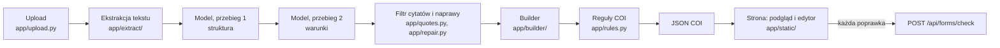

# coi-formularze

REST API, które zamienia pusty formularz papierowy (PDF, DOC, DOCX, ODS, XLSX, XLS, JPG, PNG) w konfigurację e-usługi COI, czyli JSON gotowy do importu. Domyślnie wszystko działa lokalnie: otwarty model językowy w Ollamie, bez chmury i bez zewnętrznych API. Do tego strona dla urzędnika, na której widać oryginał obok gotowej e-usługi i można ją poprawić przed pobraniem.

Projekt na HackNation 2026, zadanie COI „Cyfryzacja Formularzy”.

## Szybki start

Potrzebujesz Dockera 23+ i Ollamy z modelem na tym samym komputerze.

```bash
ollama pull qwen3:30b-a3b-instruct-2507-q4_K_M
OLLAMA_CONTEXT_LENGTH=32768 ollama serve      # w osobnym terminalu, jeśli Ollama jeszcze nie działa
docker compose up -d --build
curl -X POST http://localhost:8000/api/forms/convert -F "file=@wniosek.pdf" -o wniosek.json
```

Strona dla urzędnika: http://localhost:8000. Dokumentacja OpenAPI: http://localhost:8000/docs. Stan modelu: http://localhost:8000/health.

Jeden formularz trwa od 20 s do 7 min (długie formularze mają do 16 stron). Jeśli klient nie może tyle czekać na odpowiedź, użyj [zadania w tle](#zadanie-w-tle).

## Wymagania z zadania: gdzie są

| Wymaganie z „Pełnej treści zadania konkursowego” | Gdzie |
|---|---|
| 3.2.I Usługa REST: plik formularza → JSON zgodny ze strukturą COI i wymaganiami projektowania | `POST /api/forms/convert` ([REST API](#rest-api)). Każdy wynik sprawdzają reguły COI (`app/rules.py`) przed odpowiedzią |
| 3.2.II Dokumentacja architektury | [Architektura](#architektura) |
| Przesłanie pojedynczego pliku; formaty PDF, DOC, DOCX, ODS, XLSX, JPG, JPEG, PNG | [Walidacja i limity](#walidacja-i-limity) |
| Walidacja typu pliku z weryfikacją MIME z zawartości | [Walidacja i limity](#walidacja-i-limity), `app/upload.py` |
| Walidacja nazwy pliku (do 250 znaków, bez `; : > < / \ \| ' * % $`) | [Walidacja i limity](#walidacja-i-limity) |
| Maksymalny rozmiar pliku konfigurowalny parametrem aplikacji | `MAX_FILE_SIZE_MB` ([Konfiguracja](#konfiguracja)) |
| Tylko tymczasowe przetwarzanie pliku | [Przechowywanie plików](#przechowywanie-plików), `HISTORY_ENABLED=0` |
| Konteneryzacja, wymagania dla obrazów Docker | [Budowanie obrazu Docker](#budowanie-obrazu-docker), [Uruchomienie aplikacji](#uruchomienie-aplikacji) |
| Konfiguracja: rozmiar pliku, JWT, parametry integracji | [Konfiguracja](#konfiguracja) |
| README: budowanie obrazu, uruchomienie, konfiguracja, REST API | sekcje o tych nazwach poniżej |
| Python 3.14+, open source bez copyleft, bez zewnętrznych API i SaaS | [Licencje](#licencje). Domyślna konfiguracja i obraz używają tylko lokalnego modelu w Ollamie |

## Architektura



Model czyta papier, a kod pilnuje formatu COI. Model zwraca tylko krótki plan formularza. Wszystko po nim to deterministyczny kod z testami (`uv run pytest`). Kroki skleja `app/pipeline.py`, a REST jest w `app/api.py`.

1. **Upload** (`app/upload.py`). Plik trafia strumieniowo do pamięci. Limit rozmiaru jest liczony w trakcie odczytu. Potem kod sprawdza nazwę, rozszerzenie i sygnaturę bajtów. Przy `AUTH_ENABLED=1` żądanie potrzebuje tokenu JWT (`app/security.py`).
2. **Ekstrakcja** (`app/extract/`). Każdy format daje ten sam znormalizowany tekst (`normalize.py`), więc ten sam formularz w PDF, DOCX i skanie trafia do modelu tak samo.
   - PDF czyta PDFium (`pypdfium2`). Strony bez warstwy tekstu albo z fontami bez mapy Unicode idą do OCR.
   - DOC czyta własny parser formatu Word 97. DOCX czyta własny czytnik OOXML, razem z polami tekstowymi, numeracją list, przypisami, nagłówkami i stopkami.
   - XLSX, XLS i ODS czytają `openpyxl`, `xlrd` i własny czytnik ODS.
   - Skany JPG i PNG czyta Tesseract (`pol`). Przed OCR kod obraca stronę (OSD), prostuje ją i wymazuje wykropkowania. W tekście wykropkowanie to `____`, a kratka to `[ ]`.
3. **Plan od modelu** (`app/llm/planner.py`, klient `app/llm/client.py`). Dwa wywołania, a odpowiedź wymusza schemat JSON.
   - Przebieg 1 ustala strukturę: strony, sekcje, pola z typami i opcjami, oświadczenia, adresata, kto może złożyć wniosek i czy przez pełnomocnika.
   - Przebieg 2 ustala warunki pokazania pól i sekcji. Model widzi listę pól z ich cytatami, a schemat dopuszcza tylko istniejące pola i opcje.
   - Każdy element planu niesie `quote`, dosłowny cytat z papieru. Kontrakt planu jest w `app/plan.py`.
4. **Filtr cytatów i naprawy** (`app/quotes.py`, `app/repair.py`). Element, którego cytatu nie ma na papierze, wypada. Dopasowanie jest rozmyte (`rapidfuzz`, próg 90, dla tekstu z OCR 85). Wypadają też pola strony „Dane”, które kod buduje sam, i warunki bez oparcia w papierze (pole zostaje). Naprawy bez modelu:
   - lista wyboru z opcją spoza papieru staje się polem tekstowym;
   - pytanie wyboru zadane dwa razy zostaje raz;
   - adres do korespondencji dostaje pytanie Tak/Nie, gdy papier mówi „inny niż”.
5. **Builder** (`app/builder/`). Plan staje się pełną konfiguracją COI, bez modelu: UUID, `techName`, siatka, strony ze Standardów COI (Dane z rejestru MLPZ, Kontakt i zgody, strona końcowa), warunki `SHOW` w JSONata, walidatory, słowniki i sekcje powtarzalne.
   - Zależności to warunki `SHOW` na polach i sekcjach. Schemat COI nie ma warunku na stronie ani na linku między stronami, więc warunkowe przejście między stronami to warunki na sekcjach.
   - Builder zwraca też mapę dowodów: dla każdego elementu cytat z papieru albo informację, że element dodał kod.
   - Lista walidatorów COI nie ma długości pola ani formatu telefonu. Pola telefonu dostają więc podpowiedź w opisie.
6. **Reguły** (`app/rules.py`). Kod sprawdza schemat JSON COI i „Reguły techniczne”. Każdy problem kończy żądanie kodem 422, więc API nie wypuszcza JSON-a, którego generator COI nie przyjmie.

Dwie opcjonalne ścieżki wejścia, obie wyłączone domyślnie:
- `LLM_VISION=1`: model dostaje też obrazy stron PDF i JPG/PNG, obok tekstu (potrzebny model wizyjny).
- `PIPELINE=images` (`app/llm/transcribe.py`): każdy plik staje się obrazami stron (PDF przez PDFium, pliki biurowe przez LibreOffice), a model wizyjny przepisuje każdą stronę do Markdown. Planer czyta ten Markdown zamiast tekstu z ekstrakcji.

### Strona dla urzędnika

Strona `/` (`app/static/index.html`, `preview.html`, `editor.js`) pokazuje oryginał obok e-usługi, tak jak zobaczy ją obywatel.
- Pod każdym polem widać jego cytat z dokumentu i warunek, który je pokazuje. „Źródło” pokazuje to miejsce w oryginale.
- Ikona ołówka przy elemencie otwiera panel „Edycja” z prawej strony. Urzędnik poprawia albo usuwa tam pole, sekcję, stronę lub oświadczenie, a „Cofnij” przywraca zmianę.
- Każdą zmianę sprawdza `POST /api/forms/check`, te same reguły co przy konwersji. Z problemami nie da się pobrać JSON-a. Jeśli usunięcie zepsułoby import, przycisk jest wyłączony i podaje powód.
- Kilka wgranych plików strona przetwarza po kolei.
- Bez dokumentu też się da. Gotowy JSON e-usługi (np. z innego systemu) albo „+ Zacznij od pustego formularza” otwiera się od razu w edytorze, bez modelu.

Pozostałe części:
- **Propozycje słowników** (bonus II, `app/dictionaries.py`). Model proponuje nowe słowniki dla pól formularza, a kod odrzuca propozycje bez oparcia w papierze. JSON e-usługi się nie zmienia.
- **Katalog słowników** (`app/catalog.py`, strona `/slowniki`). „Dodaj” przy propozycji zapisuje słownik i podpina go pod pole formularza (w JSON-ie tylko `dictionaryName`, jak w słowniku Kraje). Urzędnik dopisuje i usuwa wartości na stronie „Słowniki”. Słowniki COI (Kraje, TERYT, Numery kierunkowe) są tam tylko do odczytu.
- **Historia strony** (`app/history.py`). Plik SQLite `HISTORY_DB`, więc wyniki widać w każdej przeglądarce. `HISTORY_ENABLED=0` ją wyłącza.
- **Zadania w tle** (`app/jobs.py`). `POST /api/forms/jobs` od razu zwraca adres wyniku, który można odpytywać.

## Budowanie obrazu Docker

```bash
docker build -t coi-formularze:0.1.0 .
```

Obraz buduje też `docker compose build` albo `docker compose up --build`. Potrzebny jest Docker 23+, bo `Dockerfile` używa `RUN --mount=type=cache` (BuildKit, domyślny builder).

LibreOffice jest potrzebny tylko przy `PIPELINE=images`. Domyślny obraz go nie ma, bo to kilkaset MB, a domyślna ścieżka czyta pliki biurowe bibliotekami Pythona. Obraz z LibreOffice:

```bash
docker build --build-arg LIBREOFFICE=1 -t coi-formularze:0.1.0-lo .
```

Co jest w obrazie API (`Dockerfile`):
- Oficjalny obraz `python:3.14.10-alpine3.24` w obu etapach budowy. Wszystkie zależności mają gotowe koła dla musl.
- `uv` instaluje zależności dokładnie z `uv.lock` w etapie budowy. Do obrazu końcowego trafia tylko środowisko i kod `app/`.
- Tesseract z danymi `pol` (tekst) i `osd` (wykrywanie obróconych skanów).
- Proces działa jako użytkownik bez uprawnień (UID 10001), wystawia tylko port 8000 i ma `HEALTHCHECK` na `/health`.
- Sekrety przychodzą wyłącznie przy uruchomieniu, z `.env`. `.dockerignore` wyklucza `.env`, więc nie trafia do obrazu.
- Jawne wersje, nigdzie `latest`. Obrazy bazowe są przypięte co do wersji (`python:3.14.10-alpine3.24`, w compose `ollama/ollama:0.40.17`), `uv==0.13.9`, a zależności Pythona pochodzą z `uv.lock` z hashami. Pakiety systemowe (Tesseract) pochodzą z zamrożonej gałęzi Alpine 3.24, bez numerów rewizji: Alpine usuwa stare rewizje z repozytorium, więc przypięty build przestałby się budować.

## Uruchomienie aplikacji

### Docker Compose

```bash
cp .env.example .env          # opcjonalnie; z AUTH_ENABLED=1 uzupełnij JWT_SECRET i AUTH_PASSWORD
docker compose up -d --build  # strona http://localhost:8000, OpenAPI /docs, stan modelu /health
```

Wersja w pełni odizolowana, z modelem też w kontenerze. Pierwszy start pobiera model, ponad 10 GB:

```bash
LLM_BASE_URL=http://ollama:11434/v1 docker compose --profile ollama up -d --build
```

`docker-compose.yml` (Docker Compose 2.24+) dokłada system plików tylko do odczytu, `cap_drop: ALL` i `no-new-privileges`. Kontener API zapisuje tylko do `/tmp` w pamięci (tmpfs, 1 GB). Trafiają tam pliki tymczasowe OCR i historia strony (`HISTORY_DB=/tmp/history.sqlite3`), która znika przy restarcie kontenera.

Skąd API bierze model (ustawiasz w `.env`):

| Wariant | W `.env` | Uruchomienie |
|---|---|---|
| Ollama na hoście (domyślnie; na Macu tylko tak model liczy na GPU) | nic, API łączy się z `http://host.docker.internal:11434/v1` | `docker compose up -d --build` |
| Ollama w kontenerze (serwer Linux, GPU NVIDIA opcjonalnie, patrz komentarz w `docker-compose.yml`) | `LLM_BASE_URL=http://ollama:11434/v1` | `docker compose --profile ollama up -d --build` |
| Zdalny model z otwartymi wagami przez API zgodne z OpenAI (opcja poza wymaganą konfiguracją, np. Eden AI do pomiarów) | `LLM_BACKEND=openai`, `LLM_BASE_URL=https://api.edenai.run/v3`, `LLM_MODEL=deepinfra/google/gemma-4-31B-it`, `EDENAI_API_KEY=...` | `docker compose up -d --build` |

Zanim uruchomisz:
- Ollama na hoście potrzebuje modelu (`ollama pull qwen3:30b-a3b-instruct-2507-q4_K_M`) i kontekstu 32k (`OLLAMA_CONTEXT_LENGTH=32768`).
- Na Linuksie Ollama musi słuchać na adresie mostu Dockera, na który wskazuje `host-gateway`: `OLLAMA_HOST=172.17.0.1`. Adres `0.0.0.0` też działa, ale wystawia Ollamę bez hasła na całą sieć.
- Nie wpisuj do `.env` używanego z Dockerem `LLM_BASE_URL=http://localhost:...`. W kontenerze `localhost` to sam kontener.
- `LIBREOFFICE=1` w `.env` dokłada LibreOffice do obrazu budowanego przez compose (patrz [Budowanie obrazu Docker](#budowanie-obrazu-docker)).
- Profil `ollama` przy pierwszym starcie pobiera `LLM_MODEL` do wolumenu `ollama` (usługa `ollama-pull`). Do tego czasu `/health` pokazuje `"llm": "model_missing"`. Obraz `ollama/ollama` jest obrazem producenta i działa jako root, więc compose odbiera mu uprawnienia jądra (`cap_drop: ALL`, `no-new-privileges`).

### Bez compose (`docker run`)

Z obrazem z [Budowania obrazu Docker](#budowanie-obrazu-docker) i Ollamą na hoście:

```bash
docker run --rm -p 8000:8000 --read-only --tmpfs /tmp --cap-drop ALL --security-opt no-new-privileges \
  --add-host=host.docker.internal:host-gateway \
  -e LLM_BASE_URL=http://host.docker.internal:11434/v1 \
  coi-formularze:0.1.0
```

Ze zdalnym modelem podaj `--env-file .env` zamiast `-e LLM_BASE_URL=...`.

### Natywnie (macOS, Linux)

Potrzebujesz Pythona 3.14+, [uv](https://docs.astral.sh/uv/), [Ollamy](https://ollama.com) i Tesseracta z językiem polskim (`brew install tesseract tesseract-lang` albo `apt install tesseract-ocr tesseract-ocr-pol`).

```bash
ollama pull qwen3:30b-a3b-instruct-2507-q4_K_M   # model z LLM_MODEL
cp .env.example .env                              # logowanie: AUTH_ENABLED=1 + JWT_SECRET i AUTH_PASSWORD
uv sync
uv run uvicorn app.api:app --port 8000
```

Ollama potrzebuje okna kontekstu co najmniej 32k tokenów, bo najdłuższy formularz ma 16 stron: `OLLAMA_CONTEXT_LENGTH=32768 ollama serve`. Kontener `ollama` z compose ma to ustawione.

Strona działa pod http://localhost:8000, a dokumentacja OpenAPI pod http://localhost:8000/docs. Testy: `uv run pytest`.

Sam podgląd e-usługi jest pod http://localhost:8000/preview. Wrzucasz plik JSON COI albo go wklejasz, a strona pokazuje e-usługę tak, jak zobaczy ją obywatel: strony, sekcje, zależności na żywo i walidatory. Każdy krok otwiera się bez wypełniania pól. „Pokaż cytaty” dopisuje pod każdym polem fragment formularza, z którego powstało. „Pokaż warunki” dopisuje warunek, który pokazuje pole, a ukryte pola zastępuje jedną linią z tym warunkiem.

## Konfiguracja

Aplikacja czyta zmienne środowiskowe albo plik `.env` przy starcie (`app/config.py`, wzór w `.env.example`). Sekrety podajesz tylko przy uruchomieniu, nigdy w obrazie.

### Parametry, których wymaga zadanie

| Zmienna | Domyślnie | Opis |
|---|---|---|
| `MAX_FILE_SIZE_MB` | `10` | Maksymalny rozmiar pliku (MiB) |
| `AUTH_ENABLED` | `0` | `0` = API otwarte, strony bez logowania (na razie domyślnie). `1` = każde wywołanie wymaga tokenu `Bearer` JWT, strony pokazują logowanie |
| `JWT_SECRET` | brak | Klucz podpisu tokenów, min. 32 znaki. Wymagany w produkcji. Lokalnie bez niego API losuje klucz na czas życia procesu i ostrzega w logu |
| `JWT_ALGORITHM` | `HS256` | Algorytm podpisu (z `JWT_JWKS_URL` np. `RS256`) |
| `JWT_ISSUER` | `coi-formularze` | Wymagane `iss` w tokenie |
| `JWT_AUDIENCE` | `coi-formularze` | Wymagane `aud` w tokenie |
| `JWT_TTL_MINUTES` | `60` | Ważność wydanego tokenu |
| `AUTH_USERNAME` | `admin` | Login do `/api/auth/token` |
| `AUTH_PASSWORD` | brak | Hasło. Bez niego logowanie lokalne jest wyłączone |
| `JWT_JWKS_URL` | brak | Zewnętrzny serwer tożsamości (np. Keycloak). API weryfikuje tokeny jego kluczami publicznymi, a logowanie lokalne jest wyłączone |
| `LLM_BACKEND` | `ollama` | `ollama` (lokalna Ollama, bez klucza) albo `openai` (dowolne API zgodne z OpenAI, np. Eden AI) |
| `LLM_BASE_URL` | `http://localhost:11434/v1` | Adres API czatu (`/chat/completions`). Dawna nazwa `LLM_URL` też działa. Dla Eden AI: `https://api.edenai.run/v3` |
| `LLM_MODEL` | `qwen3:30b-a3b-instruct-2507-q4_K_M` | Model planujący formularz, tylko z otwartymi wagami. Dla Eden AI: `deepinfra/google/gemma-4-31B-it` (zapasowo `deepinfra/Qwen/Qwen3.8-27B`) |
| `LLM_TIMEOUT_S` | `1200` | Limit czasu jednego wywołania modelu (s) |
| `EDENAI_API_KEY` | brak | Klucz API dla `LLM_BACKEND=openai`. Tylko w `.env`, nigdy w repo. Nie trafia do logów |

### Historia strony

| Zmienna | Domyślnie | Opis |
|---|---|---|
| `HISTORY_ENABLED` | `1` | `0` = serwer nie zachowuje żadnego wgranego pliku ani wyniku po zakończeniu żądania. `/api/history` odpowiada 404, a strona trzyma listę plików tylko do odświeżenia (bez „Źródła”). Katalog słowników zostaje, bo trzyma same nazwy i wartości |
| `HISTORY_DB` | `history.sqlite3` (katalog repo); w Dockerze `/tmp/history.sqlite3` | Plik SQLite z historią strony (wgrane pliki i wyniki) i katalogiem słowników |

### Strojenie modelu i OCR (opcjonalne)

| Zmienna | Domyślnie | Opis |
|---|---|---|
| `LLM_VISION` | `0` | `1` = strony PDF i obrazy JPG/PNG trafiają do modelu także jako obrazy, obok tekstu. Model widzi wtedy pola narysowane liniami i ramkami, kratki i tabele. Wymaga modelu wizyjnego w `LLM_MODEL`, np. `qwen3-vl:30b-a3b-instruct`. DOC, DOCX, XLS, XLSX i ODS zostają tekstem |
| `LLM_VISION_MAX_SIDE` | `1400` | Dłuższy bok obrazu strony w 1. przebiegu (struktura), px. Qwen3-VL liczy ok. 1 token na 32×32 px, strona A4 to ok. 1,4 tys. tokenów |
| `LLM_VISION_MAX_PAGES` | `8` | Obraz dostaje tylko N pierwszych stron, reszta idzie samym tekstem (limit kontekstu 32k) |
| `LLM_VISION_CONDITIONS_SIDE` | `1024` | Dłuższy bok obrazów w 2. przebiegu (warunki), px. `0` = 2. przebieg bez obrazów |
| `LLM_VISION_TEXT` | `1` | `0` = model dostaje same obrazy stron, bez wyciągniętego tekstu, jeśli obraz ma każda strona pliku (dłuższy plik zostaje przy tekście). Cytaty model przepisuje z obrazu, a filtr sprawdza je z naszym tekstem z progiem jak dla OCR |
| `LLM_VISION_GRAY` | `0` | `1` = obrazy stron w skali szarości |
| `PIPELINE` | `text` | `images` = każdy plik (też DOC, DOCX, ODS, XLS i XLSX przez LibreOffice) staje się obrazami stron, model wizyjny przepisuje każdą stronę do Markdown, a planer czyta ten Markdown zamiast wyciągniętego tekstu |
| `TRANSCRIBE_MODEL` | `LLM_MODEL` | Model wizyjny przepisujący strony przy `PIPELINE=images` |
| `TRANSCRIBE_SIDE` | `1024` | Dłuższy bok obrazu strony wysyłanego do przepisania, px (ok. 1,4 tys. tokenów na stronę) |
| `TRANSCRIBE_WORKERS` | `4` | Ile stron przepisywanych naraz |
| `TRANSCRIBE_TIMEOUT_S` | `180` | Limit czasu przepisania jednej strony (s), potem jedna ponowna próba |
| `SOFFICE` | `soffice` | Program LibreOffice do zamiany plików biurowych na PDF (na macOS kod sprawdza też ścieżkę aplikacji) |
| `OCR_ENGINE` | `tesseract` | `tesseract` albo `vlm` (model wizyjny w Ollamie) |
| `OCR_VLM_MODEL` | `LLM_MODEL` | Model wizyjny dla `OCR_ENGINE=vlm`. Domyślnie ten sam co `LLM_MODEL`, który musi wtedy czytać obrazy |

## REST API

Kolumna „Autoryzacja” dotyczy `AUTH_ENABLED=1`. Przy domyślnym `0` wszystko działa bez tokenu. Pełny schemat żądań i odpowiedzi jest w `/docs`.

### Formularze

| Metoda i ścieżka | Autoryzacja | Opis |
|---|---|---|
| `POST /api/forms/convert` | `Bearer` JWT | Jeden plik w polu `file` (multipart) → JSON COI, bez żadnej otoczki. Z `?evidence=1` → `{"coi": ..., "evidence": {id elementu: {"source": "paper" \| "model" \| "code", "quote": cytat z papieru, "page": ...}}}`. Tej wersji używa strona, żeby pokazać cytaty w podglądzie i w edytorze |
| `POST /api/forms/jobs` | `Bearer` JWT | To samo co `convert`, ale bez czekania. Plik w polu `file` przechodzi te same kontrole (400/413/415 od razu) → `202 {"id", "status_url", "result_url"}`, nagłówek `Location` = `result_url`. 429, gdy 20 zadań jest już w toku (liczone i czekające) |
| `GET /api/forms/jobs/{id}/result` | `Bearer` JWT | **404, dopóki formularz się przetwarza** (nagłówek `Retry-After`). Potem 200 i czysty JSON COI jak z `convert` albo ten sam kod błędu co `convert` (422/500/502/503/504) z `{"detail"}`. Wynik jest dostępny przez 1 h od zakończenia |
| `GET /api/forms/jobs/{id}` | `Bearer` JWT | `{"id", "status": "pending" \| "done" \| "error"}`, przy błędzie też `code` i `detail`. 404 = nieznane albo wygasłe zadanie |
| `POST /api/forms/text` | `Bearer` JWT | Jeden plik w polu `file` (multipart) → `{"text": tekst odczytany z pliku, "method": sposób odczytu}`, bez modelu. Strona pokazuje ten tekst jako oryginał pliku biurowego tylko wtedy, gdy nie udało się zrobić z niego PDF-u |
| `POST /api/forms/check` | `Bearer` JWT | JSON COI (np. po poprawkach urzędnika) → `{"problems": [{"id": id elementu lub null, "message": opis po polsku, "detail": reguła}]}`. Pusta lista = gotowe do importu. Te same reguły co przy konwersji |
| `GET /api/forms/blank` | `Bearer` JWT | `{"coi": ..., "evidence": ...}` formularza do zbudowania ręcznie, bez pliku i bez modelu: strony standardowe COI (Dane, Kontakt i zgody, strona końcowa) wokół jednej strony z jednym polem. Używa go przycisk „+ Zacznij od pustego formularza” |

### Słowniki

| Metoda i ścieżka | Autoryzacja | Opis |
|---|---|---|
| `POST /api/dictionaries/proposals` | `Bearer` JWT | Bonus II. Ten sam upload co `convert` → propozycje nowych słowników dla pól formularza (nazwa, struktura kod + nazwa, wartości, pole) i to, co kod odrzucił. JSON e-usługi się nie zmienia |
| `GET/POST /api/dictionaries` | `Bearer` JWT | Katalog słowników (SQLite, `HISTORY_DB`). `GET`: najpierw słowniki COI tylko do odczytu, potem nasze z wartościami `{kod, nazwa}`. `POST`: nowy słownik `{name, code?, source?: {file, field}, items?}`, zajęty kod dostaje `_2` |
| `GET/PUT/DELETE /api/dictionaries/{code}` | `Bearer` JWT | Jeden słownik: odczyt, zmiana nazwy lub wartości, usunięcie (słowniki COI: 403) |
| `POST /api/dictionaries/{code}/items` | `Bearer` JWT | Dopisanie wartości bez duplikatów |

### Historia strony

Wszystkie trasy odpowiadają 404 przy `HISTORY_ENABLED=0`. Skrypty dopisują gotowy wynik bez API: `uv run python -m bench.history_add <plik> <coi.json>`.

| Metoda i ścieżka | Autoryzacja | Opis |
|---|---|---|
| `GET /api/history` | `Bearer` JWT | Lista wpisów bez bajtów pliku, najnowsze pierwsze |
| `POST /api/history` | `Bearer` JWT | Nowy wpis: multipart `record` (JSON ze stanem) + `file` → `{id}`. Plik przechodzi te same kontrole co w `convert`. JSON COI formularza bez papieru musi spełniać te same zasady nazwy i być konfiguracją e-usługi |
| `DELETE /api/history` | `Bearer` JWT | Usuwa wszystkie wpisy |
| `PUT/DELETE /api/history/{id}` | `Bearer` JWT | Zmiana stanu wpisu (JSON) albo usunięcie |
| `GET /api/history/{id}/file` | `Bearer` JWT | Oryginał pliku |
| `GET /api/history/{id}/pdf` | `Bearer` JWT | Plik biurowy (DOC, DOCX, ODS, XLS, XLSX) jako PDF zrobiony raz przez LibreOffice, żeby oryginał wyglądał jak prawdziwy dokument (arkusz na szerokość jednej strony) |
| `POST /api/history/{id}/sources` | `Bearer` JWT | „Źródło”: `{coi, evidence}` → miejsce każdego elementu w oryginale |
| `GET /api/history/{id}/page/{n}.png` | `Bearer` JWT | Strona `n` oryginału jako PNG |

### Logowanie, stan i strony

| Metoda i ścieżka | Autoryzacja | Opis |
|---|---|---|
| `POST /api/auth/token` | brak | `username` i `password` (JSON lub formularz) → `{access_token, token_type, expires_in}` |
| `GET /api/auth/config` | brak | `{"enabled": true \| false, "history": true \| false}`: czy potrzebny jest token (`AUTH_ENABLED`) i czy serwer prowadzi historię (`HISTORY_ENABLED`). Strony pytają o to przed pokazaniem logowania |
| `GET /health` | brak | `{"status": "ok", "llm": "ok" \| "model_missing" \| "busy" \| "unreachable" \| "no_api_key", "llm_backend": ..., "llm_model": ...}` |
| `GET /` | brak | Strona dla urzędnika (opis w [Strona dla urzędnika](#strona-dla-urzędnika)) |
| `GET /preview` | brak | Sam podgląd e-usługi z pliku JSON COI |
| `GET /slowniki` | brak | Strona katalogu słowników: słowniki COI tylko do odczytu i nasze, z dodawaniem i usuwaniem wartości |
| `GET /docs` | brak | OpenAPI i Swagger UI. Przycisk „Authorize” loguje loginem i hasłem |

### Przykłady

```bash
# AUTH_ENABLED=0 (domyślnie): bez tokenu
curl -X POST http://localhost:8000/api/forms/convert -F "file=@wniosek.pdf" -o wniosek.json

# AUTH_ENABLED=1: najpierw token
TOKEN=$(curl -s -X POST http://localhost:8000/api/auth/token \
  -H 'Content-Type: application/json' -d '{"username": "admin", "password": "haslo"}' | jq -r .access_token)

curl -X POST http://localhost:8000/api/forms/convert \
  -H "Authorization: Bearer $TOKEN" -F "file=@wniosek.pdf" -o wniosek.json
```

#### Zadanie w tle

Wyślij plik, a potem odpytuj adres wyniku, aż przestanie zwracać 404. Z `AUTH_ENABLED=1` dodaj `-H "Authorization: Bearer $TOKEN"` do każdego `curl`.

```bash
BASE=http://localhost:8000
JOB=$(curl -s -X POST $BASE/api/forms/jobs -F "file=@wniosek.pdf")   # {"id", "status_url", "result_url"}
RESULT=$BASE$(echo "$JOB" | jq -r .result_url); STATUS=$BASE$(echo "$JOB" | jq -r .status_url)
for i in $(seq 1 240); do   # do 20 minut
  CODE=$(curl -s -o wniosek.json -w '%{http_code}' "$RESULT")
  [ "$CODE" != 404 ] && break                                         # 200 = gotowe, inny kod = błąd w wniosek.json
  [ "$(curl -s -o /dev/null -w '%{http_code}' "$STATUS")" = 404 ] && break   # nieznane albo wygasłe zadanie
  sleep 5
done
echo "$CODE"
```

### Błędy

Każdy błąd to JSON `{"detail": "..."}`.

| Kod | Kiedy |
|---|---|
| 400 | zła nazwa pliku, pusty plik, brak pola `file` albo więcej niż jeden plik |
| 401 | brak, zły lub wygasły token; zły login lub hasło (tylko z `AUTH_ENABLED=1`) |
| 404 | `GET /api/forms/jobs/{id}/result`: wynik jeszcze się liczy albo zadanie jest nieznane; `/api/history` przy `HISTORY_ENABLED=0` |
| 413 | plik większy niż `MAX_FILE_SIZE_MB` |
| 415 | nieobsługiwane rozszerzenie albo zawartość niezgodna z rozszerzeniem |
| 422 | nie udało się odczytać formularza |
| 429 | `POST /api/forms/jobs`: 20 zadań już w toku |
| 500 | nieoczekiwany błąd serwera (szczegóły tylko w logu) |
| 502 / 503 / 504 | model językowy zwrócił błąd / jest niedostępny / nie odpowiedział na czas |

## Walidacja i limity

- Jeden plik na żądanie, w polu `file`. Każda inna liczba plików kończy się kodem 400.
- Rozszerzenia (wielkość liter bez znaczenia): `.pdf .doc .docx .ods .xlsx .xls .jpg .jpeg .jpe .png`. Każde inne rozszerzenie kończy się kodem 415.
- To świadomy nadzbiór listy z zadania. `.xls` (starszy Excel) i `.jpe` (inne rozszerzenie JPEG) spotykamy w BIP-ach gmin, a ich zawartość przechodzi tę samą kontrolę sygnatury.
- Zadanie wymienia DOC jako „.doc .docx”, więc oba rozszerzenia Worda przyjmują oba formaty Worda. Gminy publikują DOCX z końcówką `.doc`. Zawartość nadal musi być prawdziwym dokumentem Worda.
- Nazwa pliku: najwyżej 250 znaków, bez `; : > < / \ | ' * % $`.
- Typ MIME wynika z zawartości (sygnatury) i musi pasować do rozszerzenia. Nagłówek `Content-Type` od klienta nie decyduje.
  - PDF: `%PDF`.
  - DOC: plik OLE2 ze strumieniem `WordDocument`. XLS: plik OLE2 ze strumieniem `Workbook` (lub `Book`).
  - DOCX i XLSX: archiwum ZIP z `[Content_Types].xml` i katalogiem `word/` lub `xl/`.
  - ODS: archiwum z `mimetype` = `application/vnd.oasis.opendocument.spreadsheet`.
  - JPEG: `FF D8 FF`. PNG: sygnatura PNG.
- Rozmiar jest liczony w trakcie strumieniowego odczytu. Odczyt kończy się zaraz po przekroczeniu limitu, niezależnie od nagłówka `Content-Length`.

### Przechowywanie plików

- `POST /api/forms/convert`. Treść żądania trafia prosto do RAM i nic nie zostaje po odpowiedzi. Na dysk trafiają tylko pliki tymczasowe na czas żądania. `pytesseract` przekazuje obraz strony Tesseractowi przez plik w katalogu tymczasowym i zaraz go usuwa. Przy `PIPELINE=images` LibreOffice konwertuje plik biurowy w katalogu tymczasowym.
- `POST /api/forms/jobs`. Wgrany plik jest tylko w pamięci procesu i znika, gdy zadanie się skończy, także po błędzie. W trakcie konwersja tworzy te same pliki tymczasowe co `convert`. Zostaje sam wynik JSON, przez 1 h od zakończenia. Restart serwera zapomina wszystkie zadania.
- Historia strony `/` (`HISTORY_DB`) to funkcja interfejsu, nie API. Zachowuje oryginał i wynik, żeby urzędnik mógł wrócić do pliku. W Dockerze leży w `/tmp` w pamięci kontenera i znika przy restarcie. `HISTORY_ENABLED=0` wyłącza ją całkiem. Wtedy serwer nie zachowuje żadnego wgranego pliku ani wyniku po zakończeniu żądania.

## Benchmark i wybór modelu

Liczby pochodzą z naszych pomiarów na 9 formularzach COI z zadania, każdy w kilku formatach (PDF, skan, Word). Model lokalny `qwen3:30b-a3b-instruct-2507-q4_K_M` działał w Ollamie na Macu. Notatki z pomiarów i decyzji o modelu są w `bench/MODELS.md`.

### Jak mierzymy

Uruchomienie: `uv run python -m bench.run_all`, ocena: `bench/score.py`.
- `gold=` porównuje plan modelu z wzorcowym planem formularza (`gold/plans/formN.json`, uzasadnienia w `gold/notes/`). To średnia z pięciu miar: F1 pól, zgodność typów, zgodność opcji, odzysk warunków i zgodność strony „Dane” (kto składa wniosek). 1,0 = jak wzorzec.
- `ref` to odzysk elementów z wzorcowych JSON-ów COI (formularze 1 i 5).
- Do tego: czy JSON powstał, ile problemów z regułami COI i czas.

### Wynik bazowy na 9 formularzach

26 plików, tryb tekstowy, kod `7090c84`, 2 pliki naraz na wspólnej Ollamie. Wynik: 26/26 poprawnych JSON-ów, 0 problemów z regułami COI, średnio `gold=` **0,759** (PDF 0,795, skan PNG 0,724, DOCX 0,758).

| Formularz | PDF | skan PNG | DOCX | Czas PDF / PNG / DOCX (s) |
|---|---|---|---|---|
| 1 | 0,978 | 0,978 | 0,960 | 20 / 74 / 31 |
| 2 | 0,971 | 1,000 | 0,843 | 84 / 69 / 75 |
| 3 | 0,629 | 0,589 | 0,567 | 43 / 32 / 41 |
| 4 | 0,753 | 0,753 | 0,708 | 70 / 66 / 69 |
| 5 | 0,960 | 0,803 | 0,803 | 36 / 34 / 40 |
| 6 | 0,736 | 0,736 | 0,722 | 124 / 121 / 113 |
| 7 | 0,939 | 0,563 | brak DOCX | 110 / 79 |
| 8 | 0,587 | 0,540 | 0,713 | 400 / 411 / 304 |
| 9 | 0,603 | 0,557 | 0,752 | 422 / 414 / 285 |

- Reguły po modelu dodane później (filtr warunków, naprawy w `app/repair.py`) na tych samych planach, bez nowego wywołania modelu: średnia 0,759 → **0,764**, precyzja warunków 0,585 → 0,606. Żaden formularz nie spadł.
- Wzorcowe JSON-y COI (PDF, wcześniejszy przebieg): `ref` 0,89 (formularz 1) i 0,88 (formularz 5). Wzorcowe plany przepuszczone przez nasz builder dają 1,00, więc różnica siedzi w planie od modelu, nie w kodzie.
- Formularze 1-7 (PDF) między kolejnymi poprawkami promptów i kodu: średnio 0,734 → 0,800.
- Czas: formularze 1-7 to 20-124 s na plik, długie formularze 8 i 9 (do 16 stron) 285-422 s.
- Przebiegi nie są w pełni powtarzalne. Prawie identyczne prompty zmieniają wynik małego formularza nawet o około 0,2.
- Ślepy test reguł po modelu na 18 prawdziwych pustych formularzach urzędowych spoza zadania. Dwóch sędziów Claude Opus porównywało wynik bez reguł i z regułami w losowej kolejności. Z regułami wygrywa 9 razy, bez nich 1 raz, 8 remisów (identyczny wynik). Błędy do poprawienia przez urzędnika: 70 → 56 (-20%). Uwaga: to zestaw, na którym reguły rozwijaliśmy, nie zestaw kontrolny.

### Sufit modelu

Te same prompty i ten sam tekst, ale plan pisze Claude Opus zamiast lokalnego modelu. To pomiar diagnostyczny, nie produkt.

| Przypadek | qwen3 30B | Opus |
|---|---|---|
| Formularz 7, skan (tekst z OCR) | 0,563 | 0,968 |
| Formularz 7, PDF | 0,939 | 0,968 |
| Formularz 8, PDF | 0,587 | 0,845 |
| Formularz 9, PDF | 0,578 | 0,858 |

- Qwen na formularzu 9 to wcześniejszy przebieg, stąd inna liczba niż w tabeli bazowej.
- Na formularzu 7 PDF wysokie 0,939 qwena ukrywa odzysk pól 0,59 (F1 pól 0,70 wobec 0,96 u Opusa).
- Na formularzu 8 limit długości odpowiedzi uciął drugi przebieg qwena, więc wynik nie ma żadnych warunków.
- Na formularzu 7 Opus ma ten sam wynik na skanie i na PDF, więc tam OCR nie jest wąskim gardłem.

Wąskim gardłem jest model. Pipeline jest gotowy na mocniejszy model z otwartymi wagami: wystarczy zmienić `LLM_MODEL`, lokalnie albo przez `LLM_BACKEND=openai`. Zastrzeżenie: wzorcowe plany pisał Claude, więc Opus dzieli ich konwencje, a to jedna próba na przypadek.

### Dlaczego `qwen3:30b-a3b-instruct-2507`

- To model MoE z ok. 3 mld aktywnych parametrów. Mieści się na laptopie i jest szybki.
- Na formularzu 4 jest prawie 3 razy szybszy od `qwen3:14b` (79 s wobec 229 s) przy lepszym planie (0,60 wobec 0,41).
- Model wizyjny `qwen3-vl:30b-a3b-instruct` przegrał sito na formularzach 1, 4, 5 i 7 (PDF i skan): średnio `gold=` 0,77 z obrazami stron i 0,65 na samym tekście, wobec 0,84 obecnego modelu. Wymyślał pola i zamieniał wybór na pytania tak/nie, więc tekst z naszej ekstrakcji zostaje domyślnym wejściem.
- Na Edenie (9 formularzy, PDF i skany, koszt 0,43 $) najlepszy był `deepinfra/google/gemma-4-31B-it` (0,81, F1 warunków 0,75). Zapasowy `deepinfra/Qwen/Qwen3.8-27B` był dwa razy szybszy, ale miał 0,79 i słabiej radził sobie ze skanami. To inny zestaw plików i wcześniejsza wersja kodu, więc tych liczb nie porównujemy wprost z wynikiem bazowym.

## Licencje

Wyłącznie open source bez copyleft.
- Zależności Pythona: MIT, BSD, Apache-2.0, PSF i MIT-CMU (Pillow). `certifi` (zależność `httpx`) ma MPL-2.0, która obejmuje tylko jego własne pliki i nie wymaga publikacji naszego kodu.
- Tesseract: Apache-2.0. Ollama: MIT. Modele Qwen3: Apache-2.0. Modele proponowane przez Eden AI (Gemma 4, Qwen3.8): Apache-2.0.
- LibreOffice (tylko w obrazie z `LIBREOFFICE=1`): MPL-2.0.

Domyślnie model działa lokalnie w Ollamie, a rozwiązanie nie korzysta z zewnętrznych API ani usług SaaS. Klient modelu mówi protokołem zgodnym z OpenAI. Ten sam kod może więc użyć innego modelu o otwartych wagach na własnym serwerze GPU albo u dostawcy (`LLM_BACKEND=openai`).
