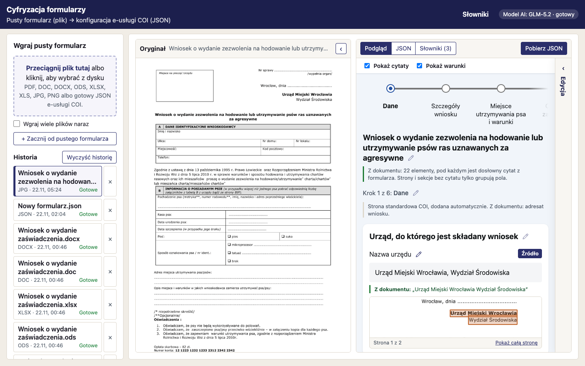
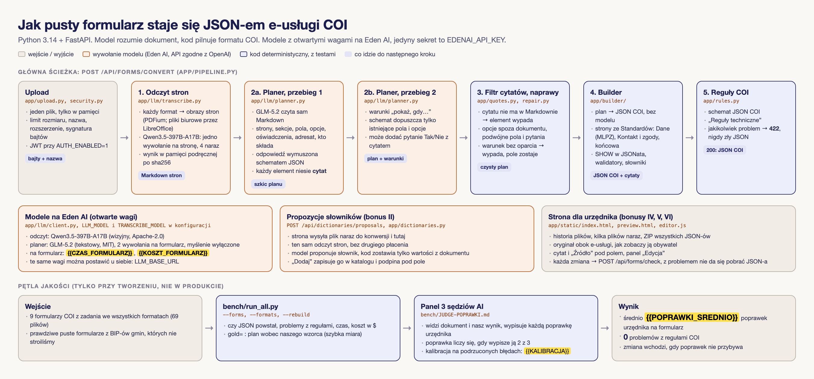
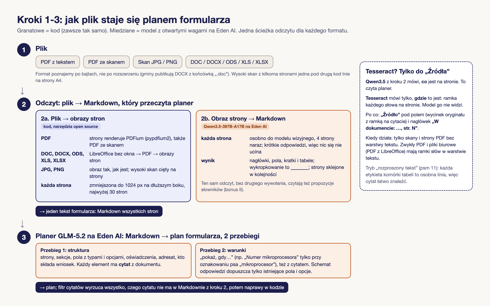

# eFormatka: z papierowego formularza e-usługa COI

Projekt na HackNation 2026, zadanie COI „Cyfryzacja Formularzy”.

**Film (2:40):** https://youtu.be/S_v0vJNXzpw  
**Prezentacja:** https://docs.google.com/presentation/d/1KXvomqc19rmjyOTTgIM4rdwm_7cLuJfp7GtJpmJxMY4/view  
**Outputy surowe** (prosto z API, bez ręcznych zmian): https://github.com/Pawel-Kica/eFormatka-HackNation/tree/main/output/api  
**Outputy poprawione** (wersja końcowa, po sprawdzeniu w edytorze): https://github.com/Pawel-Kica/eFormatka-HackNation/tree/main/output

Wgrywasz pusty formularz urzędowy w dowolnym formacie (PDF, skan JPG/PNG, DOC, DOCX, ODS, XLS, XLSX), a REST API zwraca JSON e-usługi COI gotowy do importu. Urzędnik widzi go obok oryginału i poprawia w edytorze: pod polem jest cytat z dokumentu, z którego pole powstało, i „Źródło”, czyli wycinek oryginału z zaznaczonym miejscem. Dlatego model nie musi trafić wszystkiego za pierwszym razem.




[Jak uruchomić](#jak-uruchomić) · [Wyniki](#wyniki) · [Jak z tego korzystać](#jak-z-tego-korzystać) · [Co z zadania jest zrobione](#co-z-zadania-jest-zrobione) · [Architektura](#architektura) · [Docker](#budowanie-obrazu-docker) · [Uruchomienie](#uruchomienie-aplikacji) · [Konfiguracja](#konfiguracja) · [REST API](#rest-api) · [Wdrożenie](#wdrożenie) · [Znane ograniczenia](#znane-ograniczenia)

## Jak uruchomić

Potrzebujesz Dockera 23+ z Compose 2.24+ i klucza Eden AI (od organizatorów zadania albo z własnego konta Eden AI). Trzeba podać tylko klucz, bo reszta ustawień ma gotowe wartości domyślne ([Konfiguracja](#konfiguracja)).

```bash
git clone https://github.com/Pawel-Kica/eFormatka-HackNation.git && cd eFormatka-HackNation
echo "EDENAI_API_KEY=twój-klucz" > .env
docker compose up -d --build --wait     # pierwsza budowa: około 3 minut (LibreOffice w obrazie)
curl -X POST http://localhost:8000/api/forms/convert -F "file=@examples/formularz-3.jpeg" -o formularz-3.json
```

Po około 20 sekundach `formularz-3.json` zawiera JSON e-usługi COI gotowy do importu. Powstał ze skanu „Wniosku o wydanie zaświadczenia”, na którym sędziowie nie policzyli żadnej poprawki urzędnika. Nasz wynik dla tego pliku leży w `output/api/formularz-3.json`, a drugi przykład to `examples/formularz-2.pdf`. Własny plik podajesz tak samo: `-F "file=@ścieżka/do/pliku.pdf"`.

- Strona dla urzędnika jest pod http://localhost:8000. Wgraj tam ten sam plik, a zobaczysz go obok e-usługi z edytorem.
- OpenAPI: http://localhost:8000/docs. Stan: http://localhost:8000/health (`"llm": "ok"` oznacza, że klucz jest wczytany).
- Jeden formularz trwa od kilkunastu sekund do około dwóch minut, dłużej, gdy Eden zwalnia. Klient, który nie może tyle czekać, korzysta z [zadania w tle](#zadanie-w-tle).
- Bez klucza działa wszystko oprócz odczytu nowego pliku: edytor, podgląd, pusty formularz, wgrany JSON e-usługi, sprawdzanie reguł i katalog słowników. Konwersja i propozycje słowników odpowiadają wtedy 503.
- Zatrzymanie: `docker compose down`. Uruchomienie bez Dockera opisuje sekcja [Natywnie](#natywnie-macos-linux).

## Wyniki

Mierzymy to, co obchodzi urzędnika: ile poprawek musi zrobić w edytorze, zanim JSON pójdzie do importu.

| Miara | Wynik |
|---|---|
| Poprawki urzędnika | średnio **1,9** na formularz: 13 na 7 formularzach (przed końcową pętlą jakości 19, więcej o tym pod tabelą formularzy). Formularz ma średnio 24 pola z dokumentu (razem ze stronami standardowymi COI około 70 pól i tekstów); szczegóły w tabeli niżej |
| Pliki, z których powstał JSON | **54** z 54: 7 formularzy do cyfryzacji z zadania w każdym formacie, w jakim przyszły (PDF, DOC, DOCX, ODS, XLSX, JPEG, JPG, JPE, PNG). Formularze 1 i 5 to materiał referencyjny COI z gotowym JSON-em |
| Problemy z regułami COI | **0** w każdym z tych JSON-ów. API nie wypuszcza JSON-a, który łamie schemat COI albo „Reguły techniczne”, tylko odpowiada 422; taki plik liczy się jako porażka w wierszu wyżej |
| Czas i koszt | średnio **50 s** i **0,025 $** na formularz według cennika Eden AI (od 19 s i 0,012 $ za 1 stronę do 98 s i 0,051 $ za 6-stronicową deklarację). Koszt zależy od liczby stron (jedno wywołanie odczytu na stronę) i od wielkości planu (dwa przebiegi planera): formularz 9 (16 stron) kosztuje 0,048 $, mniej niż 6-stronicowa deklaracja |
| Kalibracja sędziów | z 10 błędów podrzuconych do poprawnej e-usługi znaleźli 10 (formularz 8) i 9 (formularz 7), a na formularzu 3: 4 z 4 w elementach z papieru; zmyślonych poprawek 0 |

Narzędzia pomiaru (benchmark, wzorce, przepisy dla sędziów) nie są częścią produktu, więc leżą na gałęzi [`badania`](https://github.com/Pawel-Kica/eFormatka-HackNation/tree/badania). Linki `bench/...` niżej prowadzą tam.

**Jak liczymy poprawki** (przepis: [`bench/JUDGE-POPRAWKI.md`](https://github.com/Pawel-Kica/eFormatka-HackNation/blob/badania/bench/JUDGE-POPRAWKI.md)):
- Trzech sędziów AI dostaje strony oryginału i nasz JSON jako czytelny konspekt. Każdy osobno wypisuje poprawki, które urzędnik zrobiłby w edytorze: brakujące pole, zmyślone pole, zły typ, złe opcje, zły albo brakujący warunek, złe „wymagane”. Poprawka liczy się, gdy wypiszą ją co najmniej 2 z 3 sędziów.
- Liczy się tylko to, czy e-usługa pyta o to samo co papier. Sędziowie nie liczą stron standardowych COI (Dane, Kontakt i zgody, strona końcowa; poza oświadczeniami z papieru), tekstów informacyjnych, walidatorów, brzmienia etykiet, kolejności pól ani podziału na strony.
- Sędziami są mocniejsze modele zamknięte, inne niż nasz planer i odczyt, więc nie oceniają samych siebie. Służą tylko do pomiaru i nie ma ich w produkcie (pkt 5 zadania pozwala używać takich modeli przy testowaniu).
- Samych sędziów sprawdziliśmy tak: nasz wzorcowy plan formularza zbudowaliśmy w e-usługę dwa razy, czystą i z celowo wstawionymi błędami (`bench/poprawki.py plant`: usunięte pola, złe typy, usunięty albo zły warunek, zmyślone pole, ucięta lista opcji, zdjęte „wymagane”). Panel ocenił obie wersje, nie wiedząc o błędach.
  - Na czystej wersji nie policzył żadnej poprawki.
  - Na formularzach 8 i 7 znalazł 19 z 20 błędów. Ominął zdjęte „wymagane” przy potwierdzeniu przelewu, którego papier wprost nie każe dołączać.
  - Na formularzu 3 (1 strona, mały formularz) znalazł 4 z 4 błędów w elementach z papieru. Pozostałe 3 z 7 trafiły w pytanie o opłatę i załącznik z potwierdzeniem zapłaty, które dodał tylko nasz wzorzec, oraz w warunek przy tekście informacyjnym, którego sędziowie z zasady nie oceniają; słusznie ich nie policzyli.

### Każdy formularz z zadania

| Formularz | Plik | Poprawki urzędnika | Jakie | Drugi oceniony plik | Pola z dokumentu | Czas | Koszt |
|---|---|---|---|---|---|---|---|
| 2. Zwrot opłaty skarbowej | PDF | **0** | | JPEG: 0 | 7 | 22 s | 0,013 $ |
| 3. Wydanie zaświadczenia | JPEG (obraz) | **0** | | JPG: 0 | 6 | 19 s | 0,012 $ |
| 4. Wynajęcie świetlicy wiejskiej | DOC | **1** | brakujące pole: załącznik z oświadczeniem osoby odpowiedzialnej | XLSX: 1 | 10 | 19 s | 0,012 $ |
| 6. Zajęcie pasa drogowego | PDF | **4** | złe „wymagane” 4 razy: cztery warianty tabeli zajęcia pasa (jezdnia do 20%, 20-50%, ponad 50% szerokości, chodnik) są wymagane, a wnioskodawca wypełnia tylko ten, który go dotyczy | XLSX: 4 | 31 | 59 s | 0,020 $ |
| 7. Psy ras agresywnych | JPE (obraz 2 stron) | **1** | brakujące pole: adres poprzedniego właściciela psa | PDF: 2 | 22 | 46 s | 0,020 $ |
| 8. Deklaracja opłaty za odpady, 6 stron | JPEG (obraz 6 stron) | **3** | 2 brakujące warunki (miejsce gromadzenia odpadów tylko przy budynku wielorodzinnym, obliczenie opłaty ukryte przy kompostowniku), brakujące pole: data zmiany przy korekcie | PDF: 4 | 60 | 98 s | 0,051 $ |
| 9. Stypendium sportowe, 3 wnioski w 1 | ODS | **4** | 2 brakujące warunki (rubryki tylko przy stypendium lub nagrodzie), 2 brakujące pola (dowód pełnomocnika klubu, rodzic niepełnoletniego kandydata) | DOCX: 9 | 32 | 87 s | 0,048 $ |
| **Średnio** | | **1,9** | | 2,9 | 24 | 50 s | 0,025 $ |

- Formularz 7 przyszedł w 6 formatach, pozostałe w 8. Wszystkie 54 pliki dały JSON bez problemów z regułami COI (pliki, które padły przez zerwaną sieć na sali, puściliśmy jeszcze raz), a ich zgodność z naszym wzorcem (`gold=`) jest w [docs/historia.md](docs/historia.md#7-końcowy-pomiar-każdy-plik-każdego-formularza). Sędziowie ocenili po 2 pliki na formularz, te z najwyższą zgodnością. Tabela pokazuje lepszy z nich i ten trafił do `output/`; drugi stoi w kolumnie „Drugi oceniony plik” (razem 20 poprawek zamiast 13). Najwięcej poprawek, 9, wymagał DOCX formularza 9.
- Przed końcową pętlą jakości ten sam panel liczył na tych formularzach 19 poprawek. Wtedy był to jeden plik na formularz, ten z najwyższą `gold=`; wybrany tak samo dziś daje 14, a 13 to lepszy z dwóch ocenionych plików. Zysk dały formularze 8 (8 → 3) i 9 (7 → 4). Formularz 6 się pogorszył (2 → 4): zniknęły 2 stare poprawki przy załącznikach, doszły 4 przy wariantach tabeli.
- „Pola z dokumentu” to pola na stronach formularza, bez stron standardowych COI. Czas i koszt to cały przebieg pliku: odczyt stron, 2 przebiegi planera i kod.
- Na tych formularzach stroiliśmy prompty i kod, a w końcowej pętli uwagi tego samego panelu podpowiadały nam, co poprawić. To wynik na znanych dokumentach.

### Porównanie podejść

Te same dokumenty i ci sami sędziowie, od najprostszego podejścia (cały plik prosto do jednego modelu, który ma oddać JSON COI) do naszego. Przy każdym podejściu podajemy model. Miara: poprawki urzędnika, mniej = lepiej.

Trzy dokumenty: formularz 3 PDF (1 strona), formularz 7 JPG (skan, 2 strony) i formularz 8 PDF (6 stron). Sędziowie oceniali każdy wynik pod losową nazwą, nie wiedząc, które podejście go dało. W podejściach 1-4 model dostał w prompcie dokumenty COI (reguły techniczne, opis i schemat JSON, słowniki, Standardy) i wzorcowy JSON formularza 1 (`bench/arms_direct.md`).

| Podejście | Model | Poprawki urzędnika: formularz 3 / 7 / 8 | Razem | Problemy z regułami COI | Czas razem | Koszt razem |
|---|---|---|---|---|---|---|
| 1. Cały plik do jednego modelu, który oddaje JSON COI | Mistral Large 3 | 3 / 11 / 16 | 30 | 55 | 340 s | 0,104 $ |
| 2. Obrazy stron do jednego modelu wizyjnego, który oddaje JSON COI | Qwen3.5-397B-A17B | 7 / 13 / 18 | 38 | 20 | 1634 s | 0,205 $ |
| 3. Nasz odczyt stron, potem jeden model pisze cały JSON COI | GLM-5.2 | 2 / 1 / 19 | 22 | 64 | 513 s | 0,200 $ |
| 4. To samo z trybem myślenia | GLM-5.2 | 0 / 1 / 21 | 22 | 11 | 605 s | 0,184 $ |
| **Nasze**: odczyt stron, plan w 2 przebiegach, JSON składa kod | Qwen3.5 + GLM-5.2 | 0 / 1 / 5 | **6** | **0** | 337 s | **0,087 $** |

- Jeden model piszący cały JSON (3 i 4) dorównuje nam na krótkich formularzach, ale na 6-stronicowej deklaracji potrzebuje 19-21 poprawek wobec naszych 5. Na formularzach 7 i 8 jego JSON łamie reguły COI (4-52 problemów: powtórzone identyfikatory, warunki na opcjach, których nie ma). Kosztuje też ponad 2 razy więcej, bo pisze 7-20 tys. tokenów JSON-a, a nasz planer 1-6 tys. tokenów planu.
- Nasze bez filtra cytatów i napraw daje na tych 3 dokumentach prawie to samo (różnica jednego pola na formularzu 8), też bez problemów z regułami. Te reguły to siatka bezpieczeństwa na trudniejsze przypadki (na formularzu 9 poprawiają 3 warunki). Zero problemów z regułami daje builder: format COI pisze kod, nie model.
- Nasz potok stroiliśmy na tych dokumentach, pozostałych podejść nie, więc porównanie działa na naszą korzyść.
- Porównanie zrobiliśmy przed końcowymi poprawkami, więc nasze liczby różnią się trochę od tabeli wyżej. Nasze 267 s na formularzu 8 to wolny moment Edenu; spokojny przebieg trwa około 100 s.
- Przepis i pełna tabela (z drugimi przebiegami): [`bench/ARMS.md`](https://github.com/Pawel-Kica/eFormatka-HackNation/blob/badania/bench/ARMS.md), kod: `bench/arms.py`.

### JSON-y do oddania

| | Co to jest | Link |
|---|---|---|
| **Surowe** | JSON prosto z naszego API, bajt w bajt. Tak działa samo rozwiązanie, te pliki mierzą tabele wyżej. | [`output/api/`](https://github.com/Pawel-Kica/eFormatka-HackNation/tree/main/output/api) |
| **Poprawione** | Wersja końcowa: ten sam JSON po poprawkach, które urzędnik robi w naszym edytorze (np. dopisane brakujące pole). Ile ich było: [`POPRAWKI.md`](output/POPRAWKI.md). | [`output/`](https://github.com/Pawel-Kica/eFormatka-HackNation/tree/main/output) |

Są tam wszystkie formularze 1-9. Formularze 1 i 5 to materiał referencyjny COI, bez oceny sędziów, więc ich wersja poprawiona jest równa surowej.

## Jak z tego korzystać

1. **Wgraj plik** na http://localhost:8000: upuść go gdziekolwiek na stronie albo wybierz z dysku. Kilka plików naraz strona przetwarza po kolei. Gotowy JSON e-usługi otwiera „Wgraj JSON”, od zera zaczyna „Zacznij od pustego formularza”.
2. **Porównaj.** Z lewej oryginał, z prawej e-usługa tak, jak zobaczy ją obywatel, w układzie formularzy e-usług państwowych: kroki u góry, białe karty na szarym tle, „Wstecz” i „Dalej” na dole. Wszystkie kroki przeklikasz bez wypełniania pól.
3. **Sprawdź.** Pod polem z dokumentu jest jego cytat i warunek, który je pokazuje. „Źródło” rozwija wycinek oryginału z ramką na tym cytacie, a klik w wycinek pokazuje całą stronę.
4. **Popraw.** Ołówek przy elemencie otwiera panel „Edycja” obok podglądu: etykieta, typ, opcje, „wymagane”, warunek „pokaż, gdy…”, dodawanie i usuwanie pól, sekcji, stron i oświadczeń, „Cofnij”. Każdą zmianę sprawdzają reguły COI: z problemem nie da się pobrać JSON-a, a usunięcie, które zepsułoby import, jest wyłączone i podaje powód.
5. **Pobierz JSON** gotowy do importu.

Do tego:
- **Słowniki** (bonus II). Zakładka „Słowniki” przy wyniku pokazuje propozycje nowych słowników dla pól formularza. „Dodaj” zapisuje słownik w katalogu na stronie `/slowniki` i podpina go pod pole.
- **Bez dokumentu.** Gotowy JSON e-usługi (np. z innego systemu) albo „Zacznij od pustego formularza” otwiera się od razu w edytorze, bez modelu.
- **Sam podgląd** dowolnego JSON-a COI: http://localhost:8000/preview.
- **Historia** plików jest na serwerze, więc zostaje po odświeżeniu strony. `HISTORY_ENABLED=0` ją wyłącza, a razem z nią „Źródło”, bo wycinki serwer liczy z zapisanego oryginału.

## Co z zadania jest zrobione

| Punkt zadania | Co mamy | Gdzie |
|---|---|---|
| 3.2.I REST API: plik → JSON COI | `POST /api/forms/convert`, każdy wynik przechodzi reguły COI przed odpowiedzią | [REST API](#rest-api) |
| 3.2.II Dokumentacja architektury | diagramy i opis kroków | [Architektura](#architektura) |
| 3.3.I Słowniki i dane inicjalne | strona „Dane” z rejestru MLPZ według Standardów COI, słowniki Kraje, TERYT i Numery kierunkowe; pole z rejestru PESEL tylko wtedy, gdy na pewno dotyczy samego wnioskodawcy | `backend/app/coi/builder/standard.py`, `registry.py` |
| 3.3.II Nowy słownik | propozycje z wartościami z dokumentu, katalog słowników z dodawaniem do pola | `POST /api/dictionaries/proposals`, `/slowniki` |
| 3.3.III Zależności | warunki „pokaż, gdy…” na polach i sekcjach, każdy z cytatem; sekcje powtarzalne. Schemat COI nie ma warunku na stronie, więc przejście zależne od odpowiedzi to warunki na sekcjach | `backend/app/llm/planner.py`, `backend/app/coi/builder/` |
| 3.3.IV Frontend | strona `/`: upload, kilka plików naraz, historia, JSON | [Jak z tego korzystać](#jak-z-tego-korzystać) |
| 3.3.V Wizualizacja e-usługi | podgląd tak, jak widzi go obywatel, z edytorem; osobno `/preview` | `frontend/preview.html` |
| 3.3.VI Walidacje i UX (w kryteriach oceny punkt V) | walidatory COI z etykiet (PESEL, NIP, REGON, kod pocztowy, e-mail, ePUAP, ADE, dowód osobisty), „wymagane”, przy telefonie numer kierunkowy i podpowiedź formatu; batch i ZIP | `backend/app/coi/builder/` |
| 5. Formaty, MIME z zawartości, nazwa pliku, limit rozmiaru | wszystko z listy zadania plus `.xls` i `.jpe` | [Walidacja i limity](#walidacja-i-limity) |
| 5. Tylko tymczasowe przetwarzanie | `convert` trzyma plik tylko w pamięci. Historia strony jest domyślnie włączona; `HISTORY_ENABLED=0` ją wyłącza, kosztem „Źródła” | [Przechowywanie plików](#przechowywanie-plików) |
| 5. Docker, konfiguracja, README | lekki Debian slim, wersje przypięte, użytkownik bez uprawnień, sekrety tylko przy starcie | [Budowanie obrazu Docker](#budowanie-obrazu-docker), [Konfiguracja](#konfiguracja) |
| 5. Python 3.14+, open source bez copyleft, bez zewnętrznych API i modeli dostępnych tylko przez API | GLM-5.2 (MIT) i Qwen3.5 (Apache-2.0) mają otwarte wagi. Na hackathonie wołamy je przez Eden AI, czyli zewnętrzne API, na tokenach od organizatorów zadania (pkt 7). Wdrożenie bez zewnętrznego API to własny serwer z tymi samymi wagami, ustawiany w konfiguracji (tej drogi nie testowaliśmy) | [Znane ograniczenia](#znane-ograniczenia), [Licencje](#licencje) |

## Architektura

Model czyta i planuje, kod buduje JSON COI. Modele oddają tylko Markdown stron i plan formularza. Wszystko po nich to deterministyczny kod z testami.

| Krok | Kto | Co robi | Kod |
|---|---|---|---|
| 1. Strony | kod | PDF, Word, Excel i skan stają się obrazami stron: PDFium renderuje PDF, pliki biurowe najpierw zamienia na PDF LibreOffice, wysoki skan z kilkoma stronami kod tnie na strony | `backend/app/llm/transcribe.py`, `backend/app/extract/scan.py` |
| 2. Odczyt | model wizyjny Qwen3.5 | patrzy na obraz strony i przepisuje jej tekst do Markdown (tabele, kratki ☐); 1 wywołanie na stronę, 4 strony naraz | `backend/app/llm/transcribe.py` |
| 3. Plan | model GLM-5.2 | czyta sam Markdown; 2 wywołania na formularz, każdy element z cytatem: (1) struktura: strony, sekcje, pola, opcje, oświadczenia, (2) warunki: tylko istniejące pola i opcje, do 3 nowych pytań Tak/Nie | `backend/app/llm/planner.py`, kontrakt `backend/app/core/plan.py` |
| 4. Filtr | kod | element, którego cytatu nie ma w dokumencie, odpada; zmyślone opcje też; deterministyczne naprawy (podwójne pola i pytania, „wymagane, gdy widoczne”) | `backend/app/grounding/quotes.py`, `repair.py` |
| 5. JSON COI | kod | identyfikatory, strony ze Standardów COI, warunki JSONata, walidatory, słowniki; na końcu reguły COI (schemat i „Reguły techniczne”), a JSON z problemem nigdy nie wychodzi (422) | `backend/app/coi/builder/`, `backend/app/coi/rules.py` |

Kroki skleja `backend/app/services/pipeline.py`, a REST jest w `backend/app/api/`.



**Dlaczego plan, a nie JSON od razu?** Gdy model sam pisze JSON COI (podejście A), zgaduje identyfikatory i warunki: 11-64 problemów z regułami COI na 3 formularzach. U nas (podejście B) model pisze plan z cytatami, a JSON buduje kod: 0 problemów na tych samych 3, a każde pole da się sprawdzić w dokumencie ([Porównanie podejść](#porównanie-podejść)).

Dlaczego tak:
- **Jedna ścieżka odczytu dla każdego formatu.** Każdy plik staje się obrazami stron, a Qwen3.5 przepisuje każdą stronę do Markdown. Skan, PDF i Word idą tą samą drogą, bez osobnego kodu na skany. Jedyny wyjątek to plik biurowy, któremu LibreOffice zgubi tekst przy zamianie na PDF: wtedy planer dostaje tekst z samego pliku. W pomiarze obrazy wyraźnie wygrały na skanach, a na PDF z warstwą tekstu zysk był mniejszy (remis na formularzach 3 i 8, +0,10 na formularzu 7) ([historia](#jak-doszliśmy-do-tej-architektury)).
- **Każde pole, warunek i oświadczenie planu niesie cytat z dokumentu.** Kod wyrzuca te, których cytatu nie ma w odczytanym tekście, i naprawia zmyślone opcje, więc model nie doda pola, którego na papierze nie ma. Ten sam cytat urzędnik widzi pod polem, a „Źródło” pokazuje go w oryginale.
- **JSON COI pisze kod, nie model.** UUID, `techName`, siatkę, warunki JSONata, walidatory, słowniki i strony ze Standardów COI (Dane, Kontakt i zgody, strona końcowa) builder składa z gotowych klocków. Dlatego struktura zgadza się ze schematem COI, a reguły COI i tak sprawdzamy jeszcze raz przed odpowiedzią.
- **Dwa przebiegi planera.** Najpierw struktura, potem warunki. W drugim przebiegu schemat odpowiedzi dopuszcza tylko istniejące pola i opcje oraz nowe pytania Tak/Nie z cytatem; pytanie, którego żaden warunek nie używa, kod wyrzuca.



Szczegóły kroków:
- **Upload** (`backend/app/api/upload.py`). Plik idzie do pamięci, a limit rozmiaru działa w trakcie odczytu. Potem kod sprawdza nazwę, rozszerzenie i sygnaturę bajtów. Przy `AUTH_ENABLED=1` żądanie potrzebuje tokenu JWT (`backend/app/api/security.py`).
- **Odczyt.** Każda strona, zmniejszona do 1024 px, idzie osobno do Qwen3.5-397B-A17B. Gdy model zapętli się na stronie (np. w kółko przepisuje pusty wiersz tabeli) i odpowiedź się utnie albo przekroczy limit czasu, strona idzie jeszcze raz z karą za powtórzenia (`frequency_penalty`). Gdy w PDF z LibreOffice brakuje tekstu pliku (LibreOffice gubi pływające pola tekstowe niektórych DOCX, w PDF zostają puste ramki) albo LibreOffice nie umie pliku zamienić, kod nie wysyła obrazów stron, tylko daje planerowi tekst odczytany z samego pliku (`backend/app/extract/`).
- **Plan.** GLM-5.2 czyta sam Markdown, bez trybu myślenia, a odpowiedź wymusza schemat JSON.
- **Filtr cytatów i naprawy.** Wypadają: element bez cytatu w Markdownie (dopasowanie rozmyte, `rapidfuzz`), pole, które kod i tak buduje na stronie „Dane”, warunek bez oparcia w dokumencie (pole zostaje). Naprawy bez modelu: lista rozwijana z opcją spoza dokumentu staje się polem tekstowym, a z pól wyboru zmyślone opcje wypadają; podwójne pytanie i podwójne pole zostają raz; adres do korespondencji dostaje pytanie Tak/Nie, gdy dokument mówi „inny niż”.
- **Builder** zwraca też mapę dowodów: przy każdym elemencie cytat z dokumentu albo informacja, skąd jest (stronę lub sekcję bez cytatu ułożył model, strony ze Standardów dodał kod).

Tesseract nie czyta treści formularza. Daje tylko ramki słów na skanach (`backend/app/document/sources.py`, tryb `psm 11`), żeby „Źródło” i nagłówek „W dokumencie: …, str. N” (skąd w oryginale jest strona albo sekcja e-usługi) trafiły w miejsce na stronie. PDF z warstwą tekstu i pliki biurowe mają te ramki bez OCR.

Diagramy to pliki HTML obok PNG w `docs/img/`. Liczby na nich są w `docs/img/liczby.json`, a `python3 docs/img/render.py` renderuje wszystkie od nowa (potrzebny Google Chrome).

### Struktura repozytorium

```
backend/                 Python 3.14, FastAPI, uv
  app/
    main.py              aplikacja FastAPI: REST API i strony frontendu
    api/                 tylko HTTP: router na zasób, logowanie JWT, kontrola uploadu, kody błędów
    services/            przypadki użycia: konwersja (pipeline.py), propozycje słowników
    llm/                 klient Eden AI, odczyt stron, planer, prompty
    grounding/           zostaje tylko to, co jest w dokumencie: filtr cytatów, naprawy
    coi/                 format COI należy do kodu: builder, reguły, komunikaty problemów po polsku
    document/            wgrany oryginał: gdzie leży każdy cytat („Źródło”), nagłówki, plik biurowy → PDF
    extract/             własny tekst pliku (pliki biurowe, warstwa tekstu PDF)
    storage/             SQLite: historia strony, katalog słowników
    core/                ustawienia (.env), kontrakt planu, logi, pomocnicze funkcje tekstu
  tests/                 pytest bez sieci; fixtures/plans = wzorcowe plany 9 formularzy COI
frontend/                strony statyczne bez budowania, wołają API z tego samego adresu
  index.html             strona urzędnika: historia, oryginał obok e-usługi, JSON, słowniki
  preview.html           e-usługa tak, jak widzi ją obywatel, z warstwą urzędnika (cytaty, warunki, „Źródło”)
  editor.js              panel „Edycja” obok podglądu
  dictionaries.html      katalog słowników (/slowniki)
examples/                dwa puste formularze z zadania do wypróbowania API
output/                  JSON-y do oddania (formularze 1-9)
docs/                    historia pomiarów i diagramy z README
Dockerfile, docker-compose.yml, .env.example
```

Zależności idą w jedną stronę, bez cykli: `api` → `services` → `llm`, `document`, `grounding`, `coi`, `storage` → `extract`, `core`. Tylko `api` wie o HTTP, więc konwersja działa tak samo ze skryptu (`from app.services.pipeline import convert`).

## Budowanie obrazu Docker

```bash
docker build -t coi-formularze:0.2.0 .
```

Obraz buduje też `docker compose build`. Potrzebny jest Docker 23+, bo `Dockerfile` używa `RUN --mount=type=cache` (BuildKit).

- Oficjalny obraz `python:3.14.10-slim-trixie` (Debian slim) w obu etapach budowy. Nie Alpine, bo LibreOffice z Alpine ciągnie Qt, GTK i Mesa (około 1 GB więcej); na Debianie są pakiety bez interfejsu (`-nogui`), więc cały obraz ma 972 MB zamiast 1,76 GB. `uv==0.13.9` instaluje zależności dokładnie z `backend/uv.lock` (z hashami), a do obrazu końcowego trafia tylko środowisko, kod `backend/app/` i strony `frontend/`.
- LibreOffice Writer i Calc z fontami Liberation zamieniają pliki biurowe na obrazy stron. Lżejszy obraz bez nich (`--build-arg LIBREOFFICE=0`) czyta jako obrazy stron tylko PDF, JPG i PNG. Plik biurowy planer dostaje wtedy jako sam tekst pliku, bez obrazów stron, a plik bez tekstu kończy się błędem 422.
- Tesseract z danymi `pol`, tylko do ramek słów na skanach.
- Proces działa jako użytkownik bez uprawnień (UID 10001), wystawia tylko port 8000 i ma `HEALTHCHECK` na `/health`.
- Sekrety przychodzą tylko przy uruchomieniu, z `.env`. `.dockerignore` wyklucza `.env`, więc plik nie trafia do obrazu.
- Nigdzie `latest`. Obraz ma wersję z `backend/pyproject.toml` (tag `coi-formularze:0.2.0` i etykieta `org.opencontainers.image.version`; test pilnuje, żeby compose mówił to samo). Pakiety systemowe pochodzą ze stabilnego Debiana 13 (trixie) bez numerów wydań, bo stare wydania znikają z repozytorium i przypięty build przestałby się budować.

## Uruchomienie aplikacji

### Docker Compose

```bash
cp .env.example .env          # wpisz EDENAI_API_KEY; z AUTH_ENABLED=1 także JWT_SECRET i AUTH_PASSWORD
docker compose up -d --build  # strona http://localhost:8000, OpenAPI /docs, stan /health
```

`docker-compose.yml` (Compose 2.24+) dodaje system plików tylko do odczytu, `cap_drop: ALL` i `no-new-privileges`. Kontener zapisuje tylko do `/tmp` w pamięci (tmpfs, 1 GB): pliki tymczasowe LibreOffice i Tesseracta oraz historię strony i katalog słowników, które znikają przy restarcie (trwały wolumin dla `HISTORY_DB` to zmienia). Modele są na Eden AI, więc kontener potrzebuje tylko klucza i internetu.

### Bez compose (`docker run`)

```bash
docker run --rm -p 8000:8000 --read-only --tmpfs /tmp --cap-drop ALL --security-opt no-new-privileges \
  --env-file .env coi-formularze:0.2.0
```

### Natywnie (macOS, Linux)

Potrzebujesz Pythona 3.14+, [uv](https://docs.astral.sh/uv/) i LibreOffice (`brew install --cask libreoffice` albo `apt install libreoffice-writer libreoffice-calc`). Tesseract z językiem polskim jest potrzebny tylko do „Źródła” na skanach (`brew install tesseract tesseract-lang` albo `apt install tesseract-ocr tesseract-ocr-pol`).

```bash
cp .env.example .env          # wpisz EDENAI_API_KEY; aplikacja czyta .env z katalogu głównego repo
cd backend
uv sync
uv run uvicorn app.main:app --port 8000
uv run pytest                 # testy bez sieci, żaden nie woła modelu
```

## Konfiguracja

Zmienne środowiskowe albo plik `.env` w katalogu głównym repo (`backend/app/core/config.py`, wzór w `.env.example`). Trzeba podać tylko `EDENAI_API_KEY`, reszta ma wartości domyślne.

| Zmienna | Domyślnie | Opis |
|---|---|---|
| `EDENAI_API_KEY` | brak | **Jedyne wymagane ustawienie.** Klucz Eden AI do każdego wywołania modelu. Tylko w `.env` albo w zmiennej środowiskowej, nigdy w repo ani w obrazie, nie trafia do logów |
| `MAX_FILE_SIZE_MB` | `10` | Maksymalny rozmiar pliku (MiB) |
| `AUTH_ENABLED` | `0` | `0` = API otwarte, strony bez logowania. `1` = każde wywołanie `/api/...` wymaga tokenu `Bearer` JWT, strony pokazują logowanie |
| `JWT_SECRET` | brak | Klucz podpisu tokenów, min. 32 znaki (`openssl rand -hex 32`). Bez niego API losuje klucz na czas życia procesu (przy `AUTH_ENABLED=1` ostrzega o tym w logu) |
| `JWT_ALGORITHM` | `HS256` | Algorytm podpisu (z `JWT_JWKS_URL` np. `RS256`) |
| `JWT_ISSUER`, `JWT_AUDIENCE` | `coi-formularze` | Wymagane `iss` i `aud` w tokenie |
| `JWT_TTL_MINUTES` | `60` | Ważność wydanego tokenu |
| `AUTH_USERNAME`, `AUTH_PASSWORD` | `admin`, brak | Login i hasło do `/api/auth/token`. Bez hasła logowanie lokalne jest wyłączone |
| `JWT_JWKS_URL` | brak | Zewnętrzny serwer tożsamości (np. Keycloak): API sprawdza tokeny jego kluczami publicznymi, logowanie lokalne jest wyłączone |
| `LLM_BASE_URL` | `https://api.edenai.run/v3` | API czatu zgodne z OpenAI. Tu wskazuje się własny serwer z tymi samymi wagami (jego klucz idzie w `EDENAI_API_KEY`) |
| `LLM_MODEL` | `deepinfra/zai-org/GLM-5.2` | Planer: czyta Markdown stron i pisze plan formularza |
| `TRANSCRIBE_MODEL` | `deepinfra/Qwen/Qwen3.5-397B-A17B` | Model wizyjny, który przepisuje każdą stronę do Markdown |
| `LLM_TIMEOUT_S` | `1200` | Limit czasu jednego wywołania planera (s) |
| `TRANSCRIBE_SIDE` | `1024` | Dłuższy bok obrazu strony wysyłanego do przepisania (px) |
| `TRANSCRIBE_WORKERS` | `4` | Ile stron przepisywanych naraz |
| `TRANSCRIBE_TIMEOUT_S` | `180` | Limit czasu jednego wywołania modelu dla strony (s). Strona ucięta albo po limicie dostaje jedną ponowną próbę z karą za powtórzenia |
| `SOFFICE` | `soffice` | Program LibreOffice (na macOS kod sprawdza też ścieżkę aplikacji) |
| `FRONTEND_DIR` | `frontend/`, w Dockerze `/app/frontend` | Katalog stron, które serwuje aplikacja |
| `LOG_LEVEL` | `INFO` | `INFO` = jedna linia na krok konwersji, wywołanie modelu i zadanie w tle, z nazwą pliku. `DEBUG` dodaje każdy element, który odrzucił filtr cytatów. `WARNING` = tylko problemy |
| `HISTORY_ENABLED` | `1` | `0` = serwer nie zapisuje wgranych plików ani wyników, `/api/history` odpowiada 404, a strona działa bez „Źródła”. W pamięci procesu zostają tylko wynik zadania w tle (1 h) i odczyt 16 ostatnich plików ([Przechowywanie plików](#przechowywanie-plików)). Katalog słowników zostaje, bo trzyma tylko nazwy i wartości |
| `HISTORY_DB` | `backend/history.sqlite3`, w Dockerze `/tmp/history.sqlite3` | Plik SQLite z historią strony i katalogiem słowników; obok niego katalog `<nazwa>-pdf` z PDF-ami plików biurowych |
| `LIBREOFFICE` | `1` | Tylko przy budowie obrazu (compose czyta go z `.env`): `0` = obraz bez LibreOffice |

## REST API

Przy `AUTH_ENABLED=1` każda trasa `/api/...` poza `/api/auth/*` wymaga nagłówka `Authorization: Bearer <token>`. Pełny schemat żądań i odpowiedzi jest w `/docs`.

| Trasa | Co robi |
|---|---|
| `POST /api/forms/convert` | Jeden plik w polu `file` (multipart) → czysty JSON COI. Z `?evidence=1` → `{"coi", "evidence"}`: skąd jest każdy element (cytat z dokumentu, model albo kod) |
| `POST /api/forms/jobs` | To samo bez czekania. Te same kontrole pliku od razu, potem `202 {"id", "status_url", "result_url"}`. Liczą się 2 naraz; 429, gdy 20 zadań jest w toku. Z `?evidence=1` wynik to `{"coi", "evidence"}`; tego używa strona, więc odświeżenie nie przerywa konwersji |
| `GET /api/forms/jobs/{id}/result` | **404, dopóki formularz się liczy** (z `Retry-After`), potem JSON COI albo ten sam kod błędu co `convert`. Wynik czeka 1 h |
| `GET /api/forms/jobs/{id}` | `{"id", "status": "pending" \| "done" \| "error"}`, przy błędzie też `code` i `detail` |
| `POST /api/forms/check` | JSON COI → `{"problems": [{"id", "message", "detail"}]}` po polsku. Pusta lista = gotowe do importu. Te same reguły co przy konwersji |
| `POST /api/forms/text` | Tekst pliku biurowego albo warstwa tekstu PDF, bez modelu. Strona pokazuje go jako oryginał, gdy LibreOffice nie zrobi PDF-u |
| `GET /api/forms/blank` | `{"coi", "evidence"}` pustego formularza do zbudowania ręcznie: strony standardowe COI wokół jednej strony z jednym polem |
| `POST /api/dictionaries/proposals` | Bonus II: ten sam upload co `convert` → propozycje nowych słowników (nazwa, kod + nazwa, wartości, pole) i to, co kod odrzucił. JSON e-usługi się nie zmienia |
| `GET/POST /api/dictionaries`, `GET/PUT/DELETE /api/dictionaries/{code}`, `POST /api/dictionaries/{code}/items` | Katalog słowników: słowniki COI tylko do odczytu, nasze z wartościami `{kod, nazwa}` do zmiany |
| `GET/POST/DELETE /api/history`, `PUT/DELETE /api/history/{id}`, `GET /api/history/{id}/file`, `GET /api/history/{id}/pdf` | Historia strony: wpisy, oryginał pliku, plik biurowy jako PDF z LibreOffice. 404 przy `HISTORY_ENABLED=0` |
| `POST /api/history/{id}/sources`, `GET /api/history/{id}/page/{n}.png` | „Źródło”: miejsce każdego elementu w oryginale i strona oryginału jako PNG |
| `POST /api/auth/token`, `GET /api/auth/config` | Token JWT za login i hasło. Czy token jest potrzebny i czy serwer prowadzi historię |
| `GET /health` | `{"status", "version", "llm": "ok" \| "no_api_key", "llm_model", "transcribe_model"}`. Sprawdza tylko, czy jest klucz, nie woła Edenu |

Strony: `/` (urzędnik), `/preview` (sam podgląd), `/slowniki` (katalog słowników), `/docs` (OpenAPI).

```bash
# AUTH_ENABLED=0 (domyślnie)
curl -X POST http://localhost:8000/api/forms/convert -F "file=@examples/formularz-3.jpeg" -o formularz-3.json

# AUTH_ENABLED=1: najpierw token
TOKEN=$(curl -s -X POST http://localhost:8000/api/auth/token -H 'Content-Type: application/json' \
  -d '{"username": "admin", "password": "haslo"}' | jq -r .access_token)
curl -X POST http://localhost:8000/api/forms/convert -H "Authorization: Bearer $TOKEN" -F "file=@examples/formularz-3.jpeg" -o formularz-3.json
```

### Zadanie w tle

Wyślij plik, potem pytaj o adres wyniku, aż przestanie odpowiadać 404:

```bash
BASE=http://localhost:8000
JOB=$(curl -s -X POST $BASE/api/forms/jobs -F "file=@examples/formularz-3.jpeg")
RESULT=$(echo "$JOB" | jq -r '.result_url // empty')   # puste = plik odrzucony od razu, powód w $JOB
for i in $(seq 240); do   # do 20 minut
  [ -z "$RESULT" ] && { echo "$JOB"; break; }
  CODE=$(curl -s -o formularz-3.json -w '%{http_code}' "$BASE$RESULT"); [ "$CODE" != 404 ] && break; sleep 5
done; echo "$CODE"         # 200 = JSON COI, inny kod = błąd opisany w formularz-3.json, pusto = plik odrzucony
```

Zadanie, którego nie ma (nieznane albo wygasłe), też daje 404 na adresie wyniku. Odróżnisz je przez `status_url`: tam 404 znaczy właśnie to, a liczące się zadanie odpowiada `pending`.

### Błędy

Każdy błąd to JSON z polem `detail`, zwykle `{"detail": "opis po polsku"}`.

| Kod | Kiedy |
|---|---|
| 400 | zła nazwa pliku, pusty plik, brak pliku albo więcej niż jeden plik; brak `username` lub `password` przy logowaniu; zła treść żądania do słowników albo historii |
| 401 | zły login lub hasło przy logowaniu; brak, zły lub wygasły token (tylko przy `AUTH_ENABLED=1`) |
| 403 | zmiana albo usunięcie słownika COI, który jest tylko do odczytu |
| 404 | wynik zadania jeszcze się liczy albo zadania nie ma; nieznany wpis historii albo słownik; `/api/history` przy `HISTORY_ENABLED=0` |
| 413 | plik większy niż `MAX_FILE_SIZE_MB` |
| 415 | nieobsługiwane rozszerzenie albo zawartość niezgodna z rozszerzeniem |
| 422 | nie udało się odczytać formularza albo wynik łamałby reguły COI |
| 429 | 20 zadań w tle już w toku |
| 500 | nieoczekiwany błąd serwera (szczegóły tylko w logu) |
| 502 | model zwrócił błąd |
| 503 | model jest niedostępny albo brak `EDENAI_API_KEY`; `/api/auth/token`, gdy logowanie lokalne jest wyłączone (brak `AUTH_PASSWORD` albo tokeny wydaje `JWT_JWKS_URL`); każda chroniona trasa, gdy serwer tożsamości z `JWT_JWKS_URL` nie odpowiada |
| 504 | model nie odpowiedział na czas |

## Walidacja i limity

- Jeden plik na żądanie, jako `multipart/form-data` w polu `file`. Żądanie bez pliku albo z więcej niż jednym plikiem to 400.
- Rozszerzenia, bez względu na wielkość liter: `.pdf .doc .docx .ods .xlsx .xls .jpg .jpeg .jpe .png`. Inne to 415. `.xls` i `.jpe` to świadomy dodatek do listy z zadania, bo spotykamy je w BIP-ach gmin.
- Zadanie wymienia DOC jako „.doc .docx”, więc oba rozszerzenia przyjmują oba formaty Worda (gminy publikują DOCX z końcówką `.doc`). Zawartość nadal musi być prawdziwym dokumentem Worda.
- Nazwa pliku: najwyżej 250 znaków, bez `; : > < / \ | ' * % $`.
- Typ MIME wynika z zawartości i musi pasować do rozszerzenia; nagłówek `Content-Type` od klienta nie decyduje. PDF: `%PDF-` w pierwszym kilobajcie. DOC: plik OLE2 ze strumieniem `WordDocument`. XLS: plik OLE2 ze strumieniem `Workbook` albo `Book`. DOCX i XLSX: ZIP z `[Content_Types].xml` i katalogiem `word/` albo `xl/`. ODS: `mimetype` = `application/vnd.oasis.opendocument.spreadsheet`. JPEG: `FF D8 FF`. PNG: sygnatura PNG.
- Rozmiar jest liczony w trakcie odczytu: żądanie kończy się zaraz po przekroczeniu limitu, niezależnie od `Content-Length`.

### Przechowywanie plików

- `POST /api/forms/convert`: plik jest tylko w pamięci i po odpowiedzi nie zostaje ani on, ani wynik. Jedyny wyjątek to odczyt stron (Markdown) 16 ostatnich plików w pamięci procesu, żeby propozycje słowników nie płaciły za ten sam odczyt drugi raz; znika przy restarcie. Na dysk na czas żądania trafiają tylko pliki tymczasowe LibreOffice (w tym kopia pliku biurowego do konwersji) i Tesseracta, w Dockerze w `/tmp` w pamięci. Obrazy stron idą do modelu na Eden AI, nie na dysk.
- `POST /api/forms/jobs`: plik jest w pamięci procesu do końca zadania, także gdy kończy się ono błędem. Zostaje sam wynik JSON, przez 1 h. Restart serwera zapomina wszystkie zadania.
- Historię zapisuje sama strona `/` przez `/api/history`; `convert` i zadania w tle jej nie używają. Zachowuje oryginał i wynik, żeby urzędnik mógł wrócić do pliku. Jest domyślnie włączona. W Dockerze leży w `/tmp` w pamięci kontenera i znika przy restarcie, a uruchomiona natywnie to plik SQLite na dysku (`HISTORY_DB`) i obok niego katalog z PDF-ami plików biurowych dla okna oryginału. `HISTORY_ENABLED=0` wyłącza ją całkiem.

## Jak doszliśmy do tej architektury

Każdy krok rozstrzygnął pomiar na formularzach COI z zadania. Miarą była `gold=`: zgodność planu z naszym wzorcem formularza (1,0 = jak wzorzec), szybsza i tańsza niż poprawki liczone przez sędziów w „Wynikach”.
1. **Lokalny model był za słaby.** Zaczęliśmy od qwen3 30B na laptopie. Działał od pliku do JSON-a, ale mocniejszy model zamknięty na tym samym tekście i promptach (tylko pomiar, nie produkt) pokazał, że wąskim gardłem jest model, nie odczyt ani kod. Ten model pomagał też pisać wzorce, więc jego wynik jest raczej zawyżony, ale różnica była duża.
2. **Obrazy stron zamiast tekstu.** Na Eden AI porównaliśmy tekst z naszej ekstrakcji i Tesseracta z obrazami stron przepisanymi przez Qwen3.5. Na skanach obrazy wyraźnie wygrały, na PDF z warstwą tekstu zysk był mniejszy, więc zostały jedyną ścieżką: jedna droga dla każdego formatu (poza plikiem biurowym, któremu LibreOffice zgubi tekst).
3. **GLM-5.2 jako planer.** Na tym samym Markdownie formularza 3 w trzech formatach porównaliśmy cztery modele. GLM-5.2 dał najlepszy plan, 10 razy szybciej niż Qwen3.5 w tej roli i za podobne pieniądze.
4. **Potem pętla jakości.** Każdą zmianę promptu albo kodu po modelu mierzyliśmy, zanim weszła: najpierw zgodnością z naszym wzorcem (`gold=`), w końcowej fazie także liczbą poprawek urzędnika. Problemów z regułami COI nie mogło przybyć.


Tabele, czasy, koszty i odrzucone pomysły są w [docs/historia.md](docs/historia.md). Benchmark (`bench/run_all.py`, woła modele i kosztuje), ocena bez modelu (`bench/score.py`) i wzorce (`gold/`) są na gałęzi [`badania`](https://github.com/Pawel-Kica/eFormatka-HackNation/tree/badania). Benchmark czyta paczki 9 formularzy COI z katalogu `data/coi/`, którego nie ma w repo (to materiały organizatorów).

## Wdrożenie

- Jeden obraz Docker: Debian slim, proces bez uprawnień, system plików tylko do odczytu, jedyny wymagany sekret to klucz do modeli. Baza danych nie jest potrzebna: SQLite trzyma tylko historię strony i katalog słowników (na trwałym woluminie przetrwają restart).
- Logowanie przez JWT: własny login albo tokeny z serwera tożsamości urzędu (np. Keycloak) przez `JWT_JWKS_URL`. Domyślnie API jest otwarte (`AUTH_ENABLED=0`), we wdrożeniu trzeba ustawić `1`.
- Do modeli idą tylko strony pustego formularza, bez danych obywateli.
- Koszt płaci się raz na formularz, przy cyfryzacji, a nie przy każdym wniosku obywatela: średnio 0,025 $ za formularz, około 0,05 $ za najdłuższe formularze z zadania.
- Integracja z innym systemem: REST, zadania w tle dla długich formularzy, a `POST /api/forms/check` sprawdza reguły COI w JSON-ie z dowolnego źródła.
- Logi: jedna linia na krok konwersji i wywołanie modelu, z nazwą pliku (`LOG_LEVEL`).
- Testy: ponad 400, bez sieci, `cd backend && uv run pytest` w kilkanaście sekund. Testy z Tesseractem są oznaczone `slow` i pomijane domyślnie (`uv run pytest -m ""` uruchamia wszystkie). Testy, które potrzebują paczek formularzy COI, pomijają się, gdy nie ma ich w `backend/data/coi/`.

## Znane ograniczenia

- Najsłabsze są warunki na długich formularzach (np. 16-stronicowy wniosek „3 w 1”). Model znajduje część zależności, resztę urzędnik ustawia w panelu „Edycja” wyborem „pokaż, gdy…”.
- Ten sam plik wysłany dwa razy może dać trochę inny szkic, bo modele nie są powtarzalne co do bitu.
- Modele działają na Eden AI, czyli przez zewnętrzne API, na tokenach od organizatorów zadania. Wagi są otwarte, więc te same modele można postawić na własnym serwerze z API zgodnym z OpenAI: adres w `LLM_BASE_URL`, nazwy w `LLM_MODEL` i `TRANSCRIBE_MODEL`, klucz tego serwera w `EDENAI_API_KEY`. Tej drogi nie testowaliśmy, a oba modele są duże, więc potrzebują serwera z kilkoma GPU.
- Formularz dłuższy niż 30 stron jest czytany do 30. strony.
- Gdy model odda w przebiegu warunków odpowiedź, której nie da się użyć, formularz wychodzi bez warunków (API odpowiada 200), a urzędnik dodaje je w edytorze.
- Zadania w tle i odczyty stron żyją w pamięci jednego procesu, więc usługa działa jako jedna instancja. Kilka instancji za load balancerem wymagałoby wspólnej kolejki zadań.

## Licencje

Nasz kod jest na licencji MIT ([LICENSE](LICENSE)). Kod i zależności to wyłącznie open source bez licencji copyleft, które wymagałyby upublicznienia naszego kodu (pkt 5 zadania).
- Zależności Pythona: MIT, BSD, Apache-2.0, PSF i MIT-CMU (Pillow). `certifi` (zależność `httpx`) ma MPL-2.0, która obejmuje tylko jego własne pliki i nie wymaga publikacji naszego kodu.
- Tesseract: Apache-2.0. LibreOffice: MPL-2.0, uruchamiany jako osobny program, bez linkowania z naszym kodem.
- Modele: GLM-5.2 (planer) na licencji MIT, Qwen3.5-397B-A17B (odczyt stron) na Apache-2.0. Oba mają otwarte wagi.
