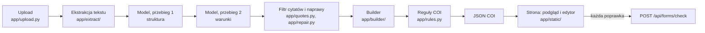

# coi-formularze

REST API, które zamienia pusty formularz papierowy (PDF, DOC, DOCX, ODS, XLSX, XLS, JPG, PNG) w konfigurację e-usługi COI (JSON gotowy do importu). Domyślnie działa w całości lokalnie: otwarty model językowy w Ollamie, bez chmury i zewnętrznych API. Ten sam klient umie też użyć modelu z otwartymi wagami przez API zgodne z OpenAI (np. Eden AI, `LLM_BACKEND=openai`). Projekt na HackNation 2026, zadanie COI „Cyfryzacja Formularzy”.

## Architektura



Model rozumie papier, kod pilnuje formatu COI. Model zwraca tylko krótki plan formularza, a wszystko po nim jest deterministycznym kodem z testami (`uv run pytest`). Całość skleja `app/pipeline.py`, REST jest w `app/api.py`.

1. **Upload** (`app/upload.py`): plik trafia strumieniowo do pamięci; limit rozmiaru liczony w trakcie odczytu, kontrola nazwy, rozszerzenia i sygnatury bajtów. Przy `AUTH_ENABLED=1` wymagany token JWT (`app/security.py`).
2. **Ekstrakcja** (`app/extract/`): plik → znormalizowany tekst. PDF przez PDFium (`pypdfium2`), a strony bez warstwy tekstu albo z fontami bez mapy Unicode idą do OCR. DOC czyta własny parser formatu Word 97, DOCX własny czytnik OOXML (z polami tekstowymi, numeracją list, przypisami, nagłówkami i stopkami), XLSX/XLS/ODS `openpyxl`, `xlrd` i własny czytnik ODS. Skany JPG/PNG czyta Tesseract (`pol`) po obróbce: obrót (OSD), prostowanie, wykropkowania wymazane przed OCR i oddane w tekście jako `____`, kratki jako `[ ]`. `normalize.py` sprawia, że ten sam formularz w każdym formacie daje ten sam tekst. Opcjonalnie (`LLM_VISION=1`, model wizyjny) model dostaje też obrazy stron PDF i JPG/PNG. Alternatywa `PIPELINE=images` (`app/llm/transcribe.py`): każdy plik staje się obrazami stron (PDF przez PDFium, pliki biurowe przez LibreOffice), a model wizyjny przepisuje każdą stronę do Markdown, który zastępuje tekst z ekstrakcji.
3. **Plan od modelu** (`app/llm/planner.py`, klient `app/llm/client.py`): dwa wywołania, odpowiedź wymuszona schematem JSON. Przebieg 1: struktura (strony, sekcje, pola z typami i opcjami, oświadczenia, adresat, kto może składać wniosek i czy przez pełnomocnika). Przebieg 2: warunki pokazania pól i sekcji; model widzi listę pól z ich cytatami, a schemat dopuszcza tylko istniejące pola i opcje. Każdy element planu niesie `quote`, dosłowny cytat z papieru. Kontrakt planu: `app/plan.py`.
4. **Filtr cytatów i naprawy** (`app/quotes.py`, `app/repair.py`): element, którego cytatu nie ma na papierze, wypada (dopasowanie rozmyte `rapidfuzz`, próg 90, dla tekstu z OCR 85); wypadają też pola strony „Dane”, które kod buduje sam, i warunki bez oparcia w papierze (pole zostaje). Naprawy bez modelu: lista wyboru z opcją spoza papieru staje się polem tekstowym, pytanie wyboru zadane dwa razy zostaje raz, a adres do korespondencji dostaje pytanie Tak/Nie, gdy papier mówi „inny niż”.
5. **Builder** (`app/builder/`): plan → pełna konfiguracja COI, bez modelu: UUID, `techName`, siatka, strony ze Standardów COI (Dane z rejestru MLPZ, Kontakt i zgody, strona końcowa), warunki `SHOW` w JSONata, walidatory, słowniki, sekcje powtarzalne. Zależności to warunki `SHOW` na polach i sekcjach; warunkowe przejścia między stronami realizujemy warunkami na sekcjach, bo schemat COI nie ma warunku na stronie ani na linku flow. Builder zwraca też mapę dowodów: id elementu → cytat z papieru albo informacja, że element dodał kod.
6. **Reguły** (`app/rules.py`): schemat JSON COI i „Reguły techniczne”. Każdy problem kończy żądanie kodem 422, więc API nie wypuszcza JSON-a, którego generator COI nie przyjmie.

Obok głównej ścieżki:
- **Strona `/` z edytorem** (`app/static/index.html`, `preview.html`, `editor.js`): oryginał obok e-usługi; podgląd pokazuje pod każdym polem jego cytat z papieru i warunek, który je pokazuje. „Edytuj” przy elemencie otwiera z prawej strony panel „Edycja” (zwijany jednym kliknięciem, bez zmiany widoku): urzędnik poprawia albo usuwa element w panelu, każdą zmianę sprawdza `POST /api/forms/check` (te same reguły co przy konwersji), a z problemami nie pobierze JSON-a. Wiele plików naraz przetwarza po kolei.
- **Propozycje słowników** (bonus II, `app/dictionaries.py`): `POST /api/dictionaries/proposals`, obok czystego JSON-a; model proponuje, kod odrzuca propozycje bez oparcia w papierze.
- **Historia strony** (`app/history.py`): SQLite w pliku `HISTORY_DB`, więc wyniki widać w każdej przeglądarce.

## Uruchomienie natywne (macOS/Linux)

Wymagane: Python 3.14+, [uv](https://docs.astral.sh/uv/), [Ollama](https://ollama.com), Tesseract z językiem polskim (`brew install tesseract tesseract-lang` albo `apt install tesseract-ocr tesseract-ocr-pol`).

```bash
ollama pull qwen3:30b-a3b-instruct-2507-q4_K_M   # model z LLM_MODEL
cp .env.example .env                              # logowanie: AUTH_ENABLED=1 + JWT_SECRET i AUTH_PASSWORD
uv sync
uv run uvicorn app.api:app --port 8000
```

Ollama powinna mieć okno kontekstu co najmniej 32k tokenów (najdłuższy formularz ma 16 stron): `OLLAMA_CONTEXT_LENGTH=32768 ollama serve` (kontener `ollama` z compose ma to ustawione).

Strona: http://localhost:8000, dokumentacja OpenAPI: http://localhost:8000/docs. Testy: `uv run pytest`.

Podgląd e-usługi: http://localhost:8000/preview pokazuje JSON COI tak, jak zobaczy go obywatel (strony, sekcje, zależności na żywo, walidatory). Każdy krok otwiera się bez wypełniania pól. Przełącznik „Cytaty z papieru i warunki” pokazuje pod każdym polem dosłowny fragment papierowego formularza, z którego powstało, a ukryte pola jako jedną linię z warunkiem, który je odsłoni. JSON wrzucasz plikiem albo wklejasz; na stronie uploadu ten sam podgląd jest wbudowany obok oryginału.

## Uruchomienie w Dockerze

Obraz API (`Dockerfile`):
- oficjalny obraz `python:3.14.10-alpine3.24` w obu etapach budowy (wszystkie zależności mają gotowe koła dla musl); `uv` z PyPI w etapie budowy instaluje zależności dokładnie z `uv.lock`, a do obrazu końcowego trafia tylko środowisko i kod `app/`;
- Tesseract z danymi `pol` (tekst) i `osd` (wykrywanie obróconych skanów);
- proces jako użytkownik bez uprawnień (UID 10001), tylko port 8000, `HEALTHCHECK` na `/health`, sekrety wyłącznie przy uruchomieniu (z `.env`, nigdy w obrazie).

`docker-compose.yml` (Docker Compose 2.24+) dokłada: system plików kontenera tylko do odczytu, `cap_drop: ALL`, `no-new-privileges`. Jedyne miejsce zapisu w kontenerze API to `/tmp` w pamięci (tmpfs, 1 GB): pliki tymczasowe OCR i historia strony (`HISTORY_DB=/tmp/history.sqlite3`), która znika przy restarcie kontenera.

```bash
cp .env.example .env          # opcjonalnie; z AUTH_ENABLED=1 uzupełnij JWT_SECRET i AUTH_PASSWORD
docker compose up -d --build  # strona http://localhost:8000, OpenAPI /docs, stan modelu /health
```

Skąd API bierze model (ustawiasz w `.env`):

| Wariant | W `.env` | Uruchomienie |
|---|---|---|
| Ollama na hoście (domyślnie; na Macu tylko tak model liczy na GPU) | nic, API łączy się z `http://host.docker.internal:11434/v1` | `docker compose up -d --build` |
| Ollama w kontenerze (serwer Linux, GPU NVIDIA opcjonalnie, patrz komentarz w `docker-compose.yml`) | `LLM_BASE_URL=http://ollama:11434/v1` | `docker compose --profile ollama up -d --build` |
| Eden AI (model z otwartymi wagami przez API zgodne z OpenAI) | `LLM_BACKEND=openai`, `LLM_BASE_URL=https://api.edenai.run/v3`, `LLM_MODEL=deepinfra/google/gemma-4-31B-it`, `EDENAI_API_KEY=...` | `docker compose up -d --build` |

- Ollama na hoście potrzebuje modelu (`ollama pull qwen3:30b-a3b-instruct-2507-q4_K_M`) i kontekstu 32k (`OLLAMA_CONTEXT_LENGTH=32768`). Na Linuksie musi też słuchać na adresie mostu Dockera, na który wskazuje `host-gateway`: `OLLAMA_HOST=172.17.0.1` (`0.0.0.0` też działa, ale wystawia Ollamę bez hasła na całą sieć).
- Nie wpisuj do `.env` używanego z Dockerem `LLM_BASE_URL=http://localhost:...`: w kontenerze `localhost` to sam kontener.
- `LIBREOFFICE=1` w `.env` (albo `docker build --build-arg LIBREOFFICE=1`) dokłada do obrazu LibreOffice, którego `PIPELINE=images` potrzebuje do plików DOC/DOCX/ODS/XLS/XLSX. Domyślny obraz go nie ma (to kilkaset MB), a domyślna ścieżka czyta te formaty bibliotekami Pythona.
- Profil `ollama`: przy pierwszym starcie `ollama-pull` pobiera `LLM_MODEL` do wolumenu `ollama` (ponad 10 GB), do tego czasu `/health` pokazuje `"llm": "model_missing"`. Obraz `ollama/ollama` jest obrazem producenta i działa jako root; compose odbiera mu uprawnienia jądra (`cap_drop: ALL`, `no-new-privileges`).

Bez compose (Ollama na hoście):

```bash
docker build -t coi-formularze:0.1.0 .
docker run --rm -p 8000:8000 --read-only --tmpfs /tmp --cap-drop ALL --security-opt no-new-privileges \
  --add-host=host.docker.internal:host-gateway \
  -e LLM_BASE_URL=http://host.docker.internal:11434/v1 \
  coi-formularze:0.1.0
```

Z Edenem zamiast `-e LLM_BASE_URL=...` podaj `--env-file .env`.

## Konfiguracja

Zmienne środowiskowe albo plik `.env` (wzór: `.env.example`).

| Zmienna | Domyślnie | Opis |
|---|---|---|
| `MAX_FILE_SIZE_MB` | `10` | Maksymalny rozmiar pliku (MiB) |
| `HISTORY_DB` | `history.sqlite3` (katalog repo); w Dockerze `/tmp/history.sqlite3` | Plik SQLite z historią strony (wgrane pliki i wyniki) |
| `AUTH_ENABLED` | `0` | `0` = API otwarte, strony bez logowania (na razie domyślnie). `1` = każde wywołanie wymaga tokenu `Bearer` JWT, strony pokazują logowanie |
| `JWT_SECRET` | brak | Klucz podpisu tokenów, min. 32 znaki. Wymagany w produkcji; lokalnie bez niego API losuje klucz na czas życia procesu (z ostrzeżeniem w logu) |
| `JWT_ALGORITHM` | `HS256` | Algorytm podpisu (z `JWT_JWKS_URL` np. `RS256`) |
| `JWT_ISSUER` | `coi-formularze` | Wymagane `iss` w tokenie |
| `JWT_AUDIENCE` | `coi-formularze` | Wymagane `aud` w tokenie |
| `JWT_TTL_MINUTES` | `60` | Ważność wydanego tokenu |
| `AUTH_USERNAME` | `admin` | Login do `/api/auth/token` |
| `AUTH_PASSWORD` | brak | Hasło; bez niego logowanie lokalne jest wyłączone |
| `JWT_JWKS_URL` | brak | Zewnętrzny serwer tożsamości (np. Keycloak): tokeny weryfikowane jego kluczami publicznymi, logowanie lokalne wyłączone |
| `LLM_BACKEND` | `ollama` | `ollama` (lokalna Ollama, bez klucza) albo `openai` (dowolne API zgodne z OpenAI, np. Eden AI) |
| `LLM_BASE_URL` | `http://localhost:11434/v1` | Adres API czatu (`/chat/completions`); dawna nazwa `LLM_URL` też działa. Dla Eden AI: `https://api.edenai.run/v3` |
| `LLM_MODEL` | `qwen3:30b-a3b-instruct-2507-q4_K_M` | Model planujący formularz. Dla Eden AI: `deepinfra/google/gemma-4-31B-it` (zapasowo `deepinfra/Qwen/Qwen3.8-27B`); tylko modele z otwartymi wagami |
| `LLM_TIMEOUT_S` | `1200` | Limit czasu jednego wywołania modelu (s) |
| `EDENAI_API_KEY` | brak | Klucz API dla `LLM_BACKEND=openai` (tylko w `.env`, nigdy w repo; nie trafia do logów) |
| `LLM_VISION` | `0` | `1` = strony PDF i obrazy JPG/PNG trafiają do modelu także jako obrazy, obok tekstu (model widzi pola narysowane liniami i ramkami, kratki, tabele). Wymaga modelu wizyjnego w `LLM_MODEL`, np. `qwen3-vl:30b-a3b-instruct`. DOC/DOCX/XLS(X)/ODS zostają tekstem |
| `LLM_VISION_MAX_SIDE` | `1400` | Dłuższy bok obrazu strony w 1. przebiegu (struktura), px; Qwen3-VL liczy ok. 1 token na 32×32 px, strona A4 to ok. 1,4 tys. tokenów |
| `LLM_VISION_MAX_PAGES` | `8` | Obraz dostaje tylko N pierwszych stron, reszta idzie samym tekstem (limit kontekstu 32k) |
| `LLM_VISION_CONDITIONS_SIDE` | `1024` | Dłuższy bok obrazów w 2. przebiegu (warunki), px; `0` = 2. przebieg bez obrazów |
| `LLM_VISION_TEXT` | `1` | `0` = model dostaje same obrazy stron, bez wyciągniętego tekstu (tylko gdy obraz ma każda strona pliku, dłuższy plik zostaje przy tekście); cytaty model przepisuje z obrazu, a filtr sprawdza je z naszym tekstem z progiem jak dla OCR |
| `LLM_VISION_GRAY` | `0` | `1` = obrazy stron w skali szarości |
| `PIPELINE` | `text` | `images` = każdy plik (też DOC/DOCX/ODS/XLS/XLSX przez LibreOffice) zamieniany na obrazy stron, model wizyjny przepisuje każdą stronę do Markdown, planer czyta ten Markdown zamiast wyciągniętego tekstu |
| `TRANSCRIBE_MODEL` | `LLM_MODEL` | Model wizyjny przepisujący strony przy `PIPELINE=images` |
| `TRANSCRIBE_SIDE` | `1024` | Dłuższy bok obrazu strony wysyłanego do przepisania, px (ok. 1,4 tys. tokenów na stronę) |
| `TRANSCRIBE_WORKERS` | `4` | Ile stron przepisywanych naraz |
| `TRANSCRIBE_TIMEOUT_S` | `180` | Limit czasu przepisania jednej strony (s), potem jedna ponowna próba |
| `SOFFICE` | `soffice` | Program LibreOffice do zamiany plików biurowych na PDF (na macOS sprawdzana też ścieżka aplikacji) |
| `OCR_ENGINE` | `tesseract` | `tesseract` albo `vlm` (model wizyjny w Ollamie) |
| `OCR_VLM_MODEL` | `LLM_MODEL` | Model wizyjny dla `OCR_ENGINE=vlm`; domyślnie ten sam co `LLM_MODEL` (musi czytać obrazy) |

## REST API

Kolumna „Autoryzacja” dotyczy `AUTH_ENABLED=1`; przy domyślnym `0` wszystko działa bez tokenu.

| Metoda i ścieżka | Autoryzacja | Opis |
|---|---|---|
| `GET /api/auth/config` | brak | `{"enabled": true \| false}`, czy wymagany jest token (`AUTH_ENABLED`); strony pytają o to przed pokazaniem logowania |
| `POST /api/auth/token` | brak | `username` i `password` (JSON lub formularz) → `{access_token, token_type, expires_in}` |
| `POST /api/forms/convert` | `Bearer` JWT | Jeden plik w polu `file` (multipart) → JSON COI, bez żadnej otoczki. Z `?evidence=1` → `{"coi": ..., "evidence": {id elementu: {"source": "paper" \| "model" \| "code", "quote": cytat z papieru, "page": ...}}}` (tego używa strona: cytaty w podglądzie i w edytorze) |
| `POST /api/forms/text` | `Bearer` JWT | Jeden plik w polu `file` (multipart) → `{"text": tekst odczytany z pliku, "method": sposób odczytu}`, bez modelu. Strona pokazuje go jako oryginał dla formatów, których przeglądarka nie wyświetla (DOC, DOCX, ODS, XLSX, XLS) |
| `POST /api/forms/check` | `Bearer` JWT | JSON COI (np. po poprawkach urzędnika) → `{"problems": [{"id": id elementu lub null, "message": opis po polsku, "detail": reguła}]}`; pusta lista = gotowe do importu, te same reguły co przy konwersji |
| `GET/POST/DELETE /api/history`, `GET /api/history/{id}/file`, `PUT/DELETE /api/history/{id}` | `Bearer` JWT | Historia strony na serwerze (SQLite, `HISTORY_DB`): lista bez bajtów pliku, najnowsze pierwsze; oryginał pliku; nowy wpis (multipart `record` JSON + `file`) → `{id}`; zmiana stanu (JSON); usunięcie jednego lub wszystkich. Skrypty dopisują gotowy wynik przez `uv run python -m bench.history_add <plik> <coi.json>` |
| `GET /health` | brak | `{"status": "ok", "llm": "ok" \| "model_missing" \| "busy" \| "unreachable" \| "no_api_key", "llm_backend": ..., "llm_model": ...}` |
| `GET /` | brak | Strona do wgrywania plików (kilka plików przetwarza po kolei): oryginał obok e-usługi w widokach „Podgląd” (cytat z papieru pod każdym polem), „JSON” i „Słowniki”. „Edytuj” obok każdego elementu (także na stronach standardowych: Dane, Kontakt i zgody, strona końcowa) otwiera w tym samym widoku boczny panel „Edycja” na tym elemencie (panel zwija się jednym kliknięciem): urzędnik poprawia go w panelu albo usuwa jednym kliknięciem (pole, sekcję, całą stronę, oświadczenie; „Cofnij” przywraca). Każdą zmianę sprawdzają reguły COI: z problemami nie pobierze JSON-a, a gdy usunięcie zepsułoby import, przycisk jest wyłączony i podaje powód |
| `GET /docs` | brak | OpenAPI / Swagger UI (przycisk „Authorize” loguje loginem i hasłem) |

```bash
# AUTH_ENABLED=0 (domyślnie): bez tokenu
curl -X POST http://localhost:8000/api/forms/convert -F "file=@wniosek.pdf" -o wniosek.json

# AUTH_ENABLED=1: najpierw token
TOKEN=$(curl -s -X POST http://localhost:8000/api/auth/token \
  -H 'Content-Type: application/json' -d '{"username": "admin", "password": "haslo"}' | jq -r .access_token)

curl -X POST http://localhost:8000/api/forms/convert \
  -H "Authorization: Bearer $TOKEN" -F "file=@wniosek.pdf" -o wniosek.json
```

Błędy zawsze jako JSON `{"detail": "..."}`:

| Kod | Kiedy |
|---|---|
| 400 | zła nazwa pliku, pusty plik, brak pola `file` albo więcej niż jeden plik |
| 401 | brak, zły lub wygasły token; zły login lub hasło (tylko z `AUTH_ENABLED=1`) |
| 413 | plik większy niż `MAX_FILE_SIZE_MB` |
| 415 | nieobsługiwane rozszerzenie albo zawartość niezgodna z rozszerzeniem |
| 422 | nie udało się odczytać formularza |
| 502 / 503 / 504 | model językowy zwrócił błąd / jest niedostępny / nie odpowiedział na czas |

## Walidacja i limity

- Rozszerzenia (wielkość liter bez znaczenia): `.pdf .doc .docx .ods .xlsx .xls .jpg .jpeg .jpe .png`.
- Nazwa pliku: najwyżej 250 znaków, bez `; : > < / \ | ' * % $`.
- Typ MIME ustalany z zawartości (sygnatury), musi pasować do rozszerzenia: PDF `%PDF`, DOC plik OLE2 ze strumieniem `WordDocument`, XLS plik OLE2 ze strumieniem `Workbook` (lub `Book`), DOCX/XLSX archiwum ZIP z `[Content_Types].xml` i katalogiem `word/` lub `xl/`, ODS archiwum z `mimetype` = `application/vnd.oasis.opendocument.spreadsheet`, JPEG `FF D8 FF`, PNG sygnatura PNG. Nagłówek `Content-Type` od klienta nie decyduje.
- Rozmiar: liczony w trakcie strumieniowego odczytu, odczyt przerywany po przekroczeniu limitu (nie ufamy samemu `Content-Length`).
- Pliki w pamięci: treść żądania trafia prosto do RAM, a `POST /api/forms/convert` niczego trwale nie zapisuje. Na dysk trafiają tylko pliki tymczasowe: OCR (`pytesseract` przekazuje obraz strony Tesseractowi przez plik w katalogu tymczasowym i zaraz go usuwa), a przy `PIPELINE=images` LibreOffice konwertuje plik biurowy w katalogu tymczasowym. Oryginał i wynik zapisuje dopiero strona `/` w swojej historii (`HISTORY_DB`); w Dockerze to `/tmp` w pamięci kontenera.

## Benchmark i wybór modelu

Liczby z naszych pomiarów na 9 formularzach COI z zadania (każdy w kilku formatach: PDF, skan, Word), model lokalny `qwen3:30b-a3b-instruct-2507-q4_K_M` w Ollamie na Macu. Notatki z pomiarów i decyzji o modelu: `bench/MODELS.md`.

**Jak mierzymy** (`uv run python -m bench.run_all`, ocena `bench/score.py`):
- `gold=`: plan modelu porównany z wzorcowym planem formularza (`gold/plans/formN.json`, uzasadnienia w `gold/notes/`); średnia z pięciu miar: F1 pól, zgodność typów, zgodność opcji, odzysk warunków i zgodność strony „Dane” (kto składa wniosek). 1,0 = jak wzorzec.
- `ref`: odzysk elementów z wzorcowych JSON-ów COI (formularze 1 i 5).
- Do tego: czy JSON powstał, ile problemów z regułami COI, czas.

**Wynik bazowy na 9 formularzach** (26 plików, tryb tekstowy, kod `7090c84`, 2 pliki naraz na wspólnej Ollamie): 26/26 poprawnych JSON-ów, 0 problemów z regułami COI, średnio `gold=` **0,759** (PDF 0,795, skan PNG 0,724, DOCX 0,758).

| Formularz | PDF | skan PNG | DOCX | Czas PDF / PNG / DOCX (s) |
|---|---|---|---|---|
| 1 | 0,978 | 0,978 | 0,960 | 20 / 74 / 31 |
| 2 | 0,971 | 1,000 | 0,843 | 84 / 69 / 75 |
| 3 | 0,629 | 0,589 | 0,567 | 43 / 32 / 41 |
| 4 | 0,753 | 0,753 | 0,708 | 70 / 66 / 69 |
| 5 | 0,960 | 0,803 | 0,803 | 36 / 34 / 40 |
| 6 | 0,736 | 0,736 | 0,722 | 124 / 121 / 113 |
| 7 | 0,939 | 0,563 | brak DOCX | 110 / 79 |
| 8 | 0,587 | 0,540 | 0,713 | 400 / 411 / 304 |
| 9 | 0,603 | 0,557 | 0,752 | 422 / 414 / 285 |

- Reguły po modelu dodane później (filtr warunków, naprawy w `app/repair.py`) na tych samych planach, bez nowego wywołania modelu: średnia 0,759 → **0,764**, precyzja warunków 0,585 → 0,606, żaden formularz nie spadł.
- Wzorcowe JSON-y COI (PDF, wcześniejszy przebieg): `ref` 0,89 (formularz 1) i 0,88 (formularz 5). Wzorcowe plany przepuszczone przez nasz builder dają 1,00, więc różnica siedzi w planie od modelu, nie w kodzie.
- Formularze 1-7 (PDF) między kolejnymi poprawkami promptów i kodu: średnio 0,734 → 0,800.
- Czas: formularze 1-7 to 20-124 s na plik, długie formularze 8 i 9 (do 16 stron) 285-422 s. Przebiegi nie są w pełni powtarzalne: prawie identyczne prompty zmieniają wynik małego formularza nawet o około 0,2.
- Reguły po modelu w ślepym teście na 18 prawdziwych pustych formularzach urzędowych spoza zadania (dwóch sędziów Claude Opus porównuje wynik bez reguł i z regułami w losowej kolejności): z regułami wygrywa 9 razy, bez nich 1 raz, 8 remisów (identyczny wynik); błędy do poprawienia przez urzędnika 70 → 56 (-20%). To zestaw, na którym reguły rozwijaliśmy, nie zestaw kontrolny.

**Sufit modelu.** Te same prompty i ten sam tekst, ale plan pisze Claude Opus zamiast lokalnego modelu (pomiar diagnostyczny, nie produkt):

| Przypadek | qwen3 30B | Opus |
|---|---|---|
| Formularz 7, skan (tekst z OCR) | 0,563 | 0,968 |
| Formularz 7, PDF | 0,939 | 0,968 |
| Formularz 8, PDF | 0,587 | 0,845 |
| Formularz 9, PDF | 0,578 | 0,858 |

qwen na formularzu 9 to wcześniejszy przebieg, stąd inna liczba niż w tabeli bazowej. Na formularzu 7 PDF wysokie 0,939 qwena ukrywa odzysk pól 0,59 (F1 pól 0,70 wobec 0,96 u Opusa), a na formularzu 8 drugi przebieg qwena uciął limit długości odpowiedzi, więc nie ma żadnych warunków. Na formularzu 7 Opus ma ten sam wynik na skanie i na PDF, więc tam OCR nie jest wąskim gardłem. Wąskim gardłem jest model: pipeline jest gotowy na mocniejszy model z otwartymi wagami, wystarczy zmienić `LLM_MODEL` (lokalnie albo przez `LLM_BACKEND=openai`). Uwaga: wzorcowe plany pisał Claude, więc Opus dzieli ich konwencje, a to jedna próba na przypadek.

**Dlaczego `qwen3:30b-a3b-instruct-2507`:** model MoE z ok. 3 mld aktywnych parametrów, mieści się na laptopie i jest szybki. Na formularzu 4 prawie 3 razy szybszy od `qwen3:14b` (79 s wobec 229 s) przy lepszym planie (0,60 wobec 0,41). Model wizyjny `qwen3-vl:30b-a3b-instruct` przegrał sito na formularzach 1, 4, 5, 7 (PDF i skan): średnio `gold=` 0,77 z obrazami stron i 0,65 na samym tekście, wobec 0,84 obecnego modelu. Wymyślał pola i zamieniał wybór na pytania tak/nie, więc tekst z naszej ekstrakcji zostaje domyślnym wejściem. Na Edenie (9 formularzy, PDF i skany, koszt 0,43 $) najlepszy był `deepinfra/google/gemma-4-31B-it` (0,81, F1 warunków 0,75), zapasowy `deepinfra/Qwen/Qwen3.8-27B` dwa razy szybszy, ale 0,79 i słabszy na skanach. To inny zestaw plików i wcześniejsza wersja kodu, więc tych liczb nie porównujemy wprost z wynikiem bazowym.

## Licencje

Wyłącznie open source bez copyleft: zależności Pythona na licencjach MIT, BSD, Apache-2.0, PSF i MIT-CMU (Pillow); `certifi` (zależność `httpx`) ma MPL-2.0, które obejmuje tylko jego własne pliki i nie wymaga publikacji naszego kodu. Tesseract: Apache-2.0, Ollama: MIT, modele Qwen3: Apache-2.0; modele proponowane przez Eden AI (Gemma 4, Qwen3.8) też Apache-2.0; LibreOffice (tylko w obrazie z `LIBREOFFICE=1`): MPL-2.0. Domyślnie model działa lokalnie (Ollama) i rozwiązanie nie korzysta z zewnętrznych API ani usług SaaS. Klient modelu mówi protokołem zgodnym z OpenAI, więc ten sam kod może użyć innego modelu o otwartych wagach na serwerze GPU albo u dostawcy (`LLM_BACKEND=openai`).
